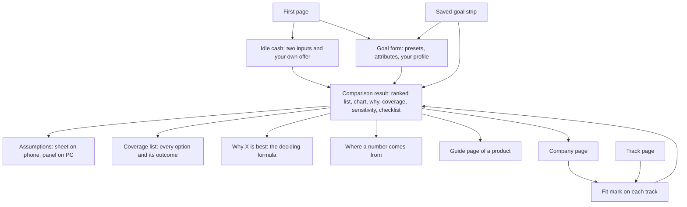

# User flows, release 1

> Release 2 sections added 2026-10-23: section 7 (release 2 flows), 8 (screens release 2 needs) and 9 (screen briefs, release 2).

Written 2026-10-23 from `docs/product.md` (the release 1 capabilities in `docs/roadmap.md`), `docs/design-system.md` and the approved mockups.
Status: **approved by the founder on 2026-10-23**, with both proposals in section 5. Section 6 holds a design brief for every screen.

What release 1 lets a person do: understand any product type in plain Hebrew with a graph they can play with, see every product and track a company offers and what each one is, check where every number comes from, and see what the site cannot answer yet and why. Nothing here ranks options or remembers a goal; that starts in release 2.

How to read a flow: who starts it and from where, the steps, what can go differently, and when it is done. The last line of each flow ("Traces to") is for whoever builds it.

---

## 1. Why people come

| Situation | Who | Flow |
|---|---|---|
| "My bank or fund app offers something and I don't know what it is." | The founder with the Meitav app; any friend with a bank or fund app | 5, 6 |
| "I want to understand a type of saving." | A friend who has never heard of a money-market fund | 2, 3 |
| "I have a word from a statement or an ad." | Anyone holding a pension statement or an ad | 6 |
| "Where does this number come from? Can I trust it?" | Anyone reading a page | 4 |
| "What about the thing my friend mentioned?" | Anyone asking about a product the site doesn't cover yet | 7 |
| "Which rules and judgement calls does the site use?" | The founder, a careful friend, a reviewer | 8 |
| Keeping the catalogue and the data current | The founder | 9, 10 |

---

## 2. Map of the site in release 1

Every page also has the header: site name (back to the first page), search, and the menu (guide, companies, rules, parameters). A friend may land directly on any page from a shared link, so every page stands on its own and has a way back to its list.

---

## 3. The flows

### Flow 1. Arrive and find your way

**Starts:** a link the founder sends, or the icon on a phone's home screen.

1. The first page shows a search field ("הדביקו שם של מוצר, מסלול או מונח") and two doors: understand a type of saving (the guide) and see everything a company offers (the companies list). A small link leads to what the site does not cover yet. Nothing else (approved, question 1).
2. On every page the header holds the site name, search and the menu. On a phone the menu is a sheet; on PC the four destinations sit in the header.
3. A shared link opens its page directly. The back link at the top leads to that page's list (guide or companies).

**Done when:** the person is on a guide page, a company page, or searching.
**Traces to:** product.md 2 (users, phone first); architecture.md 3.5 (pages); design-system.md 3.1.

### Flow 2. Learn what a product is

**Starts:** the guide list (from the first page or the menu), or a link from a company page, a track page or search.

1. The guide list has two groups: where the money is held (a bank deposit, a kupat gemel lehashkaa, a brokerage account …) and what it is invested in (cash in shekels, an index such as the S&P 500 …). Each card has the name and one line. A link at the end leads to what is not covered yet.
2. A product page opens with its name, one-line summary and the key to the three number styles.
3. The page always runs in the same order, so two pages can be compared side by side: what it is, the timeline, who offers it and who supervises, how money goes in and out, what it costs, how it is taxed, risks and what is not protected, typical use, what to check, and the words used for it. On a phone a row of section chips jumps between them; on PC a list on the right does.
4. In "who offers it", each company links to its company page (flow 5).
5. "Typical use" links to the related product pages, for example from a money-market fund to a bank deposit, so the reader can see when each one suits. Ranking one against the other for a goal comes in release 2.
6. "What to check" lists every point that matters for this product, each marked considered, not relevant, or blocked by an open question. Tapping one shows where it comes from.
7. "Words used for it" shows each term as it appears on a statement, in an app or in the law, with what it means.
8. A page about what the money is invested in (an index, cash) explains the exposure and links to the products that can hold it. The timeline lives on the product pages.

**What can go differently:** a part that depends on an open question shows a lock and names the question instead of a number. A number older than usual shows a clock.
**Done when:** the reader can say what it is, how to get it, what it costs, how it is taxed, and when another product suits better.
**Traces to:** product.md 3.1, 3.3, success criterion 5 and the R1 "done when" in roadmap.md; design-system.md 3.5, 3.6.

### Flow 3. Try your own numbers on the timeline

**Starts:** the timeline on any product page. It opens on the site's example: an amount today, a monthly deposit, a number of years, a return and inflation.

1. The reader sees what is left after the years shown, net of fees and tax, in today's money, then the graph, then the values it uses as chips under it, each showing whether it is the site's example or entered by them.
2. On a phone, tapping a chip opens the values sheet at that field ("כל ההנחות" opens all of them). On PC the values sit in a panel beside the graph.
3. Changing a value (slider or typing) moves the graph and the numbers straight away. The field turns blue with "הוזן על ידך" and a button to go back to the example value.
4. Optional: age, which marks ages where the product's rules change (for example 60 for a kupat gemel lehashkaa); and employment type, which highlights the parts of the page that apply.
5. A switch shows the graph in today's money (the default) or in future shekels.
6. Dragging a finger across the graph (phone) or moving the mouse (PC) shows the numbers for that year. "הצגה כטבלה" shows them year by year.
7. Values the reader entered stay with them on every other product page, and on this device on their next visit.

**What can go differently:** a return the reader enters is drawn as a dashed line, with a note that the projection rests on their own number. A part the site cannot compute (an open question) is hatched and names the question. A rule figure past its end date stops the graph with "הנתון לא עודכן" instead of using an old figure.
**Done when:** the reader has seen how their own money would behave in this product.
**Traces to:** product.md 3.1 (timeline), 2 ("interactive by default", "real terms by default"), D7, D9; method.md F-67; design-system.md 3.3, 3.4.

### Flow 4. Check where a number comes from

**Starts:** any number on any page.

1. The style says what it is: a thin grey underline comes from a source, a dotted violet one is calculated by the site, blue is something the reader entered. The key at the top of each page explains the three.
2. Tapping (phone) or clicking (PC) opens a sheet from the bottom on a phone, or a small card beside the number on PC:
   - from a source: the document and section, with a link; who published it; the date it was checked; the rule it belongs to;
   - calculated: what the calculation is, each value it used (themselves tappable), and the rules it used;
   - entered: what the reader typed, the example value it replaced, and the button to go back;
   - a site judgement (a "site parameter"): the value, why it was chosen and when it was approved.
3. Tapping a rule opens the rule in plain words, with its conditions, source and date, and a link to it on the rules page.
4. Flags explain themselves when tapped: a clock means older than usual (with the date of the last value); "משני" or "מוסדי" means a weaker source (and which); a lock means the site cannot compute it (and which open question blocks it).

**Done when:** the reader knows where the number comes from and how far to trust it.
**Traces to:** CLAUDE.md "every number traces to a source"; product.md D3, D7, D10, 3.8; design-system.md 3.2.

### Flow 5. See everything a company offers

**Starts:** the companies list (from the first page or the menu), a company on a guide page, or search.

1. The companies list shows every managing company in the regulator's fund data. Typing filters it.
2. A company page lists every product and track the company offers, grouped by product type ("קופת גמל להשקעה", "קרן השתלמות" …), each under the name the company uses. Each group links to that product's guide page.
3. Each track row shows the name, the fund number, the regulator's classification, what the money is invested in, in plain Hebrew, and one line on why someone might pick it. The default track is marked. Tracks with the same name are grouped, with the answer from the data: two separate funds, one fund listed twice, or not resolved.
4. Tapping a track opens its page: the fund's official record and its date, what it invests in, what to check, and a link to the product's guide page.

**What can go differently:** fees show "עוד לא מוצג" until the meaning of the regulator's fee fields is confirmed. If the fund data is older than a month, a banner says since when.
**Done when:** the reader can see every option the company offers and what each one is. The same list is what the comparisons choose from in later releases (product.md "no blind spots").
**Traces to:** product.md 3.10, success criterion 5 and appendix E; roadmap.md R1; design-system.md 3.7.

### Flow 6. Look up a name you saw

**Starts:** the search field, from the header of any page.

1. The reader pastes or types a name. Results appear while typing, and match despite small differences in spelling (final letters, quote marks, hyphens).
2. Results are grouped: products, tracks and funds, words from statements and ads, and guide pages.
3. Choosing one opens it: a product on its company page, a track on its track page, a word at the guide section that explains it, a guide page at its top.

**What can go differently:** nothing matches. The page says "עוד לא קוטלג", saves the name on this device so it can be added later, offers a "העתקה" button so the reader can send the name to the founder, and offers to browse the companies or try a shorter part of the name (approved, question 2).
**Done when:** the reader is on the right page, or the name is saved for adding.
**Traces to:** product.md 3.10 ("a name the site cannot match"), 3.1 (a term from a statement finds its page); architecture.md 3.5 (search); design-system.md 3.7.

### Flow 7. Something the site doesn't cover yet

**Starts:** the link at the end of the guide list, the first page, or search.

1. One page lists the products the site knows about but does not cover yet (savings policies, structured deposits, corporate bonds and others).
2. Each one says what is known, which open question keeps it out, and why that question matters.

**Done when:** the reader knows the site cannot help with it yet, and why.
**Traces to:** product.md D2, 3.1 (the "not covered yet" page).

### Flow 8. Read the rules and the site's judgement calls

**Starts:** a rule from flow 4, or the menu.

1. The rules page lists every rule the site uses, grouped by product type, with a list to jump between groups. Each rule shows its plain text, conditions, figures by tax year, source and date checked, how strong the source is, and when it will be re-checked. Open questions are marked as such.
2. The parameters page lists the site's own judgement calls, such as when two options count as a tie. Each shows its value, why it was chosen, who approved it and when, and where it is used. One not set yet says so.

**Done when:** the reader has found the rule or judgement behind a number.
**Traces to:** product.md 3.8; design-system.md 3.8.

### Flow 9. When data is old or missing

**Starts:** the site itself; the reader only sees the result.

1. The regulator's fund data is fetched every month. When a new month appears, the pages update and the change is logged.
2. If a fetch fails, the site keeps the last data with its date. Once that is older than a month, numbers from it show the clock and company and track pages show "לא עודכן מאז …". The check runs in the reader's browser against today's date, so it still works if updates stop.
3. A rule figure past its end date is never used: the calculation stops and says "הנתון לא עודכן".

**Done when:** a reader can never mistake old data for current data.
**Traces to:** product.md D3, section 6; architecture.md 2 (time checks in the browser), 3.3.

### Flow 10. The founder adds a missing name

**Starts:** a name shows "עוד לא קוטלג" on the founder's device, or a friend tells him about one.

1. The founder notes the name, where it was seen (which app, ad or statement) and the date.
2. He runs the catalogue helper, or asks Claude, which creates the entry; he fills in what it is (product type, and fund numbers where it is a track).
3. A pull request runs the checks, including that every fund number exists in the latest regulator data.
4. Once merged, the site rebuilds and the name is found everywhere. The change is logged.

**What can go differently:** a friend's unmatched names stay on the friend's phone. Getting them off the phone as a file comes in release 3. Until then the friend copies the name with the "העתקה" button and sends it to the founder (approved, question 2).
**Done when:** search finds the name for everyone.
**Traces to:** product.md 3.10, 6a, section 6; architecture.md 3.3 (helpers).

---

## 4. Screens these flows need

| Screen | Flows | In the mockups |
|---|---|---|
| First page | 1 | no |
| Header and menu | 1 | yes (header); menu sheet no |
| Search, with results and "not catalogued yet" | 6 | no |
| Guide list | 2 | no |
| Product guide page | 2, 3 | yes |
| Exposure guide page (what the money is invested in) | 2 | no |
| Timeline values (sheet on phone, panel on PC) | 3 | yes |
| Where a number comes from (sheet on phone, card on PC) | 4 | yes (phone) |
| A rule (card) | 4 | no |
| Companies list | 5 | no |
| Company page | 5 | yes (redrawn 2026-10-23 as one list, without the app view) |
| Track page | 5 | no |
| Not covered yet | 7 | no |
| Rules page | 8 | no |
| Parameters page | 8 | no |

Flows 9 and 10 need no screen of their own: flow 9 shows up as flags and banners on the screens above, and flow 10 happens in the repository.

---

## 5. Questions for the founder (answered 2026-10-23)

1. **What the first page shows.** The product documents don't define it. Proposal: only the search field, the two doors (guide and companies) and the link to what isn't covered yet. Nothing that needs data of its own. **Approved.**
2. **Getting a friend's unmatched names to you before release 3.** A friend's "not catalogued yet" names stay on their phone until export arrives. Proposal: a "העתקה" button on the "not catalogued yet" screen, so they can paste the name to you on WhatsApp. **Approved**, and recorded in `docs/product.md` (3.10 and appendix D).

---

## 6. Screen briefs

One brief per screen in section 4. They apply `docs/design-system.md`. Mockups for the guide page, the timeline values, the number sheet and the company page are on the mockup canvas (https://claude.ai/artifact/T2WWNHiNhqXxSkmssTFbCS); those briefs add only what the mockups don't show.

**For every screen:**

- Hebrew, right to left, dark only. The page starts at the right; lists, chips and steps run from right to left; time on a graph runs left to right.
- Phone means 360 to 430 px wide and is the base design. PC means 1024 px and up (`lg`). Between them (`md`, 768 px) cards go two across and tables become real tables.
- The header (6.2) is on every screen. Any figure goes through the provenance number, so it shows its source style and opens the number sheet (6.8).
- Hebrew copy here is draft wording, in the plural imperative ("הדביקו", "בחרו"). Names of products and tracks appear exactly as the source writes them.

### 6.1 First page

**Flows:** 1. **Mockup:** none.

- The site name (h1) and one line: "להבין חיסכון והשקעה בישראל, עם מקור לכל מספר."
- The search field, labelled "מה ראיתם?", placeholder "הדביקו שם של מוצר, מסלול או מונח". It opens search (6.3) on focus.
- Two door cards:
  - "להבין סוג של חיסכון", with "מה זה, כמה זה עולה ואיך זה ממוסה". Opens the guide list (6.4).
  - "מה חברה מציעה לי", with "כל המוצרים והמסלולים שלה, עם הסבר לכל אחד". Opens the companies list (6.10).
- A small link: "מה האתר עוד לא מכסה" (6.13).

**Phone:** one column, the search field full width at 48 px, the two cards stacked, the link last. Everything fits the first screen without scrolling.
**PC:** a centred column of 38rem; the two cards side by side under the search field.
**States:** none. The page holds no figures and needs no data.
**Components:** search field, card (the whole card is the link, with a mirrored chevron at the inline end).

### 6.2 Header, menu and footer

**Flows:** 1, all. **Mockup:** header on every board; no menu sheet.

- **Phone:** a 56 px sticky bar: site name at the start (right); search and menu as 44 px icon buttons at the end (left). The menu opens a bottom sheet with 48 px rows: "מדריך", "חברות ומסלולים", "כללים", "פרמטרים", then a divider and "מה האתר עוד לא מכסה". The current page is in weight 500 with a teal marker at the start of its row.
- **PC:** a 64 px sticky bar: site name, then the four destinations as text links (the current one underlined in teal), then the search field (340 px) at the end.
- **Footer** on every page: "כללים", "פרמטרים", "מה האתר עוד לא מכסה".

**States:** the menu sheet closes on X (top left), on a tap outside it, or on choosing a row.
**Components:** header, sheet, icon button.

### 6.3 Search

**Flows:** 6, and 1 from the first page. **Mockup:** none.

- The field, focused, with its text in `dir="auto"`, a search icon at the start and a clear button at the end.
- Before typing: one hint line, "אפשר להדביק את השם בדיוק כמו שהוא מופיע באפליקציה, בפרסומת או בדוח."
- Results appear while typing, in four groups, each with a small heading:
  - "מוצרים" (catalogued names);
  - "מסלולים וקופות" (tracks and funds);
  - "מונחים מדוחות ופרסומות" (terms);
  - "עמודי מדריך" (guide pages).
- Each result: the name with the matched part in weight 600, and one quiet line saying where it is (company and product type, or the guide page a term belongs to). At most five per group, then "הצגת כל התוצאות בקבוצה".
- **Not catalogued yet** (no match):
  - the title "עוד לא קוטלג";
  - "את השם "{השם}" עוד אין אצלנו. שמרנו אותו במכשיר שלכם כדי שיהיה אפשר להוסיף אותו.";
  - a primary "העתקה" button with the line "העתיקו ושלחו את השם, כדי שיתווסף";
  - two quiet links: "לרשימת החברות" and "לחפש חלק מהשם".

**Phone:** a full-screen sheet; the field at the top with the keyboard open; X at the top left; results scroll under the field.
**PC:** the header field; results in a popover under it, 480 px wide, up to 70% of the window high. Arrow keys move through results and Enter opens the selected one.
**States:** after copying, the button shows a check and "הועתק" for two seconds. Search works without a network connection once the page has loaded (the index ships with the site).
**Components:** search field, sheet, popover, empty state, button.

### 6.4 Guide list

**Flows:** 2. **Mockup:** none.

- h1 "מדריך" and the lede "כל סוג של חיסכון והשקעה שהאתר מכסה. לכל אחד אותו מבנה, כדי שאפשר יהיה להשוות."
- h2 "איפה הכסף מוחזק", then a card for each product (wrapper).
- h2 "במה הכסף מושקע", then a card for each exposure.
- Each card: the name (h3) and one line on what it is. No figures.
- A last card in a quieter style: "מה האתר עוד לא מכסה".

**Phone:** one column of cards. **PC:** three columns; two at `md`.
**States:** none.
**Components:** instrument card.

### 6.5 Product guide page

**Flows:** 2, 3, 4. **Mockup:** "מדריך · טלפון" and "מדריך · מחשב".

The mockups show the layout. Also designed for:

- **A product with a lock-up** (for example a keren hishtalmut): the "how money goes in and out" section leads with when the money becomes free; the graph draws a marker line with "אפשר למשוך מכאן" at that year.
- **Parts that apply to the reader:** once age or employment type is entered, rows that apply get a small blue tag, "לפי מה שהזנתם". Rows that don't apply stay visible, in quiet text, with the reason ("לשכירים בלבד").
- **A section blocked by an open question:** the blocked callout stands in place of the missing figure, naming the question; the rest of the section still shows.
- **Old data:** a clock on each affected figure; nothing hidden.
- **A rule figure past its end date:** the graph area is replaced by a callout, "הנתון לא עודכן: {שם הכלל}", with a link to the rule.
- **"Typical use":** ends with links to related product pages as chips ("גם כדאי להכיר: פיקדון בבנק").

**Components:** section index, guide sections, key-value list, fee table, money-flow strip, dimension checklist, term table, timeline (6.7), provenance number.

### 6.6 Exposure guide page

**Flows:** 2. **Mockup:** none.

- h1 the exposure as people call it (for example "מדד S&P 500"), and one line on what the money is invested in.
- The same section index and fixed order as a product page, without the timeline:
  - "מה זה": what the exposure is;
  - "איך מחזיקים את זה": a card for each product that can hold it, linking to its guide page;
  - "סיכונים": risks;
  - "מה לבדוק": the dimension checklist for this exposure;
  - "מונחים": the words used for it.
- The cards under "איך מחזיקים את זה" carry no ranking and no figures; ranking for a goal comes in release 2.

**Phone:** one column; the holding products as stacked cards. **PC:** the holding products three across; section index at the start (right).
**States:** a product that cannot hold this exposure is not listed. One whose tax treatment for it is an open question is listed with the lock and the question.
**Components:** as 6.5, without the timeline.

### 6.7 Timeline values

**Flows:** 3. **Mockup:** "טלפון · שינוי ההנחות", and the panel in "מדריך · מחשב".

The mockups show amount today, monthly deposit, years, return and inflation. Also designed for:

- **Age** ("גיל (לא חובה)"): a number field with minus and plus buttons, empty by default.
- **Employment type** ("סוג העסקה (לא חובה)"): a segmented control, "שכיר | עצמאי", with nothing selected by default.
- **One link at the bottom:** "חזרה לכל הערכים של הדוגמה", shown only when at least one value was entered.
- **Errors:** under the field, in red text with the field edge red: "הזינו מספר", or "הסכום לא יכול להיות שלילי". The graph keeps the last valid value until the error is fixed.
- **A return the reader enters:** a line under the field, "הגרף יסומן בקו מקווקו, כי התשואה היא שלכם".

**Phone:** a bottom sheet over the graph, up to 85% of the screen; the headline number stays visible above it and changes while the reader types.
**PC:** a 300 px panel at the start (right) of the graph, always open.
**Components:** field, number field, slider field, stepper, segmented control, state tag, sheet.

### 6.8 Where a number comes from

**Flows:** 4. **Mockup:** "טלפון · נגיעה במספר" (a calculated number).

The mockup shows a calculated number. The other kinds:

- **From a source:** the value; the document and section as a link ("פתיחת המקור" with the mirrored external-link icon); the publisher; "נבדק ב־{תאריך}"; the dates it applies from and to; the rule chips.
- **Entered by you:** "הזנתם את הערך הזה", the example value it replaced (as a number from a source), and the reset button.
- **Site parameter:** the value, the tag "פרמטר של האתר", the reason in one or two sentences, and "אושר ב־{תאריך}". A provisional default shows "ערך זמני שהאתר קבע" instead.
- **Unknown** ("לא ידוע"): why it is unknown, from the data's note.
- **Flags**, as a line at the bottom when present:
  - stale: "לא עודכן מאז {תאריך}. בדרך כלל מתעדכן {כל חודש}.";
  - weaker source: which kind, and what it means.

**Phone:** a bottom sheet, up to 70% of the screen. **PC:** a card up to 22rem wide beside the number, closed by Esc or a click outside.
**Components:** provenance popover, state tag, strength label, rule reference.

### 6.9 A rule

**Flows:** 4, 8. **Mockup:** none.

- The rule chip (its ID) and its short title.
- The strength label: "מקור ראשי", "מקור ראשי (עותק)", "מקור מוסדי", "מקור משני", or "שאלה פתוחה".
- The rule in plain words, two to four sentences.
- "תנאים וחריגים" as a disclosure.
- Figures by tax year, each a number from a source.
- The source as a link, with "נבדק ב־{תאריך}".
- A link "לכל הכללים", which opens the rules page at this rule.
- **An open question** uses the blocked style instead: "שאלה פתוחה", what is unknown, and which numbers on the site wait for it.

**Phone:** a bottom sheet; tapping a rule inside the number sheet replaces its content, with a back arrow (pointing right) at the top. **PC:** a card like 6.8.
**Components:** rule reference, strength label, disclosure, callout (blocked).

### 6.10 Companies list

**Flows:** 5. **Mockup:** none.

- h1 "מה חברה מציעה לי" (the menu calls this page "חברות ומסלולים") and the lede "בחרו חברה כדי לראות את כל המוצרים והמסלולים שלה, ומה כל אחד מהם."
- A filter field, "חיפוש חברה", which narrows the list as you type.
- One row per managing company in the regulator's data:
  - the name as the regulator writes it;
  - one quiet line with the product types it runs ("גמל, השתלמות, פנסיה");
  - a mirrored chevron.
- Rows are in Hebrew alphabetical order.

**Phone:** one column of 56 px rows. **PC:** two columns of rows, filter at the top, 72rem page width.
**States:** a filter with no match shows "לא מצאנו חברה בשם הזה" and a link to the full search.
**Components:** search field, list row.

### 6.11 Company page

**Flows:** 5. **Mockup:** "חברה · טלפון" and "חברה · מחשב", redrawn on 2026-10-23 as the single list below (product.md appendix E).

- h1 the company name; under it "כל מה שהחברה מציעה, עם הסבר לכל מסלול", with the regulator's data month.
- The fee-pending callout, then the list heading "כל המסלולים של {חברה}".
- Every track the company runs, grouped by product type under disclosures ("קופת גמל להשקעה", "קרן השתלמות" …), the first open, each with its count of tracks.
- Each group heading links to that product's guide page.
- Track rows as in design-system 3.7; same-name tracks in a near-duplicate group.
- After the list, the paste card "לא מצאתם שם?" (on PC in the side column), which opens search (6.3).

**States:**

- **Old data:** a caution banner under the h1, "נתוני הרשות לא עודכנו מאז {חודש}".
- **Same-name tracks still unresolved:** the group banner says "לא הוכרע: הנתונים לא מראים אם זו אותה קופה", in caution colours.

**Components:** track row, near-duplicate group, fee-pending note, disclosure.

### 6.12 Track page

**Flows:** 5, 6. **Mockup:** none.

- Breadcrumb "חברות ומסלולים › {חברה} › {מסלול}"; on a phone only the back link to the company.
- h1 the track name exactly as the source writes it; under it "קופה {מספר}" in the identifier style, and the tag "ברירת המחדל" when it is the company's default track.
- One line: why someone might pick this track.
- A key-value card, every value a number or text from the regulator's data with its source style:
  - "חברה מנהלת" (link to the company page);
  - "סוג מוצר" (link to the guide page);
  - "סיווג";
  - "במה הכסף מושקע";
  - "דמי ניהול מחיסכון" and "דמי ניהול מהפקדה", which show the fee-pending note for now;
  - "נכון לחודש".
- When another track has the same name: a caution callout, "יש מסלול נוסף באותו שם", with the answer and a link to the other track.
- The dimension checklist for this track.
- A space reserved under the h1 for the release 2 mark ("מתאים למטרה שלכם?"); nothing is drawn in release 1.

**Phone:** one column. **PC:** the key-value card and the checklist side by side (card at the start, 360 px), the page at 72rem.
**Components:** key-value list, tag, callout, dimension checklist, provenance number.

### 6.13 Not covered yet

**Flows:** 7. **Mockup:** none.

- h1 "מה האתר עוד לא מכסה" and the lede "מוצרים שאנחנו מכירים אבל עוד לא יכולים להסביר עד הסוף, ולמה."
- One card per product:
  - the name (h3);
  - "מה ידוע" in two or three sentences;
  - one blocked callout per open question that keeps it out ("שאלה פתוחה {מזהה}: {מה לא ידוע}");
  - "למה זה חשוב" in one sentence.

**Phone:** one column. **PC:** two columns of cards.
**States:** a product that moves into full coverage disappears from this page and appears in the guide list.
**Components:** card, callout (blocked), rule reference.

### 6.14 Rules page

**Flows:** 8. **Mockup:** none.

- h1 "כללים" and the lede "כל כלל שהאתר משתמש בו, עם המקור שלו. כלל שהמקור שלו חלש יותר מסומן, ושאלה פתוחה מסומנת במנעול."
- Rules grouped by product type, using the rule card of 6.9 at full width, each an anchor target.
- Each group lists its open questions at the end, in the blocked style.
- A re-check date shows as "ייבדק שוב ב־{תאריך}" on rules likely to change.

**Phone:** the section-index chips for the groups at the top; each group a disclosure, closed unless the reader arrived on a rule inside it. **PC:** the group index at the start (right); all groups open.
**Components:** section index, disclosure, rule card, strength label.

### 6.15 Parameters page

**Flows:** 8. **Mockup:** none.

- h1 "פרמטרים של האתר" and the lede "החלטות שהאתר מקבל בעצמו, כמו מתי שתי אפשרויות נחשבות שקולות. הן לא כללים מהחוק, ואי אפשר לשנות אותן מהעמוד."
- One card per parameter:
  - its name in plain Hebrew;
  - its value as a number with the site-parameter tag;
  - "למה" in one to three sentences;
  - "אושר ב־{תאריך}", or "ערך זמני שהאתר קבע" for a provisional default;
  - "משמש ב:" with links to where it is used.
- A parameter with no value yet shows "עוד לא נקבע".

**Phone:** one column. **PC:** two columns of cards.
**Components:** card, provenance number, state tag.

---

## 7. Release 2 flows

**Note 2026-10-23.** The worked examples in this section use the golden fixtures (the S14 and S20 fee sets in `tests/golden/scenarios.md`), while the site runs on the collected records (the Meitav and Leumi fee and deposit records in `data/`). The numbers on screen therefore differ from the examples here by design; the examples show the shape of each flow, not the figures a person will see.

Added 2026-10-23 from `docs/product.md` 3.2, 3.3, 3.9 and 3.10 (D5, D7, D9, D11, D12, D13, D16, D17), `docs/roadmap.md` Release 2, `docs/method.md` §2, §8, §10 (F-60, F-67) and §11 (F-80, F-81, F-83), and the worked examples in `tests/golden/scenarios.md` (S39, the founder's ETF-vs-provident case; S40, the apartment case; S41, idle cash; S50, a tie). Status: **draft for the founder.** Where the product text leaves a choice, the brief makes one and marks it "chosen 2026-10-23, revisable".

What release 2 adds: a person states a goal (or just the cash sitting in the current account), and the site says which product type is best for it, net of fees and tax over the horizon, with every option accounted for, why the winner wins, what would change the answer, and what it considered. The goal stays on the device, and company and track pages say whether a track fits it.

Every figure in these flows is a computed, sourced or entered value shown through the provenance number (flow 4); the numbers quoted from S39 and S40 are the golden check's values, used here only to make the briefs concrete.

### 7.1 Why people come (added rows)

| Situation | Who | Flow |
|---|---|---|
| "I have money sitting in my current account and I don't know what it costs me." | The founder today; a friend with a bank app open | 11 |
| "I'm saving for something; which product should it sit in?" | The founder (apartment); a friend with a goal | 12, 13, 14 |
| "Why is this the best one? What did it consider?" | Anyone reading a result | 13, 14, 15 |
| "What if the return is lower, or I need the money sooner?" | A careful friend | 14, 16 |
| "I did this last week; show me again." | Anyone coming back | 17 |
| "Does this track at my manager fit what I'm saving for?" | Anyone on a company or track page | 18 |
| "Why is this option missing, or marked old?" | Anyone reading a result | 19 |

### 7.2 Map of what release 2 adds

The header's menu gains one row, "השוואה למטרה", which opens the goal form, or the result when a goal is saved. The first page gains a third door card, "כסף שיושב בעו״ש", to the idle-cash screen (chosen 2026-10-23, revisable: the first page was approved with two doors, question 1; the product says the idle-cash entry point is "meant to be the first thing a friend sees", 3.2).

### 7.3 The flows

### Flow 11. Start from idle cash

**Starts:** the third door on the first page, the menu, or a link the founder sends. The person has their bank app open.

1. The screen asks for two numbers: how much is in the current account, and how much must stay available at once. Both are entered by the person and shown in blue. Nothing else is required.
2. As soon as both are filled, the result shows under the fields, no button: the computed monthly cost of leaving the rest where it is, per alternative (method F-60): a one-month deposit at the average the Bank of Israel reports for a bank last month (A-21), a daily money-market fund at the policy rate (A-20), and makam at its yield (A-22). Each row's rate carries its label: "הממוצע ששולם בבנק הזה בחודש שעבר", or "ממקור" with the series name, and, once entered, "הוזן על ידך".
3. Two optional fields under the result: the person's bank (so the deposit row uses that bank's average; a chip row of the banks in the Bank of Israel series, remembered on the device), and the deposit offer they see in their own app (A-26). Entering an offer adds a second deposit row, "לפי ההצעה שהזנתם", in blue, next to the bank-average row, so the two are read side by side (product 3.2 "idle-cash" out).
4. The coverage line says how many options were considered and that every option outside the preset is "not evaluated" with its reason (G-28: a renewable money-market fund, a savings plan, bonds, the brokerage account and the provident wrappers), child savings "not eligible", and tier 2 "not evaluated". A link leads to the full comparison with the liquid-reserve preset filled from these two numbers.
5. Done in under a minute on a phone: two fields, one scroll (product 3.2 "works when").

**Worked example (S41):** balance 80,000 and 20,000 that must stay available leave 60,000 to compare. The rows show the monthly cost of leaving it in the current account: deposit at the bank average 113.12, deposit at the entered offer 129.69, makam 142.07, daily money-market fund 129.13, each a computed number. Coverage: 26 considered, 1 baseline, 3 compared, 2 not eligible, 20 not evaluated.

**What can go differently:** a rate series older than its cadence shows the clock on the figure and a caution line (flow 19). No bank chosen: the deposit row uses the series' all-bank figure if the data holds one, else shows "בחרו בנק" in place of the figure. The money-market tax rule (tax report Q15) still open: the fund row is blocked with the lock and the question, and the roadmap says the preset does not ship until it closes.
**Done when:** the person knows, in shekels a month, what the idle money costs them against each liquid option, and can go on to the full comparison.
**Traces to:** product.md 3.2 (idle-cash preset), D4, D7, D9, D17; roadmap R2; method F-60, F-83, G-28; S41; design-system 6.4.

### Flow 12. Set a goal

**Starts:** the goal door on the first page, the menu, the link from the idle-cash screen, the saved-goal strip's "עריכה", or a track page's "הגדירו מטרה".

1. The form opens with the preset chips: "עתודה נזילה", "קנייה במועד ידוע", "הון לטווח ארוך", "סכום חד־פעמי", "חיסכון לילד", and "בלי נקודת התחלה". Tapping one fills the goal attributes below from the preset's parameter record and marks each filled field "ערך התחלתי, פרמטר של האתר"; the person changes any of them and the field turns blue (D13). Coming from idle cash, the liquid-reserve preset is chosen and the two amounts are already entered.
2. The goal attributes, in one card: name (optional), horizon in years, amount now, monthly contribution, how much must stay available at once and from when, and the constraints: "must be withdrawable at any time" (a switch) and "must not need an annual tax return" (shown with the lock: it cannot be checked yet, G-22). The loss filter (D11) is not in this release; one quiet line says it arrives later.
3. The second card, "קצת עליכם": age; employment type; gross monthly salary; the pension and hishtalmut contribution rates of employer and employee; whether a pension and a hishtalmut already exist through work. Under each salary field a disclosure, "איפה זה בתלוש", shows what the law requires a payslip to state (PEN-36); no payslip label is invented (G-19). Age and employment type arrive filled if the person set them on a guide page (3.1 "the values follow them").
4. The third card, "ההנחות": the return the person assumes on the invested part (A-01, empty, with the note that the site does not guess a return, D9) and inflation (A-02, starting from the illustrative scenario's value as a site parameter). Both arrive filled and blue if entered earlier on a guide page.
5. "להשוואה" (primary) opens the result. Everything typed is saved on the device as it is typed (flow 17); there is no separate save.
6. A second goal (D12): the result's saved-goal strip offers "מטרה נוספת"; the new form starts with the remaining balance as a hint, and the person types the amount for this goal by hand. Goals are compared one at a time, in their order; the form shows the order and lets the person move a goal up or down.

**Worked example (S39):** long-term-wealth preset; 30,000 now, 2,000 a month, 20 years, nothing must stay available; age 22, salaried, 12,000 a month, pension and hishtalmut through work; return 6% and inflation 2.5% entered.
**Worked example (S40):** purchase-at-a-known-date preset; 150,000 now, 4,000 a month, 4 years, 50,000 must stay available at once.

**What can go differently:** a required field empty: the button stays enabled but the result shows the options that can run and lists the others as "not evaluated: {field} missing" (so the person sees progress, not a wall). A salary of zero or an age outside the range: an error under the field (copy 6.1). Self-employed: the hishtalmut fields change to the self-employed deposit and the hishtalmut is ranked (D15).
**Done when:** the result opens for this goal.
**Traces to:** product.md 3.2 In, D8, D11, D12, D13, D15; method A-12, A-01, A-02, §8 constraints, G-19, G-22; design-system 6.1, 6.2.

### Flow 13. Read the ranked list and the coverage line

**Starts:** "להשוואה" from the goal form, the saved-goal strip, the fit mark's link, or a shared link (which opens the goal form, since the goal lives only on the device).

1. The page leads with the answer: "{X} היא הטובה ביותר למטרה הזו, כי {Y}" (flow 14), then the ranked list.
2. Each ranked row: the rank, the product's name (linking to its guide page), the real value at the horizon net of fees and tax as a computed headline number, the assumptions it rests on as small chips (each sourced or entered), "נעול עד {תאריך}" when it is locked past the horizon, which formula decides its place against the row above ("מכריע: דמי ניהול"), and the tie badge when it is within the site's tie threshold of its neighbour (D5, P-01).
3. Rows that are listed but not ranked (B3, D15, a ceiling) follow under their own heading, in quiet text, each with its reason and its value at its own unlock date (D16).
4. The chart (flow 14) shows the top options on one axis.
5. The coverage line: "נבדקו 26 אפשרויות: 6 דורגו, 7 מוצגות בלי דירוג, 2 לא מתאימות לכם, 0 נפסלו לפי האילוצים שלכם, 11 עוד לא נבדקו" (S40's counts). Tapping it opens the full list: every tier-1 product type and every tier-2 instrument, each exactly once, with one of the five outcomes and its reason in words and the rule, gap or constraint code (F-83). The list ends with the line that tracks and funds inside each product are shown on company pages and compared in a later release.
6. From any row: the product's guide page, or the companies that offer it.

**Worked example (S39):** 1. kupat gemel lehashkaa, 630,640.90 (its exit tax labelled "secondary source", G-02); 2. brokerage account with the ETF, 572,640.51; gap 9.20%, not a tie. Listed, not ranked: keren hishtalmut ("employee; funded only through the employer", D15), pension ("locked to 60; exit value blocked, G-03"). Deciding: fee drag.
**Worked example (S40):** 1. makam 296,362.17; 2. bank deposits 296,034.36 — tie badge on both (gap 0.11%, under the 0.5% threshold); 3. daily money-market fund 295,594.33; 4. ETF in a brokerage account 293,119.64 (dashed: rests on an entered 5%); 5. government bond 291,761.83; 6. current account 276,722.74. The 50,000 kept available is shown apart: it stays in the current account and is worth 46,072.25 real at the horizon. Listed, not ranked: kupat gemel lehashkaa (the yearly ceiling takes only part of the money; the excess routed to the next goal, F-05), keren hishtalmut, both pension funds, provident for annuity, both IRAs. Not eligible: child savings (both routes). Not evaluated: savings plan (no terms yet), renewable money-market fund (G-30), nine tier-2 instruments (G-24).

**What can go differently:** everything tied (flow 19 edge cases); nothing ranked; only the current account ranked; a wrapper blocked by an open rule shows the lock in its row and sits under "listed, not ranked".
**Done when:** the person can name the best option and say what the site considered and what it left out and why (product.md "done when" 2).
**Traces to:** product.md 3.2 Out, D5, D10, D16, D17, §2 "no blind spots"; method B1 to B3, F-80, F-83; S39, S40; design-system 6.3, 6.5.

### Flow 14. Open "why X is best" and read the sensitivity panel

**Starts:** the headline line on the result, or the chart.

1. The headline names the winner and the reason in one sentence, built from the deciding formula (F-80): the formula with the largest difference between the top two, as fee drag, tax at exit, deposit-side relief or lock-up. The two figures that make the difference sit in the sentence as computed numbers. S39: "קופת גמל להשקעה היא הטובה ביותר למטרה הזו, כי דמי הניהול בה נמוכים יותר: 55,832.65 ₪ לעומת 113,833.04 ₪ ב־20 שנים." For a tie, the sentence says both names and that the difference is under the site's threshold, with the threshold as a site parameter.
2. Tapping "למה" under the headline opens a sheet: the two top rows side by side, broken into deposit-side relief, fees, tax during, tax at exit and lock-up, each a computed number, with the deciding one marked; the rules used; the dimension marks that made the difference (S39: exit tax and track switching both "considered").
3. The chart: the top three ranked options (and the baseline where there is one) as lines on one axis, real by default, time left to right, each labelled at its right end with its name and its value at the horizon. A line that rests on a return the person entered is dashed and its label carries the pencil. A part the method cannot compute is hatched. Tied options' labels are bracketed with "שקולות". Drag or hover shows the values for a year.
4. The sensitivity panel, "מה היה משנה את התשובה": one row per assumption within the site's bounds (P-02): the return, inflation, the exchange rate, the cost inside the fund, each fee one at a time, and the horizon. A row says "מתהפך אם {הנחה} תעבור מ־{ערך} ל־{ערך}" with both values as numbers, or "לא מתהפך בטווח שנבדק: {מ} עד {עד}". Rows that flip come first. The bounds are shown as a site parameter and cannot be edited here (product.md "interactive by default"). S39: every row reads "no flip within bounds".
5. Tapping a row that flips opens the assumptions sheet at that field with the flipping value filled in as a suggestion the person can accept (it becomes "entered by you").

**What can go differently:** a tie at the top: the panel is computed against the tie set, and a row reads "מפריד בין השקולות אם …" when a move breaks the tie. A sensitivity run that would need a blocked rule shows the lock for that row.
**Done when:** the person can say why the winner wins and what would have to change for it not to.
**Traces to:** product.md 3.2 Out ("X is best because Y", sensitivity panel), D5, D7, §2 "interactive by default"; method F-80, F-81, P-01, P-02; S39; design-system 6.3, 6.5, 6.6.

### Flow 15. See the checklist marks

**Starts:** the "מה לבדוק" section of the result, or a ranked row's "מה נלקח בחשבון".

1. The dimension checklist (6.5 in release 1) appears once for the comparison, with every dimension marked considered, not applicable, or blocked by an open rule, derived from the rules the runs used (method §13). The summary line names the blocked ones first.
2. Tapping a row shows which options it affected and the rules, as on a guide page. A blocked row names the open question and says which options it keeps from being ranked.
3. Per option, the same marks are visible in the "למה" sheet (flow 14).

**Worked example (S39):** "מס ביציאה" and "מס במעבר בין השקעות" marked considered; "חובת דיווח למס" blocked (G-22) when the person set that constraint.
**Done when:** the person has seen at least one dimension they had not thought of (product.md "done when" 2).
**Traces to:** product.md 3.3, D10; method §13; design-system 3.6 (reused).

### Flow 16. Change an assumption and see "entered by you"

**Starts:** an assumption chip under the chart, "כל ההנחות", a sensitivity row, or the goal form.

1. On a phone the assumptions sheet (6.7) opens over the result; on PC the panel sits beside the chart. The fields: horizon, amount now, monthly contribution, what must stay available, the return on the invested part, inflation, and the goal's constraints. The profile fields stay on the goal form, one link away.
2. Changing a value recomputes the ranking, the headline, the chart, the coverage line, the sensitivity panel and the checklist as the person types. The field turns blue with "הוזן על ידך" and a reset button; the chip under the chart shows the new value in blue. A changed ranking animates rows to their new order.
3. The changed values are saved with the goal on the device (flow 17).

**What can go differently:** entering a return where the site had none (D9) makes the brokerage and provident rows appear in the ranking; until then they are "not evaluated: enter a return". Clearing the return returns them to that state. A value outside its error range keeps the last valid result.
**Done when:** the person sees the result on their own numbers and can tell which numbers are theirs.
**Traces to:** product.md §2 "interactive by default", D7, D9; method A-01, A-02; design-system 3.3 (reused), 6.2.

### Flow 17. Come back later with the goal saved

**Starts:** any visit after a goal was set, on the same browser.

1. The goal, its profile, assumptions and the choice of preset are saved automatically on the device as they are entered, under a versioned key beside the release 1 inputs (3.9; architecture 3.6). No account, no server, no export yet (export arrives in release 3).
2. On every page the saved-goal strip (6.4 of the briefs below) shows the goal's name, horizon and amount, with "נשמר במכשיר הזה", a link to the result and "עריכה". On the first page it sits above the doors.
3. Opening the result re-runs the comparison on today's data and rules. Which rules or data changed since the goal was saved is not reported until release 5 (3.9 revisit); the strip says "חושב מחדש עם הנתונים של היום".
4. Several goals: the strip shows the current one and a chip per other goal, in their order (D12). "מחיקה מהמכשיר" removes a goal after a confirm line.

**What can go differently:** the browser's storage is unavailable (private mode, cleared data): the strip is absent and the goal form opens empty, with a quiet line that nothing could be saved on this device. A saved goal from an older site version that cannot be read: the strip says so and offers to start again; nothing is silently converted.
**Done when:** a person who set a goal last week lands on its result in one tap.
**Traces to:** product.md 3.9, D1; roadmap R2 ("saved state, local, automatic"); architecture 3.6; design-system 6.7.

### Flow 18. See the fit mark on a track and on a company page

**Starts:** a company page or a track page, when a goal is saved.

1. On the track page, the slot reserved under the h1 in release 1 ("מתאים למטרה שלכם?") shows the mark: the track's regulator classification looked up in the site's fit table (P-04) against the saved goal's horizon band (method F-70). Three answers: fits, does not fit, or no rule for this classification. The mark names the goal it was computed against and links to its result.
2. On the company page, each track row carries the same mark as a small icon and word at its end, and a line above the list says which goal the marks refer to.
3. In this release the mark uses the horizon only; the loss filter half of the fit table arrives with exposure mode (R5, D11). The mark says "לפי האופק בלבד".
4. With no saved goal, the track page's slot shows "אין מטרה שמורה" with a link to the goal form; company rows show nothing.
5. "להשוואה למטרה הזו" on the track page opens the result for the saved goal (product 3.10 "with a link to run the comparison").

**What can go differently:** a classification not in the fit table: "אין כלל לסיווג הזה", in quiet text, never a guess. CMA data older than a month: the clock on the mark, since its input is stale.
**Done when:** a person on a company page can see which tracks fit the goal they saved, and get to the comparison.
**Traces to:** product.md 3.10 Out, D17 (every track in the catalogue gets a mark or a reason); roadmap R2 ("catalogue fit mark"); method F-70, P-04; design-system 6.8.

### Flow 19. When data is missing or stale on a comparison

**Starts:** the site; the person sees the result.

1. **A stale series** (a Bank of Israel rate, the CPI, the CMA period older than its cadence, §6): the figure shows the clock, the row it feeds shows a caution line "מבוסס על נתון שלא עודכן מאז {תאריך}", and the page banner from release 1 appears. The option is still ranked; nothing is hidden.
2. **A "not evaluated" row** (F-83 outcome 3): in the coverage list with its reason: no terms collected yet (savings plan, R4), a method gap (G-28, G-30), tier 2 (G-24), or a missing input of the person's (no return entered, D9; no salary for a wrapper whose ceiling needs it). Each reason that the person can fix links to the field; each that the site must fix names the release or the open question.
3. **A blocked rule** (D10): an option whose run otherwise works but whose exit tax is blocked is "listed, not ranked" with its pre-tax value, the lock and the open question (B3; S39's pension, G-03). A dimension blocked by an open rule shows in the checklist. The headline never names a blocked option as best.
4. **A rule figure past its end date** (§13): the run stops; the row shows "הנתון לא עודכן: {כלל}" and a link to the rule, as on a guide page.

**Done when:** a person can never mistake a missing or old input for a considered one.
**Traces to:** product.md D3, D10, D17, §6; method F-83, §12, §13; design-system 3.2 (reused).

---

## 8. Screens release 2 needs

| Screen | Flows | New in release 2 | Reuses from release 1 |
|---|---|---|---|
| Goal form (presets, attributes, profile, assumptions) | 12, 16 | preset chips, goal fields, profile fields, "איפה זה בתלוש" disclosure | field, number field, slider, segmented control, disclosure, callout |
| Comparison result | 13, 14, 15, 16, 19 | ranked row, listed-not-ranked row, "why" headline and sheet, comparison chart, coverage line and list, sensitivity row, assumption chips for the comparison | provenance number, state tag, rule reference, dimension checklist, sheet, callout, tags, section index |
| Idle-cash screen | 11 | cost rows with the three labels, bank chips | number field, provenance number, coverage line, callout |
| Saved-goal strip | 17 | the strip | tags, button |
| Fit mark on the track page and the company page | 18 | fit mark | track row, tag |
| Assumptions sheet or panel for the comparison | 16 | two added fields | timeline values (6.7) |
| First page and menu | 11, 12 | one door card, one menu row | first page (6.1), header (6.2) |

The "why" sheet, the coverage list and the rule card open as sheets on a phone and cards on PC, as in release 1 (6.8, 6.9).

---

## 9. Screen briefs, release 2

They apply `docs/design-system.md` section 6 and the "for every screen" rules of section 6 above. No mockup exists yet for any of them; the briefs are written so a developer can build from them with `docs/design-spec.md` sections 6 to 10, as the release 1 screens were built. Hebrew strings are in `docs/copy.md` section 6.

### 9.1 Goal form

**Flows:** 12, 16. **Route:** `/goal` (chosen 2026-10-23, revisable). **Mockup:** none.

- Back link "מקור" on a phone; h1 "מה המטרה שלכם?"; lede "בחרו נקודת התחלה או מלאו בעצמכם. כל ערך אפשר לשנות, והכול נשמר במכשיר הזה."
- **Preset chips** in a row that scrolls sideways on a phone: "עתודה נזילה" · "קנייה במועד ידוע" · "הון לטווח ארוך" · "סכום חד־פעמי" · "חיסכון לילד" · "בלי נקודת התחלה". One is selected at a time; the selected chip is filled. Under the row, one line on what the chosen preset filled: "מילאנו {רשימת שדות} כנקודת התחלה. שנו מה שמתאים."
- **Card 1, "המטרה":** name (text, optional, `dir="auto"`); "כמה שנים עד המטרה" (slider field, years); "סכום היום" (number field, ₪); "הפקדה חודשית" (slider field, ₪); "כמה צריך להישאר זמין מיד" (number field, ₪) and "מאיזה תאריך" (a month picker, default now); "אילוצים": a switch "חייב להיות ניתן למשיכה בכל רגע", and the row "בלי צורך בדוח שנתי למס" drawn in the blocked style with the lock and "עדיין לא ניתן לבדוק: שאלה פתוחה TXG OQ4" (G-22). A quiet last line: "כמה ירידה תסכימו לספוג: יתווסף בהמשך." (D11, R5).
- **Card 2, "קצת עליכם":** "גיל" (stepper); "סוג העסקה" (segmented, "שכירים | עצמאים"); "שכר חודשי ברוטו" (number field, ₪); "הפרשות לפנסיה" with two percent fields side by side, "מעסיק" and "עובד"; "הפרשות לקרן השתלמות", the same pair; "יש לכם פנסיה דרך העבודה?" and "יש לכם קרן השתלמות דרך העבודה?" (segmented, "כן | לא"). Under the salary and the two pairs, a disclosure "איפה זה בתלוש" whose body is the rule text of PEN-36 rendered from the rule base with its rule chip, and the line "השמות המדויקים בתלוש משתנים בין מעסיקים; עוד לא מצאנו מקור רשמי להם" (G-19). A line under the card title: "למה שואלים: תקרות ההפקדה והטבות המס תלויות בשכר ובהפרשות." For "עצמאים", the hishtalmut pair becomes one field, "הפקדה שנתית לקרן השתלמות".
- **Card 3, "ההנחות":** "תשואה שנתית על החלק המושקע" (number field, %, empty; hint "האתר לא מנחש תשואה. הזינו את שלכם, והיא תסומן בכחול בכל מקום." D9); "אינפלציה בשנה" (slider field, starts at the illustrative scenario's value with "ערך התחלתי, פרמטר של האתר"). Both arrive blue when the person entered them on a guide page.
- The primary button "להשוואה" (sticky at the bottom on a phone). Under it, "נשמר אוטומטית במכשיר הזה. בלי חשבון, בלי שרת."
- **Several goals** (D12): above the cards, when more than one goal exists, the goals in order as chips with an up and down arrow each, and "מטרה נוספת". A line: "המטרות נבדקות אחת אחת, לפי הסדר. הראשונה מקבלת את הכסף קודם."

**Phone:** one column; the three cards stacked; the preset row bleeds to the edge. **PC:** the preset row full width; cards 1 and 2 side by side (1 : 1), card 3 under card 1; the page at `max-w-page`.
**States:** a field filled by a preset shows the parameter state until changed; changed fields show "הוזן על ידך" and a reset to the preset's value; "בלי נקודת התחלה" leaves every field empty with no state line. Errors as 6.7. Fields whose value came from a guide page show the entered state at once.
**Edge cases:** a goal name over 40 characters wraps on the strip; a horizon under one year is an error; "must stay available" larger than the amount now is an error ("גדול מהסכום היום"); salary empty with the long-term preset: the result still runs and reports the pension and hishtalmut rows as "not evaluated: no salary entered".
**Components:** preset chips, goal fields, profile fields, payslip disclosure, assumptions fields; from release 1: field, number field, slider field, stepper, segmented control, disclosure, callout (blocked), rule reference, button.

### 9.2 Comparison result

**Flows:** 13, 14, 15, 16, 19. **Route:** `/goal/compare` (chosen 2026-10-23, revisable). **Mockup:** none.

Top to bottom:

1. **Saved-goal strip** (9.4) with the goal's name, horizon and amount, "עריכה" and "חושב מחדש עם הנתונים של היום".
2. **Headline:** h1 "{שם המטרה}: מה הכי מתאים"; under it the sentence "{X} היא הטובה ביותר למטרה הזו, כי {Y}." in `text-lg`, X a link to the product's guide page, Y from the deciding-formula patterns in copy 6.2 with its two figures as computed numbers; then "למה" (quiet button) opening the why sheet. For a tie: "{X} ו{Z} שקולות למטרה הזו: ההפרש ביניהן {אחוז}, פחות מסף התיקו של האתר, {אחוז}." with the threshold as a site-parameter number.
3. **Ranked list,** h2 "לפי הסדר": one ranked row per option (design-system 6.3): rank; name; the real value at the horizon as a figure-size computed number with the state tag "מחושב"; the tag "שקולה ל־{שם}" on tied rows; "נעול עד {תאריך}" where the lawful exit is later than the horizon but the person opted in (B3, rare in R2: opt-in to early withdrawal is not offered in R2, chosen 2026-10-23, so this tag appears only on listed rows); "מכריע: {נוסחה}" against the row above; chips of the assumptions this row rests on, each in its state; a caution line when a rule it used is secondary ("המס ביציאה לפי מקור משני", S39's kupat gemel lehashkaa); a lock line when a rule it used is blocked (never on a ranked row); a chevron to the row's detail sheet (the F-61-style breakdown).
4. **The part kept available:** when the goal keeps money available at once, one quiet card under the list: "{סכום} נשארים זמינים בעו״ש ושווים {סכום} במועד המטרה, בכסף של היום." (S40: 50,000 → 46,072.25).
5. **Listed, not ranked,** h2 "מוצגות בלי דירוג": the same row in quiet text, with the reason first ("שכירים: מופקדת רק דרך המעסיק", D15; "נעולה עד {תאריך}", B3; "התקרה השנתית לוקחת רק חלק מהכסף: {סכום} עוברים למטרה הבאה", F-05; "המס ביציאה חסום: שאלה פתוחה {קוד}", G-03) and its value at its own unlock date (D16) or its pre-tax value with the lock.
6. **Chart,** h2 "הכסף לאורך הזמן, באפשרויות המובילות": the comparison chart (design-system 6.5) of the top three ranked options and the baseline where one exists, real by default with the real/nominal switch, legend above, direct labels at the right, dashed lines for entered-return series with the caption from release 1, a hatch for a blocked part, "הצגה כטבלה". Under it the **assumption chips** for the comparison: שנים · סכום היום · הפקדה חודשית · זמין מיד · תשואה · אינפלציה · כל ההנחות (flow 16).
7. **Coverage line,** a single sentence in a card with a disclosure: "נבדקו {N} אפשרויות: {n} דורגו, {n} מוצגות בלי דירוג, {n} לא מתאימות לכם, {n} נפסלו לפי האילוצים שלכם, {n} עוד לא נבדקו." (every count a computed number). Open: the **coverage list** (design-system 6.3), grouped by outcome in F-83's order with the ranked group collapsed, each row the option's name, its outcome word with its icon, and the reason with its code; a group line for a set the site does not hold one by one. Last line: "המסלולים והקרנות בתוך כל מוצר מופיעים בעמודי החברות; ההשוואה ביניהם תתווסף בהמשך."
8. **Sensitivity panel,** h2 "מה היה משנה את התשובה": one sensitivity row per assumption in P-02, flipping rows first; each "מתהפך אם {הנחה} תעבור מ־{ערך} ל־{ערך}" or "לא מתהפך בטווח שנבדק: {מ} עד {עד}"; bounds as site-parameter numbers; a flipping row is a button that opens the assumptions sheet at that field. Footer: "הטווחים הם פרמטר של האתר ולא ניתנים לשינוי כאן."
9. **Checklist,** h2 "מה לבדוק": the dimension checklist, once for the comparison, with the summary line of blocked dimensions.
10. **Rules used:** the rules line for the comparison, then the footer.

**Phone:** one column in the order above; the ranked rows stacked; the chart 240 px; the why sheet, the row detail, the coverage list and the assumptions open as bottom sheets; the strip sticky under the header until the list scrolls past. **PC:** the headline and strip full width; then the ranked list (start, 60%) beside the chart with the assumptions panel under it (end, 40%); the coverage, sensitivity and checklist full width below, the sensitivity and checklist side by side; the page at `max-w-page`. The why sheet and the coverage list are cards beside what opened them.

**States and edge cases** (also in `docs/design-spec.md` 8):

- **All options tied:** the headline reads "כל האפשרויות שדורגו שקולות למטרה הזו." with the threshold; every ranked row carries the tie tag; the chart still shows the top three; the sensitivity panel computes against the tie set.
- **Nothing ranked** (every option not eligible, excluded, not evaluated or listed): no headline sentence; instead a callout "אף אפשרות לא דורגה למטרה הזו." with the top reasons, the coverage line open by default, and the listed group first.
- **Only the baseline** (only the current account ranked, for example with "withdrawable at any time" and no return entered): the headline says the current account is the only option that could be ranked and why; the coverage line open.
- **A wrapper blocked by an open rule:** under "מוצגות בלי דירוג" with the lock; its dimension blocked in the checklist; never in the headline.
- **The person's constraint excludes everything:** the headline is replaced by "האילוצים שלכם פוסלים את כל האפשרויות." with the constraint named and a link to the goal form; the coverage list shows every row as "נפסלה לפי האילוץ שלכם".
- **Stale input:** the clock on the figure and a caution line on the row (flow 19).
- **Secondary-source rule on the winner:** the headline keeps the winner and adds "(לפי מקור משני)" after the reason, with the caution tag on its row (S39).
- **Return not entered:** the rows needing it are in the coverage list as "עוד לא נבדקה: הזינו תשואה", with the field linked; the headline ranks what can run.

**Components:** ranked row, listed row, why headline and why sheet, comparison chart, assumption chips (R1 strip with the comparison's inputs), coverage line and coverage list, sensitivity row, saved-goal strip; from release 1: provenance number, state tag, rule reference, rules line, dimension checklist, sheet, callout, tag, segmented control, disclosure.

### 9.3 Idle-cash screen

**Flows:** 11. **Route:** `/idle-cash` (chosen 2026-10-23, revisable). **Mockup:** none.

- Back link on a phone; h1 "כסף שיושב בעו״ש"; lede "שני מספרים, ותראו כמה עולה לכם להשאיר אותו שם."
- Two number fields, full width: "כמה יש בעו״ש" and "כמה חייב להישאר זמין מיד". Both empty and blue once typed.
- **The result card,** shown as soon as both fields hold a number: the headline "להשאיר {סכום} בעו״ש עולה לכם עד {סכום} בחודש" (the largest cost among the rows, computed, figure size); then one **cost row** per alternative (design-system 6.4): the option's name, the rate it rests on as a number with its label, and the monthly cost as a computed number:
  - "פיקדון לחודש" at the bank average, label "הממוצע ששולם ב{בנק} בחודש שעבר" (A-21);
  - "פיקדון לחודש" at the entered offer, label "הוזן על ידך" (A-26), shown only once an offer is entered, directly under the bank-average row;
  - "קרן כספית" at the policy rate, label "ממקור: ריבית בנק ישראל" with the note that the rate is a proxy for the fund's return (A-20, S41);
  - "מק״מ" at its yield, label "ממקור: תשואת מק״מ" (A-22).
  - The baseline line under the rows: "העו״ש משלם היום {אחוז}" (A-25) or "לפי הנתונים שלנו העו״ש לא משלם ריבית".
- Under the result, two optional fields in a disclosure open by default: "הבנק שלכם" as a chip row of the banks in the Bank of Israel series (remembered on the device), and "ההצעה לפיקדון שראיתם באפליקציה של הבנק" (percent field, hint "כמו שהיא מופיעה אצלכם, לחודש אחד").
- The coverage line as in 9.2, with the preset's counts (S41: 26 considered, 1 baseline, 3 compared, 2 not eligible, 20 not evaluated) and its list.
- The primary link at the end: "להשוואה המלאה, עם המטרה 'עתודה נזילה'", which opens the goal form with the preset chosen and the two amounts entered (flow 12).

**Phone:** one column; the two fields first; the result card next; fits in two screens. **PC:** fields and the optional fields in a 360 px column at the start, the result card and coverage at the end.
**States:** before both fields are filled, the result card shows the rows with "—" in place of the cost and the line "מלאו את שני המספרים"; "must stay available" above the balance is an error; a stale rate series shows the clock and the caution line on its row; the money-market rule open: the fund row in the blocked style with the question (and the preset does not ship, roadmap R2); no bank chosen: the bank-average row uses the series' all-bank figure if present, else shows "בחרו בנק" in place of the rate.
**Edge cases:** the balance equals the amount that must stay available: the result card says "כל הכסף צריך להישאר זמין, אין מה להשוות" and still shows the coverage line; a negative or zero balance is an error.
**Components:** cost row, bank chips, coverage line; from release 1: number field, provenance number, state tag, callout, disclosure, link.

### 9.4 Saved-goal strip

**Flows:** 17. **Where:** the first page (above the doors), the result (top), the goal form (top, as the goals list), company and track pages (under the h1, compact). **Mockup:** none.

- A 56 px card row: the goal's name in weight 500 (or the preset's name when unnamed), then "{שנים} · {סכום}" as numbers in their state, then "נשמר במכשיר הזה" in `text-xs muted`.
- Actions at the end: "לתוצאה" (link; hidden on the result itself), "עריכה" (link to the goal form), and a menu with "מטרה נוספת" and "מחיקה מהמכשיר".
- With several goals: the current goal as the row, the others as chips under it in their order (D12); tapping a chip makes it current and re-runs the result.
- On company and track pages the compact form: one line, "המטרה השמורה: {שם} · {שנים}", with "שינוי".

**Phone:** full width, the actions as 44 px icon buttons. **PC:** the same row at `max-w-page`.
**States:** no saved goal: the strip is absent everywhere except the first page, where it becomes a quiet line "עוד אין מטרה שמורה" with a link to the goal form; storage unavailable: absent, with the goal form's note; a stored goal from a version the site cannot read: the strip says "המטרה שנשמרה היא מגרסה ישנה של האתר" with "להתחיל מחדש" and "מחיקה מהמכשיר".
**Components:** saved-goal strip, goal chips; from release 1: tag, button, link.

### 9.5 Fit mark on the track page and the company page

**Flows:** 18. **Mockup:** none (the track page's reserved slot, 6.12).

- **Track page:** the slot under the h1 becomes a fit-mark card: the heading "מתאים למטרה שלכם?"; the mark as icon and word (`Check` "מתאים", `Minus` "לא מתאים", a question mark glyph in `muted-foreground` "אין כלל לסיווג הזה"); the line "לפי האופק של '{שם המטרה}', {שנים}. לפי האופק בלבד; סינון לפי ירידה שתסכימו לספוג יתווסף בהמשך."; the rule line with the site-parameter tag for the fit table (P-04) and the classification used; the primary link "להשוואה למטרה הזו" and the quiet link "שינוי המטרה".
- **Company page:** above the track list, one line: "ההתאמה לפי המטרה השמורה: {שם} · {שנים}" with "שינוי"; each track row gains the mark at its end as icon plus word in `text-xs` (phone: the mark is its own line in the card). Tracks with no rule show the muted "אין כלל לסיווג הזה" mark, so every track is accounted for (changed 2026-10-23 after QA, per D17; was "show nothing").
- The mark's colours: `positive` for fits, `muted-foreground` for does not fit and for no rule. "Does not fit" is never red: it is not an error or a warning, only an answer (chosen 2026-10-23, revisable).

**Phone:** the card full width under the h1. **PC:** the card at the start of the key-value column, above it.
**States:** no saved goal: the track card reads "אין מטרה שמורה. הגדירו מטרה כדי לראות אם המסלול מתאים לה." with the link; company rows show nothing. Stale CMA period: the clock on the mark. A classification not in the fit table: the "no rule" mark, never a guess.
**Components:** fit mark, saved-goal strip (compact); from release 1: track row, tag, rule reference, provenance number.
