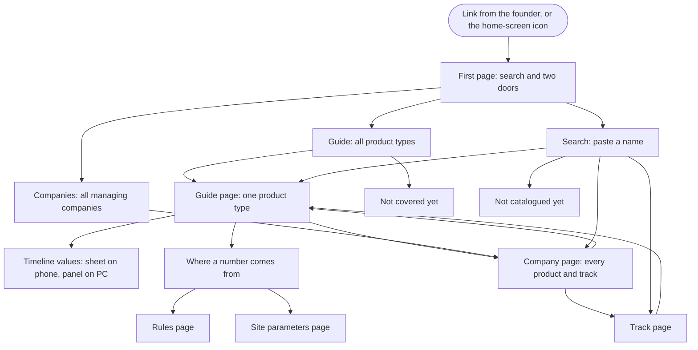
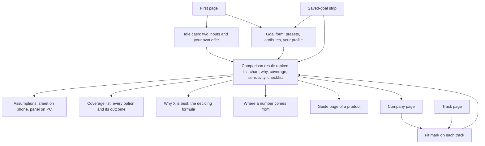
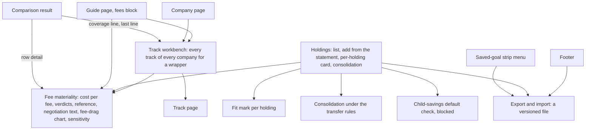
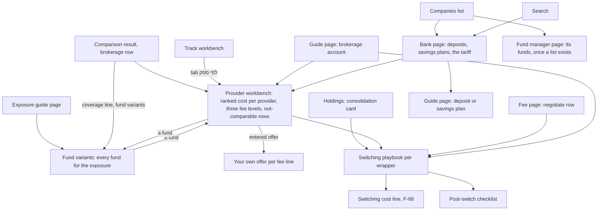
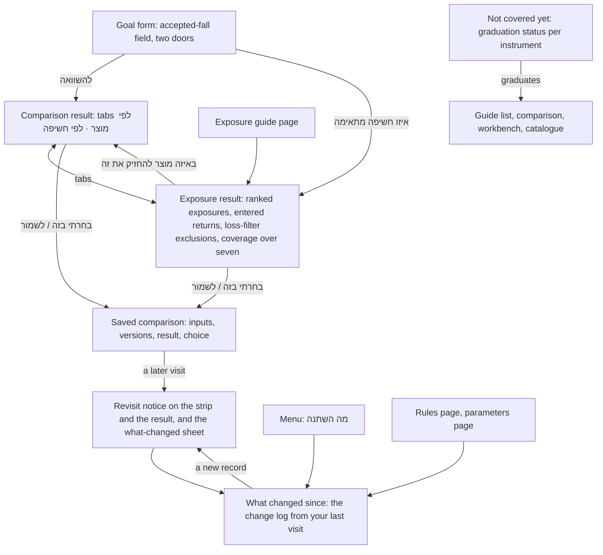

# User flows, release 1

> Release 2 sections added 2026-10-23: section 7 (release 2 flows), 8 (screens release 2 needs) and 9 (screen briefs, release 2).
> Release 3 sections added 2026-10-23: section 10 (release 3 flows), 11 (screens release 3 needs) and 12 (screen briefs, release 3).
> Release 4 sections added 2026-10-24: section 13 (release 4 flows), 14 (screens release 4 needs) and 15 (screen briefs, release 4).
> Release 5 sections added 2026-10-24: section 16 (release 5 flows), 17 (screens release 5 needs) and 18 (screen briefs, release 5).

Written 2026-10-23 from `docs/product.md` (the release 1 capabilities in `docs/roadmap.md`), `docs/design-system.md` and the approved mockups.
Status: **approved by the founder on 2026-10-23**, with both proposals in section 5. Section 6 holds a design brief for every screen.

What release 1 lets a person do: understand any product type in plain Hebrew with a graph they can play with, see every product and track a company offers and what each one is, check where every number comes from, and see what the site cannot answer yet and why. Nothing here ranks options or remembers a goal; that starts in release 2.

How to read a flow: who starts it and from where, the steps, what can go differently, and when it is done. The last line of each flow ("Traces to") is for whoever builds it.

---

## 1. Why people come

| Situation | Who | Flow |
|---|---|---|
| "My bank or fund app offers something and I don't know what it is." | The founder with the Meitav app; any friend with a bank or fund app | 5, 6 |
| "I want to understand a type of saving." | A friend who has never heard of a money-market fund | 2, 3 |
| "I have a word from a statement or an ad." | Anyone holding a pension statement or an ad | 6 |
| "Where does this number come from? Can I trust it?" | Anyone reading a page | 4 |
| "What about the thing my friend mentioned?" | Anyone asking about a product the site doesn't cover yet | 7 |
| "Which rules and judgement calls does the site use?" | The founder, a careful friend, a reviewer | 8 |
| Keeping the catalogue and the data current | The founder | 9, 10 |

---

## 2. Map of the site in release 1

Every page also has the header: site name (back to the first page), search, and the menu (guide, companies, rules, parameters). A friend may land directly on any page from a shared link, so every page stands on its own and has a way back to its list.

---

## 3. The flows

### Flow 1. Arrive and find your way

**Starts:** a link the founder sends, or the icon on a phone's home screen.

1. The first page shows a search field ("הדביקו שם של מוצר, מסלול או מונח") and two doors: understand a type of saving (the guide) and see everything a company offers (the companies list). A small link leads to what the site does not cover yet. Nothing else (approved, question 1).
2. On every page the header holds the site name, search and the menu. On a phone the menu is a sheet; on PC the four destinations sit in the header.
3. A shared link opens its page directly. The back link at the top leads to that page's list (guide or companies).

**Done when:** the person is on a guide page, a company page, or searching.
**Traces to:** product.md 2 (users, phone first); architecture.md 3.5 (pages); design-system.md 3.1.

### Flow 2. Learn what a product is

**Starts:** the guide list (from the first page or the menu), or a link from a company page, a track page or search.

1. The guide list has two groups: where the money is held (a bank deposit, a kupat gemel lehashkaa, a brokerage account …) and what it is invested in (cash in shekels, an index such as the S&P 500 …). Each card has the name and one line. A link at the end leads to what is not covered yet.
2. A product page opens with its name, one-line summary and the key to the three number styles.
3. The page always runs in the same order, so two pages can be compared side by side: what it is, the timeline, who offers it and who supervises, how money goes in and out, what it costs, how it is taxed, risks and what is not protected, typical use, what to check, and the words used for it. On a phone a row of section chips jumps between them; on PC a list on the right does.
4. In "who offers it", each company links to its company page (flow 5).
5. "Typical use" links to the related product pages, for example from a money-market fund to a bank deposit, so the reader can see when each one suits. Ranking one against the other for a goal comes in release 2.
6. "What to check" lists every point that matters for this product, each marked considered, not relevant, or blocked by an open question. Tapping one shows where it comes from.
7. "Words used for it" shows each term as it appears on a statement, in an app or in the law, with what it means.
8. A page about what the money is invested in (an index, cash) explains the exposure and links to the products that can hold it. The timeline lives on the product pages.

**What can go differently:** a part that depends on an open question shows a lock and names the question instead of a number. A number older than usual shows a clock.
**Done when:** the reader can say what it is, how to get it, what it costs, how it is taxed, and when another product suits better.
**Traces to:** product.md 3.1, 3.3, success criterion 5 and the R1 "done when" in roadmap.md; design-system.md 3.5, 3.6.

### Flow 3. Try your own numbers on the timeline

**Starts:** the timeline on any product page. It opens on the site's example: an amount today, a monthly deposit, a number of years, a return and inflation.

1. The reader sees what is left after the years shown, net of fees and tax, in today's money, then the graph, then the values it uses as chips under it, each showing whether it is the site's example or entered by them.
2. On a phone, tapping a chip opens the values sheet at that field ("כל ההנחות" opens all of them). On PC the values sit in a panel beside the graph.
3. Changing a value (slider or typing) moves the graph and the numbers straight away. The field turns blue with "הוזן על ידך" and a button to go back to the example value.
4. Optional: age, which marks ages where the product's rules change (for example 60 for a kupat gemel lehashkaa); and employment type, which highlights the parts of the page that apply.
5. A switch shows the graph in today's money (the default) or in future shekels.
6. Dragging a finger across the graph (phone) or moving the mouse (PC) shows the numbers for that year. "הצגה כטבלה" shows them year by year.
7. Values the reader entered stay with them on every other product page, and on this device on their next visit.

**What can go differently:** a return the reader enters is drawn as a dashed line, with a note that the projection rests on their own number. A part the site cannot compute (an open question) is hatched and names the question. A rule figure past its end date stops the graph with "הנתון לא עודכן" instead of using an old figure.
**Done when:** the reader has seen how their own money would behave in this product.
**Traces to:** product.md 3.1 (timeline), 2 ("interactive by default", "real terms by default"), D7, D9; method.md F-67; design-system.md 3.3, 3.4.

### Flow 4. Check where a number comes from

**Starts:** any number on any page.

1. The style says what it is: a thin grey underline comes from a source, a dotted violet one is calculated by the site, blue is something the reader entered. The key at the top of each page explains the three.
2. Tapping (phone) or clicking (PC) opens a sheet from the bottom on a phone, or a small card beside the number on PC:
   - from a source: the document and section, with a link; who published it; the date it was checked; the rule it belongs to;
   - calculated: what the calculation is, each value it used (themselves tappable), and the rules it used;
   - entered: what the reader typed, the example value it replaced, and the button to go back;
   - a site judgement (a "site parameter"): the value, why it was chosen and when it was approved.
3. Tapping a rule opens the rule in plain words, with its conditions, source and date, and a link to it on the rules page.
4. Flags explain themselves when tapped: a clock means older than usual (with the date of the last value); "משני" or "מוסדי" means a weaker source (and which); a lock means the site cannot compute it (and which open question blocks it).

**Done when:** the reader knows where the number comes from and how far to trust it.
**Traces to:** CLAUDE.md "every number traces to a source"; product.md D3, D7, D10, 3.8; design-system.md 3.2.

### Flow 5. See everything a company offers

**Starts:** the companies list (from the first page or the menu), a company on a guide page, or search.

1. The companies list shows every managing company in the regulator's fund data. Typing filters it.
2. A company page lists every product and track the company offers, grouped by product type ("קופת גמל להשקעה", "קרן השתלמות" …), each under the name the company uses. Each group links to that product's guide page.
3. Each track row shows the name, the fund number, the regulator's classification, what the money is invested in, in plain Hebrew, and one line on why someone might pick it. The default track is marked. Tracks with the same name are grouped, with the answer from the data: two separate funds, one fund listed twice, or not resolved.
4. Tapping a track opens its page: the fund's official record and its date, what it invests in, what to check, and a link to the product's guide page.

**What can go differently:** fees show "עוד לא מוצג" until the meaning of the regulator's fee fields is confirmed. If the fund data is older than a month, a banner says since when.
**Done when:** the reader can see every option the company offers and what each one is. The same list is what the comparisons choose from in later releases (product.md "no blind spots").
**Traces to:** product.md 3.10, success criterion 5 and appendix E; roadmap.md R1; design-system.md 3.7.

### Flow 6. Look up a name you saw

**Starts:** the search field, from the header of any page.

1. The reader pastes or types a name. Results appear while typing, and match despite small differences in spelling (final letters, quote marks, hyphens).
2. Results are grouped: products, tracks and funds, words from statements and ads, and guide pages.
3. Choosing one opens it: a product on its company page, a track on its track page, a word at the guide section that explains it, a guide page at its top.

**What can go differently:** nothing matches. The page says "עוד לא קוטלג", saves the name on this device so it can be added later, offers a "העתקה" button so the reader can send the name to the founder, and offers to browse the companies or try a shorter part of the name (approved, question 2).
**Done when:** the reader is on the right page, or the name is saved for adding.
**Traces to:** product.md 3.10 ("a name the site cannot match"), 3.1 (a term from a statement finds its page); architecture.md 3.5 (search); design-system.md 3.7.

### Flow 7. Something the site doesn't cover yet

**Starts:** the link at the end of the guide list, the first page, or search.

1. One page lists the products the site knows about but does not cover yet (savings policies, structured deposits, corporate bonds and others).
2. Each one says what is known, which open question keeps it out, and why that question matters.

**Done when:** the reader knows the site cannot help with it yet, and why.
**Traces to:** product.md D2, 3.1 (the "not covered yet" page).

### Flow 8. Read the rules and the site's judgement calls

**Starts:** a rule from flow 4, or the menu.

1. The rules page lists every rule the site uses, grouped by product type, with a list to jump between groups. Each rule shows its plain text, conditions, figures by tax year, source and date checked, how strong the source is, and when it will be re-checked. Open questions are marked as such.
2. The parameters page lists the site's own judgement calls, such as when two options count as a tie. Each shows its value, why it was chosen, who approved it and when, and where it is used. One not set yet says so.

**Done when:** the reader has found the rule or judgement behind a number.
**Traces to:** product.md 3.8; design-system.md 3.8.

### Flow 9. When data is old or missing

**Starts:** the site itself; the reader only sees the result.

1. The regulator's fund data is fetched every month. When a new month appears, the pages update and the change is logged.
2. If a fetch fails, the site keeps the last data with its date. Once that is older than a month, numbers from it show the clock and company and track pages show "לא עודכן מאז …". The check runs in the reader's browser against today's date, so it still works if updates stop.
3. A rule figure past its end date is never used: the calculation stops and says "הנתון לא עודכן".

**Done when:** a reader can never mistake old data for current data.
**Traces to:** product.md D3, section 6; architecture.md 2 (time checks in the browser), 3.3.

### Flow 10. The founder adds a missing name

**Starts:** a name shows "עוד לא קוטלג" on the founder's device, or a friend tells him about one.

1. The founder notes the name, where it was seen (which app, ad or statement) and the date.
2. He runs the catalogue helper, or asks Claude, which creates the entry; he fills in what it is (product type, and fund numbers where it is a track).
3. A pull request runs the checks, including that every fund number exists in the latest regulator data.
4. Once merged, the site rebuilds and the name is found everywhere. The change is logged.

**What can go differently:** a friend's unmatched names stay on the friend's phone. Getting them off the phone as a file comes in release 3. Until then the friend copies the name with the "העתקה" button and sends it to the founder (approved, question 2).
**Done when:** search finds the name for everyone.
**Traces to:** product.md 3.10, 6a, section 6; architecture.md 3.3 (helpers).

---

## 4. Screens these flows need

| Screen | Flows | In the mockups |
|---|---|---|
| First page | 1 | no |
| Header and menu | 1 | yes (header); menu sheet no |
| Search, with results and "not catalogued yet" | 6 | no |
| Guide list | 2 | no |
| Product guide page | 2, 3 | yes |
| Exposure guide page (what the money is invested in) | 2 | no |
| Timeline values (sheet on phone, panel on PC) | 3 | yes |
| Where a number comes from (sheet on phone, card on PC) | 4 | yes (phone) |
| A rule (card) | 4 | no |
| Companies list | 5 | no |
| Company page | 5 | yes (redrawn 2026-10-23 as one list, without the app view) |
| Track page | 5 | no |
| Not covered yet | 7 | no |
| Rules page | 8 | no |
| Parameters page | 8 | no |

Flows 9 and 10 need no screen of their own: flow 9 shows up as flags and banners on the screens above, and flow 10 happens in the repository.

---

## 5. Questions for the founder (answered 2026-10-23)

1. **What the first page shows.** The product documents don't define it. Proposal: only the search field, the two doors (guide and companies) and the link to what isn't covered yet. Nothing that needs data of its own. **Approved.**
2. **Getting a friend's unmatched names to you before release 3.** A friend's "not catalogued yet" names stay on their phone until export arrives. Proposal: a "העתקה" button on the "not catalogued yet" screen, so they can paste the name to you on WhatsApp. **Approved**, and recorded in `docs/product.md` (3.10 and appendix D).

---

## 6. Screen briefs

One brief per screen in section 4. They apply `docs/design-system.md`. Mockups for the guide page, the timeline values, the number sheet and the company page are on the mockup canvas (https://claude.ai/artifact/T2WWNHiNhqXxSkmssTFbCS); those briefs add only what the mockups don't show.

**For every screen:**

- Hebrew, right to left, dark only. The page starts at the right; lists, chips and steps run from right to left; time on a graph runs left to right.
- Phone means 360 to 430 px wide and is the base design. PC means 1024 px and up (`lg`). Between them (`md`, 768 px) cards go two across and tables become real tables.
- The header (6.2) is on every screen. Any figure goes through the provenance number, so it shows its source style and opens the number sheet (6.8).
- Hebrew copy here is draft wording, in the plural imperative ("הדביקו", "בחרו"). Names of products and tracks appear exactly as the source writes them.

### 6.1 First page

**Flows:** 1. **Mockup:** none.

- The site name (h1) and one line: "להבין חיסכון והשקעה בישראל, עם מקור לכל מספר."
- The search field, labelled "מה ראיתם?", placeholder "הדביקו שם של מוצר, מסלול או מונח". It opens search (6.3) on focus.
- Two door cards:
  - "להבין סוג של חיסכון", with "מה זה, כמה זה עולה ואיך זה ממוסה". Opens the guide list (6.4).
  - "מה חברה מציעה לי", with "כל המוצרים והמסלולים שלה, עם הסבר לכל אחד". Opens the companies list (6.10).
- A small link: "מה האתר עוד לא מכסה" (6.13).

**Phone:** one column, the search field full width at 48 px, the two cards stacked, the link last. Everything fits the first screen without scrolling.
**PC:** a centred column of 38rem; the two cards side by side under the search field.
**States:** none. The page holds no figures and needs no data.
**Components:** search field, card (the whole card is the link, with a mirrored chevron at the inline end).

### 6.2 Header, menu and footer

**Flows:** 1, all. **Mockup:** header on every board; no menu sheet.

- **Phone:** a 56 px sticky bar: site name at the start (right); search and menu as 44 px icon buttons at the end (left). The menu opens a bottom sheet with 48 px rows: "מדריך", "חברות ומסלולים", "כללים", "פרמטרים", then a divider and "מה האתר עוד לא מכסה". The current page is in weight 500 with a teal marker at the start of its row.
- **PC:** a 64 px sticky bar: site name, then the four destinations as text links (the current one underlined in teal), then the search field (340 px) at the end.
- **Footer** on every page: "כללים", "פרמטרים", "מה האתר עוד לא מכסה".

**States:** the menu sheet closes on X (top left), on a tap outside it, or on choosing a row.
**Components:** header, sheet, icon button.

### 6.3 Search

**Flows:** 6, and 1 from the first page. **Mockup:** none.

- The field, focused, with its text in `dir="auto"`, a search icon at the start and a clear button at the end.
- Before typing: one hint line, "אפשר להדביק את השם בדיוק כמו שהוא מופיע באפליקציה, בפרסומת או בדוח."
- Results appear while typing, in four groups, each with a small heading:
  - "מוצרים" (catalogued names);
  - "מסלולים וקופות" (tracks and funds);
  - "מונחים מדוחות ופרסומות" (terms);
  - "עמודי מדריך" (guide pages).
- Each result: the name with the matched part in weight 600, and one quiet line saying where it is (company and product type, or the guide page a term belongs to). At most five per group, then "הצגת כל התוצאות בקבוצה".
- **Not catalogued yet** (no match):
  - the title "עוד לא קוטלג";
  - "את השם "{השם}" עוד אין אצלנו. שמרנו אותו במכשיר שלכם כדי שיהיה אפשר להוסיף אותו.";
  - a primary "העתקה" button with the line "העתיקו ושלחו את השם, כדי שיתווסף";
  - two quiet links: "לרשימת החברות" and "לחפש חלק מהשם".

**Phone:** a full-screen sheet; the field at the top with the keyboard open; X at the top left; results scroll under the field.
**PC:** the header field; results in a popover under it, 480 px wide, up to 70% of the window high. Arrow keys move through results and Enter opens the selected one.
**States:** after copying, the button shows a check and "הועתק" for two seconds. Search works without a network connection once the page has loaded (the index ships with the site).
**Components:** search field, sheet, popover, empty state, button.

### 6.4 Guide list

**Flows:** 2. **Mockup:** none.

- h1 "מדריך" and the lede "כל סוג של חיסכון והשקעה שהאתר מכסה. לכל אחד אותו מבנה, כדי שאפשר יהיה להשוות."
- h2 "איפה הכסף מוחזק", then a card for each product (wrapper).
- h2 "במה הכסף מושקע", then a card for each exposure.
- Each card: the name (h3) and one line on what it is. No figures.
- A last card in a quieter style: "מה האתר עוד לא מכסה".

**Phone:** one column of cards. **PC:** three columns; two at `md`.
**States:** none.
**Components:** instrument card.

### 6.5 Product guide page

**Flows:** 2, 3, 4. **Mockup:** "מדריך · טלפון" and "מדריך · מחשב".

The mockups show the layout. Also designed for:

- **A product with a lock-up** (for example a keren hishtalmut): the "how money goes in and out" section leads with when the money becomes free; the graph draws a marker line with "אפשר למשוך מכאן" at that year.
- **Parts that apply to the reader:** once age or employment type is entered, rows that apply get a small blue tag, "לפי מה שהזנתם". Rows that don't apply stay visible, in quiet text, with the reason ("לשכירים בלבד").
- **A section blocked by an open question:** the blocked callout stands in place of the missing figure, naming the question; the rest of the section still shows.
- **Old data:** a clock on each affected figure; nothing hidden.
- **A rule figure past its end date:** the graph area is replaced by a callout, "הנתון לא עודכן: {שם הכלל}", with a link to the rule.
- **"Typical use":** ends with links to related product pages as chips ("גם כדאי להכיר: פיקדון בבנק").

**Components:** section index, guide sections, key-value list, fee table, money-flow strip, dimension checklist, term table, timeline (6.7), provenance number.

### 6.6 Exposure guide page

**Flows:** 2. **Mockup:** none.

- h1 the exposure as people call it (for example "מדד S&P 500"), and one line on what the money is invested in.
- The same section index and fixed order as a product page, without the timeline:
  - "מה זה": what the exposure is;
  - "איך מחזיקים את זה": a card for each product that can hold it, linking to its guide page;
  - "סיכונים": risks;
  - "מה לבדוק": the dimension checklist for this exposure;
  - "מונחים": the words used for it.
- The cards under "איך מחזיקים את זה" carry no ranking and no figures; ranking for a goal comes in release 2.

**Phone:** one column; the holding products as stacked cards. **PC:** the holding products three across; section index at the start (right).
**States:** a product that cannot hold this exposure is not listed. One whose tax treatment for it is an open question is listed with the lock and the question.
**Components:** as 6.5, without the timeline.

### 6.7 Timeline values

**Flows:** 3. **Mockup:** "טלפון · שינוי ההנחות", and the panel in "מדריך · מחשב".

The mockups show amount today, monthly deposit, years, return and inflation. Also designed for:

- **Age** ("גיל (לא חובה)"): a number field with minus and plus buttons, empty by default.
- **Employment type** ("סוג העסקה (לא חובה)"): a segmented control, "שכיר | עצמאי", with nothing selected by default.
- **One link at the bottom:** "חזרה לכל הערכים של הדוגמה", shown only when at least one value was entered.
- **Errors:** under the field, in red text with the field edge red: "הזינו מספר", or "הסכום לא יכול להיות שלילי". The graph keeps the last valid value until the error is fixed.
- **A return the reader enters:** a line under the field, "הגרף יסומן בקו מקווקו, כי התשואה היא שלכם".

**Phone:** a bottom sheet over the graph, up to 85% of the screen; the headline number stays visible above it and changes while the reader types.
**PC:** a 300 px panel at the start (right) of the graph, always open.
**Components:** field, number field, slider field, stepper, segmented control, state tag, sheet.

### 6.8 Where a number comes from

**Flows:** 4. **Mockup:** "טלפון · נגיעה במספר" (a calculated number).

The mockup shows a calculated number. The other kinds:

- **From a source:** the value; the document and section as a link ("פתיחת המקור" with the mirrored external-link icon); the publisher; "נבדק ב־{תאריך}"; the dates it applies from and to; the rule chips.
- **Entered by you:** "הזנתם את הערך הזה", the example value it replaced (as a number from a source), and the reset button.
- **Site parameter:** the value, the tag "פרמטר של האתר", the reason in one or two sentences, and "אושר ב־{תאריך}". A provisional default shows "ערך זמני שהאתר קבע" instead.
- **Unknown** ("לא ידוע"): why it is unknown, from the data's note.
- **Flags**, as a line at the bottom when present:
  - stale: "לא עודכן מאז {תאריך}. בדרך כלל מתעדכן {כל חודש}.";
  - weaker source: which kind, and what it means.

**Phone:** a bottom sheet, up to 70% of the screen. **PC:** a card up to 22rem wide beside the number, closed by Esc or a click outside.
**Components:** provenance popover, state tag, strength label, rule reference.

### 6.9 A rule

**Flows:** 4, 8. **Mockup:** none.

- The rule chip (its ID) and its short title.
- The strength label: "מקור ראשי", "מקור ראשי (עותק)", "מקור מוסדי", "מקור משני", or "שאלה פתוחה".
- The rule in plain words, two to four sentences.
- "תנאים וחריגים" as a disclosure.
- Figures by tax year, each a number from a source.
- The source as a link, with "נבדק ב־{תאריך}".
- A link "לכל הכללים", which opens the rules page at this rule.
- **An open question** uses the blocked style instead: "שאלה פתוחה", what is unknown, and which numbers on the site wait for it.

**Phone:** a bottom sheet; tapping a rule inside the number sheet replaces its content, with a back arrow (pointing right) at the top. **PC:** a card like 6.8.
**Components:** rule reference, strength label, disclosure, callout (blocked).

### 6.10 Companies list

**Flows:** 5. **Mockup:** none.

- h1 "מה חברה מציעה לי" (the menu calls this page "חברות ומסלולים") and the lede "בחרו חברה כדי לראות את כל המוצרים והמסלולים שלה, ומה כל אחד מהם."
- A filter field, "חיפוש חברה", which narrows the list as you type.
- One row per managing company in the regulator's data:
  - the name as the regulator writes it;
  - one quiet line with the product types it runs ("גמל, השתלמות, פנסיה");
  - a mirrored chevron.
- Rows are in Hebrew alphabetical order.

**Phone:** one column of 56 px rows. **PC:** two columns of rows, filter at the top, 72rem page width.
**States:** a filter with no match shows "לא מצאנו חברה בשם הזה" and a link to the full search.
**Components:** search field, list row.

### 6.11 Company page

**Flows:** 5. **Mockup:** "חברה · טלפון" and "חברה · מחשב", redrawn on 2026-10-23 as the single list below (product.md appendix E).

- h1 the company name; under it "כל מה שהחברה מציעה, עם הסבר לכל מסלול", with the regulator's data month.
- The fee-pending callout, then the list heading "כל המסלולים של {חברה}".
- Every track the company runs, grouped by product type under disclosures ("קופת גמל להשקעה", "קרן השתלמות" …), the first open, each with its count of tracks.
- Each group heading links to that product's guide page.
- Track rows as in design-system 3.7; same-name tracks in a near-duplicate group.
- After the list, the paste card "לא מצאתם שם?" (on PC in the side column), which opens search (6.3).

**States:**

- **Old data:** a caution banner under the h1, "נתוני הרשות לא עודכנו מאז {חודש}".
- **Same-name tracks still unresolved:** the group banner says "לא הוכרע: הנתונים לא מראים אם זו אותה קופה", in caution colours.

**Components:** track row, near-duplicate group, fee-pending note, disclosure.

### 6.12 Track page

**Flows:** 5, 6. **Mockup:** none.

- Breadcrumb "חברות ומסלולים › {חברה} › {מסלול}"; on a phone only the back link to the company.
- h1 the track name exactly as the source writes it; under it "קופה {מספר}" in the identifier style, and the tag "ברירת המחדל" when it is the company's default track.
- One line: why someone might pick this track.
- A key-value card, every value a number or text from the regulator's data with its source style:
  - "חברה מנהלת" (link to the company page);
  - "סוג מוצר" (link to the guide page);
  - "סיווג";
  - "במה הכסף מושקע";
  - "דמי ניהול מחיסכון" and "דמי ניהול מהפקדה", which show the fee-pending note for now;
  - "נכון לחודש".
- When another track has the same name: a caution callout, "יש מסלול נוסף באותו שם", with the answer and a link to the other track.
- The dimension checklist for this track.
- A space reserved under the h1 for the release 2 mark ("מתאים למטרה שלכם?"); nothing is drawn in release 1.

**Phone:** one column. **PC:** the key-value card and the checklist side by side (card at the start, 360 px), the page at 72rem.
**Components:** key-value list, tag, callout, dimension checklist, provenance number.

### 6.13 Not covered yet

**Flows:** 7. **Mockup:** none.

- h1 "מה האתר עוד לא מכסה" and the lede "מוצרים שאנחנו מכירים אבל עוד לא יכולים להסביר עד הסוף, ולמה."
- One card per product:
  - the name (h3);
  - "מה ידוע" in two or three sentences;
  - one blocked callout per open question that keeps it out ("שאלה פתוחה {מזהה}: {מה לא ידוע}");
  - "למה זה חשוב" in one sentence.

**Phone:** one column. **PC:** two columns of cards.
**States:** a product that moves into full coverage disappears from this page and appears in the guide list.
**Components:** card, callout (blocked), rule reference.

### 6.14 Rules page

**Flows:** 8. **Mockup:** none.

- h1 "כללים" and the lede "כל כלל שהאתר משתמש בו, עם המקור שלו. כלל שהמקור שלו חלש יותר מסומן, ושאלה פתוחה מסומנת במנעול."
- Rules grouped by product type, using the rule card of 6.9 at full width, each an anchor target.
- Each group lists its open questions at the end, in the blocked style.
- A re-check date shows as "ייבדק שוב ב־{תאריך}" on rules likely to change.

**Phone:** the section-index chips for the groups at the top; each group a disclosure, closed unless the reader arrived on a rule inside it. **PC:** the group index at the start (right); all groups open.
**Components:** section index, disclosure, rule card, strength label.

### 6.15 Parameters page

**Flows:** 8. **Mockup:** none.

- h1 "פרמטרים של האתר" and the lede "החלטות שהאתר מקבל בעצמו, כמו מתי שתי אפשרויות נחשבות שקולות. הן לא כללים מהחוק, ואי אפשר לשנות אותן מהעמוד."
- One card per parameter:
  - its name in plain Hebrew;
  - its value as a number with the site-parameter tag;
  - "למה" in one to three sentences;
  - "אושר ב־{תאריך}", or "ערך זמני שהאתר קבע" for a provisional default;
  - "משמש ב:" with links to where it is used.
- A parameter with no value yet shows "עוד לא נקבע".

**Phone:** one column. **PC:** two columns of cards.
**Components:** card, provenance number, state tag.

---

## 7. Release 2 flows

**Note 2026-10-23.** The worked examples in this section use the golden fixtures (the S14 and S20 fee sets in `tests/golden/scenarios.md`), while the site runs on the collected records (the Meitav and Leumi fee and deposit records in `data/`). The numbers on screen therefore differ from the examples here by design; the examples show the shape of each flow, not the figures a person will see.

Added 2026-10-23 from `docs/product.md` 3.2, 3.3, 3.9 and 3.10 (D5, D7, D9, D11, D12, D13, D16, D17), `docs/roadmap.md` Release 2, `docs/method.md` §2, §8, §10 (F-60, F-67) and §11 (F-80, F-81, F-83), and the worked examples in `tests/golden/scenarios.md` (S39, the founder's ETF-vs-provident case; S40, the apartment case; S41, idle cash; S50, a tie). Status: **draft for the founder.** Where the product text leaves a choice, the brief makes one and marks it "chosen 2026-10-23, revisable".

What release 2 adds: a person states a goal (or just the cash sitting in the current account), and the site says which product type is best for it, net of fees and tax over the horizon, with every option accounted for, why the winner wins, what would change the answer, and what it considered. The goal stays on the device, and company and track pages say whether a track fits it.

Every figure in these flows is a computed, sourced or entered value shown through the provenance number (flow 4); the numbers quoted from S39 and S40 are the golden check's values, used here only to make the briefs concrete.

### 7.1 Why people come (added rows)

| Situation | Who | Flow |
|---|---|---|
| "I have money sitting in my current account and I don't know what it costs me." | The founder today; a friend with a bank app open | 11 |
| "I'm saving for something; which product should it sit in?" | The founder (apartment); a friend with a goal | 12, 13, 14 |
| "Why is this the best one? What did it consider?" | Anyone reading a result | 13, 14, 15 |
| "What if the return is lower, or I need the money sooner?" | A careful friend | 14, 16 |
| "I did this last week; show me again." | Anyone coming back | 17 |
| "Does this track at my manager fit what I'm saving for?" | Anyone on a company or track page | 18 |
| "Why is this option missing, or marked old?" | Anyone reading a result | 19 |

### 7.2 Map of what release 2 adds

The header's menu gains one row, "השוואה למטרה", which opens the goal form, or the result when a goal is saved. The first page gains a third door card, "כסף שיושב בעו״ש", to the idle-cash screen (chosen 2026-10-23, revisable: the first page was approved with two doors, question 1; the product says the idle-cash entry point is "meant to be the first thing a friend sees", 3.2).

### 7.3 The flows

### Flow 11. Start from idle cash

**Starts:** the third door on the first page, the menu, or a link the founder sends. The person has their bank app open.

1. The screen asks for two numbers: how much is in the current account, and how much must stay available at once. Both are entered by the person and shown in blue. Nothing else is required.
2. As soon as both are filled, the result shows under the fields, no button: the computed monthly cost of leaving the rest where it is, per alternative (method F-60): a one-month deposit at the average the Bank of Israel reports for a bank last month (A-21), a daily money-market fund at the policy rate (A-20), and makam at its yield (A-22). Each row's rate carries its label: "הממוצע ששולם בבנק הזה בחודש שעבר", or "ממקור" with the series name, and, once entered, "הוזן על ידך".
3. Two optional fields under the result: the person's bank (so the deposit row uses that bank's average; a chip row of the banks in the Bank of Israel series, remembered on the device), and the deposit offer they see in their own app (A-26). Entering an offer adds a second deposit row, "לפי ההצעה שהזנתם", in blue, next to the bank-average row, so the two are read side by side (product 3.2 "idle-cash" out).
4. The coverage line says how many options were considered and that every option outside the preset is "not evaluated" with its reason (G-28: a renewable money-market fund, a savings plan, bonds, the brokerage account and the provident wrappers), child savings "not eligible", and tier 2 "not evaluated". A link leads to the full comparison with the liquid-reserve preset filled from these two numbers.
5. Done in under a minute on a phone: two fields, one scroll (product 3.2 "works when").

**Worked example (S41):** balance 80,000 and 20,000 that must stay available leave 60,000 to compare. The rows show the monthly cost of leaving it in the current account: deposit at the bank average 113.12, deposit at the entered offer 129.69, makam 142.07, daily money-market fund 129.13, each a computed number. Coverage: 26 considered, 1 baseline, 3 compared, 2 not eligible, 20 not evaluated.

**What can go differently:** a rate series older than its cadence shows the clock on the figure and a caution line (flow 19). No bank chosen: the deposit row uses the series' all-bank figure if the data holds one, else shows "בחרו בנק" in place of the figure. The money-market tax rule (tax report Q15) still open: the fund row is blocked with the lock and the question, and the roadmap says the preset does not ship until it closes.
**Done when:** the person knows, in shekels a month, what the idle money costs them against each liquid option, and can go on to the full comparison.
**Traces to:** product.md 3.2 (idle-cash preset), D4, D7, D9, D17; roadmap R2; method F-60, F-83, G-28; S41; design-system 6.4.

### Flow 12. Set a goal

**Starts:** the goal door on the first page, the menu, the link from the idle-cash screen, the saved-goal strip's "עריכה", or a track page's "הגדירו מטרה".

1. The form opens with the preset chips: "עתודה נזילה", "קנייה במועד ידוע", "הון לטווח ארוך", "סכום חד־פעמי", "חיסכון לילד", and "בלי נקודת התחלה". Tapping one fills the goal attributes below from the preset's parameter record and marks each filled field "ערך התחלתי, פרמטר של האתר"; the person changes any of them and the field turns blue (D13). Coming from idle cash, the liquid-reserve preset is chosen and the two amounts are already entered.
2. The goal attributes, in one card: name (optional), horizon in years, amount now, monthly contribution, how much must stay available at once and from when, and the constraints: "must be withdrawable at any time" (a switch) and "must not need an annual tax return" (shown with the lock: it cannot be checked yet, G-22). The loss filter (D11) is not in this release; one quiet line says it arrives later.
3. The second card, "קצת עליכם": age; employment type; gross monthly salary; the pension and hishtalmut contribution rates of employer and employee; whether a pension and a hishtalmut already exist through work. Under each salary field a disclosure, "איפה זה בתלוש", shows what the law requires a payslip to state (PEN-36); no payslip label is invented (G-19). Age and employment type arrive filled if the person set them on a guide page (3.1 "the values follow them").
4. The third card, "ההנחות": the return the person assumes on the invested part (A-01, empty, with the note that the site does not guess a return, D9) and inflation (A-02, starting from the illustrative scenario's value as a site parameter). Both arrive filled and blue if entered earlier on a guide page.
5. "להשוואה" (primary) opens the result. Everything typed is saved on the device as it is typed (flow 17); there is no separate save.
6. A second goal (D12): the result's saved-goal strip offers "מטרה נוספת"; the new form starts with the remaining balance as a hint, and the person types the amount for this goal by hand. Goals are compared one at a time, in their order; the form shows the order and lets the person move a goal up or down.

**Worked example (S39):** long-term-wealth preset; 30,000 now, 2,000 a month, 20 years, nothing must stay available; age 22, salaried, 12,000 a month, pension and hishtalmut through work; return 6% and inflation 2.5% entered.
**Worked example (S40):** purchase-at-a-known-date preset; 150,000 now, 4,000 a month, 4 years, 50,000 must stay available at once.

**What can go differently:** a required field empty: the button stays enabled but the result shows the options that can run and lists the others as "not evaluated: {field} missing" (so the person sees progress, not a wall). A salary of zero or an age outside the range: an error under the field (copy 6.1). Self-employed: the hishtalmut fields change to the self-employed deposit and the hishtalmut is ranked (D15).
**Done when:** the result opens for this goal.
**Traces to:** product.md 3.2 In, D8, D11, D12, D13, D15; method A-12, A-01, A-02, §8 constraints, G-19, G-22; design-system 6.1, 6.2.

### Flow 13. Read the ranked list and the coverage line

**Starts:** "להשוואה" from the goal form, the saved-goal strip, the fit mark's link, or a shared link (which opens the goal form, since the goal lives only on the device).

1. The page leads with the answer: "{X} היא הטובה ביותר למטרה הזו, כי {Y}" (flow 14), then the ranked list.
2. Each ranked row: the rank, the product's name (linking to its guide page), the real value at the horizon net of fees and tax as a computed headline number, the assumptions it rests on as small chips (each sourced or entered), "נעול עד {תאריך}" when it is locked past the horizon, which formula decides its place against the row above ("מכריע: דמי ניהול"), and the tie badge when it is within the site's tie threshold of its neighbour (D5, P-01).
3. Rows that are listed but not ranked (B3, D15, a ceiling) follow under their own heading, in quiet text, each with its reason and its value at its own unlock date (D16).
4. The chart (flow 14) shows the top options on one axis.
5. The coverage line: "נבדקו 26 אפשרויות: 6 דורגו, 7 מוצגות בלי דירוג, 2 לא מתאימות לכם, 0 נפסלו לפי האילוצים שלכם, 11 עוד לא נבדקו" (S40's counts). Tapping it opens the full list: every tier-1 product type and every tier-2 instrument, each exactly once, with one of the five outcomes and its reason in words and the rule, gap or constraint code (F-83). The list ends with the line that tracks and funds inside each product are shown on company pages and compared in a later release.
6. From any row: the product's guide page, or the companies that offer it.

**Worked example (S39):** 1. kupat gemel lehashkaa, 630,640.90 (its exit tax labelled "secondary source", G-02); 2. brokerage account with the ETF, 572,640.51; gap 9.20%, not a tie. Listed, not ranked: keren hishtalmut ("employee; funded only through the employer", D15), pension ("locked to 60; exit value blocked, G-03"). Deciding: fee drag.
**Worked example (S40):** 1. makam 296,362.17; 2. bank deposits 296,034.36 — tie badge on both (gap 0.11%, under the 0.5% threshold); 3. daily money-market fund 295,594.33; 4. ETF in a brokerage account 293,119.64 (dashed: rests on an entered 5%); 5. government bond 291,761.83; 6. current account 276,722.74. The 50,000 kept available is shown apart: it stays in the current account and is worth 46,072.25 real at the horizon. Listed, not ranked: kupat gemel lehashkaa (the yearly ceiling takes only part of the money; the excess routed to the next goal, F-05), keren hishtalmut, both pension funds, provident for annuity, both IRAs. Not eligible: child savings (both routes). Not evaluated: savings plan (no terms yet), renewable money-market fund (G-30), nine tier-2 instruments (G-24).

**What can go differently:** everything tied (flow 19 edge cases); nothing ranked; only the current account ranked; a wrapper blocked by an open rule shows the lock in its row and sits under "listed, not ranked".
**Done when:** the person can name the best option and say what the site considered and what it left out and why (product.md "done when" 2).
**Traces to:** product.md 3.2 Out, D5, D10, D16, D17, §2 "no blind spots"; method B1 to B3, F-80, F-83; S39, S40; design-system 6.3, 6.5.

### Flow 14. Open "why X is best" and read the sensitivity panel

**Starts:** the headline line on the result, or the chart.

1. The headline names the winner and the reason in one sentence, built from the deciding formula (F-80): the formula with the largest difference between the top two, as fee drag, tax at exit, deposit-side relief or lock-up. The two figures that make the difference sit in the sentence as computed numbers. S39: "קופת גמל להשקעה היא הטובה ביותר למטרה הזו, כי דמי הניהול בה נמוכים יותר: 55,832.65 ₪ לעומת 113,833.04 ₪ ב־20 שנים." For a tie, the sentence says both names and that the difference is under the site's threshold, with the threshold as a site parameter.
2. Tapping "למה" under the headline opens a sheet: the two top rows side by side, broken into deposit-side relief, fees, tax during, tax at exit and lock-up, each a computed number, with the deciding one marked; the rules used; the dimension marks that made the difference (S39: exit tax and track switching both "considered").
3. The chart: the top three ranked options (and the baseline where there is one) as lines on one axis, real by default, time left to right, each labelled at its right end with its name and its value at the horizon. A line that rests on a return the person entered is dashed and its label carries the pencil. A part the method cannot compute is hatched. Tied options' labels are bracketed with "שקולות". Drag or hover shows the values for a year.
4. The sensitivity panel, "מה היה משנה את התשובה": one row per assumption within the site's bounds (P-02): the return, inflation, the exchange rate, the cost inside the fund, each fee one at a time, and the horizon. A row says "מתהפך אם {הנחה} תעבור מ־{ערך} ל־{ערך}" with both values as numbers, or "לא מתהפך בטווח שנבדק: {מ} עד {עד}". Rows that flip come first. The bounds are shown as a site parameter and cannot be edited here (product.md "interactive by default"). S39: every row reads "no flip within bounds".
5. Tapping a row that flips opens the assumptions sheet at that field with the flipping value filled in as a suggestion the person can accept (it becomes "entered by you").

**What can go differently:** a tie at the top: the panel is computed against the tie set, and a row reads "מפריד בין השקולות אם …" when a move breaks the tie. A sensitivity run that would need a blocked rule shows the lock for that row.
**Done when:** the person can say why the winner wins and what would have to change for it not to.
**Traces to:** product.md 3.2 Out ("X is best because Y", sensitivity panel), D5, D7, §2 "interactive by default"; method F-80, F-81, P-01, P-02; S39; design-system 6.3, 6.5, 6.6.

### Flow 15. See the checklist marks

**Starts:** the "מה לבדוק" section of the result, or a ranked row's "מה נלקח בחשבון".

1. The dimension checklist (6.5 in release 1) appears once for the comparison, with every dimension marked considered, not applicable, or blocked by an open rule, derived from the rules the runs used (method §13). The summary line names the blocked ones first.
2. Tapping a row shows which options it affected and the rules, as on a guide page. A blocked row names the open question and says which options it keeps from being ranked.
3. Per option, the same marks are visible in the "למה" sheet (flow 14).

**Worked example (S39):** "מס ביציאה" and "מס במעבר בין השקעות" marked considered; "חובת דיווח למס" blocked (G-22) when the person set that constraint.
**Done when:** the person has seen at least one dimension they had not thought of (product.md "done when" 2).
**Traces to:** product.md 3.3, D10; method §13; design-system 3.6 (reused).

### Flow 16. Change an assumption and see "entered by you"

**Starts:** an assumption chip under the chart, "כל ההנחות", a sensitivity row, or the goal form.

1. On a phone the assumptions sheet (6.7) opens over the result; on PC the panel sits beside the chart. The fields: horizon, amount now, monthly contribution, what must stay available, the return on the invested part, inflation, and the goal's constraints. The profile fields stay on the goal form, one link away.
2. Changing a value recomputes the ranking, the headline, the chart, the coverage line, the sensitivity panel and the checklist as the person types. The field turns blue with "הוזן על ידך" and a reset button; the chip under the chart shows the new value in blue. A changed ranking animates rows to their new order.
3. The changed values are saved with the goal on the device (flow 17).

**What can go differently:** entering a return where the site had none (D9) makes the brokerage and provident rows appear in the ranking; until then they are "not evaluated: enter a return". Clearing the return returns them to that state. A value outside its error range keeps the last valid result.
**Done when:** the person sees the result on their own numbers and can tell which numbers are theirs.
**Traces to:** product.md §2 "interactive by default", D7, D9; method A-01, A-02; design-system 3.3 (reused), 6.2.

### Flow 17. Come back later with the goal saved

**Starts:** any visit after a goal was set, on the same browser.

1. The goal, its profile, assumptions and the choice of preset are saved automatically on the device as they are entered, under a versioned key beside the release 1 inputs (3.9; architecture 3.6). No account, no server, no export yet (export arrives in release 3).
2. On every page the saved-goal strip (6.4 of the briefs below) shows the goal's name, horizon and amount, with "נשמר במכשיר הזה", a link to the result and "עריכה". On the first page it sits above the doors.
3. Opening the result re-runs the comparison on today's data and rules. Which rules or data changed since the goal was saved is not reported until release 5 (3.9 revisit); the strip says "חושב מחדש עם הנתונים של היום".
4. Several goals: the strip shows the current one and a chip per other goal, in their order (D12). "מחיקה מהמכשיר" removes a goal after a confirm line.

**What can go differently:** the browser's storage is unavailable (private mode, cleared data): the strip is absent and the goal form opens empty, with a quiet line that nothing could be saved on this device. A saved goal from an older site version that cannot be read: the strip says so and offers to start again; nothing is silently converted.
**Done when:** a person who set a goal last week lands on its result in one tap.
**Traces to:** product.md 3.9, D1; roadmap R2 ("saved state, local, automatic"); architecture 3.6; design-system 6.7.

### Flow 18. See the fit mark on a track and on a company page

**Starts:** a company page or a track page, when a goal is saved.

1. On the track page, the slot reserved under the h1 in release 1 ("מתאים למטרה שלכם?") shows the mark: the track's regulator classification looked up in the site's fit table (P-04) against the saved goal's horizon band (method F-70). Three answers: fits, does not fit, or no rule for this classification. The mark names the goal it was computed against and links to its result.
2. On the company page, each track row carries the same mark as a small icon and word at its end, and a line above the list says which goal the marks refer to.
3. In this release the mark uses the horizon only; the loss filter half of the fit table arrives with exposure mode (R5, D11). The mark says "לפי האופק בלבד".
4. With no saved goal, the track page's slot shows "אין מטרה שמורה" with a link to the goal form; company rows show nothing.
5. "להשוואה למטרה הזו" on the track page opens the result for the saved goal (product 3.10 "with a link to run the comparison").

**What can go differently:** a classification not in the fit table: "אין כלל לסיווג הזה", in quiet text, never a guess. CMA data older than a month: the clock on the mark, since its input is stale.
**Done when:** a person on a company page can see which tracks fit the goal they saved, and get to the comparison.
**Traces to:** product.md 3.10 Out, D17 (every track in the catalogue gets a mark or a reason); roadmap R2 ("catalogue fit mark"); method F-70, P-04; design-system 6.8.

### Flow 19. When data is missing or stale on a comparison

**Starts:** the site; the person sees the result.

1. **A stale series** (a Bank of Israel rate, the CPI, the CMA period older than its cadence, §6): the figure shows the clock, the row it feeds shows a caution line "מבוסס על נתון שלא עודכן מאז {תאריך}", and the page banner from release 1 appears. The option is still ranked; nothing is hidden.
2. **A "not evaluated" row** (F-83 outcome 3): in the coverage list with its reason: no terms collected yet (savings plan, R4), a method gap (G-28, G-30), tier 2 (G-24), or a missing input of the person's (no return entered, D9; no salary for a wrapper whose ceiling needs it). Each reason that the person can fix links to the field; each that the site must fix names the release or the open question.
3. **A blocked rule** (D10): an option whose run otherwise works but whose exit tax is blocked is "listed, not ranked" with its pre-tax value, the lock and the open question (B3; S39's pension, G-03). A dimension blocked by an open rule shows in the checklist. The headline never names a blocked option as best.
4. **A rule figure past its end date** (§13): the run stops; the row shows "הנתון לא עודכן: {כלל}" and a link to the rule, as on a guide page.

**Done when:** a person can never mistake a missing or old input for a considered one.
**Traces to:** product.md D3, D10, D17, §6; method F-83, §12, §13; design-system 3.2 (reused).

---

## 8. Screens release 2 needs

| Screen | Flows | New in release 2 | Reuses from release 1 |
|---|---|---|---|
| Goal form (presets, attributes, profile, assumptions) | 12, 16 | preset chips, goal fields, profile fields, "איפה זה בתלוש" disclosure | field, number field, slider, segmented control, disclosure, callout |
| Comparison result | 13, 14, 15, 16, 19 | ranked row, listed-not-ranked row, "why" headline and sheet, comparison chart, coverage line and list, sensitivity row, assumption chips for the comparison | provenance number, state tag, rule reference, dimension checklist, sheet, callout, tags, section index |
| Idle-cash screen | 11 | cost rows with the three labels, bank chips | number field, provenance number, coverage line, callout |
| Saved-goal strip | 17 | the strip | tags, button |
| Fit mark on the track page and the company page | 18 | fit mark | track row, tag |
| Assumptions sheet or panel for the comparison | 16 | two added fields | timeline values (6.7) |
| First page and menu | 11, 12 | one door card, one menu row | first page (6.1), header (6.2) |

The "why" sheet, the coverage list and the rule card open as sheets on a phone and cards on PC, as in release 1 (6.8, 6.9).

---

## 9. Screen briefs, release 2

They apply `docs/design-system.md` section 6 and the "for every screen" rules of section 6 above. No mockup exists yet for any of them; the briefs are written so a developer can build from them with `docs/design-spec.md` sections 6 to 10, as the release 1 screens were built. Hebrew strings are in `docs/copy.md` section 6.

### 9.1 Goal form

**Flows:** 12, 16. **Route:** `/goal` (chosen 2026-10-23, revisable). **Mockup:** none.

- Back link "מקור" on a phone; h1 "מה המטרה שלכם?"; lede "בחרו נקודת התחלה או מלאו בעצמכם. כל ערך אפשר לשנות, והכול נשמר במכשיר הזה."
- **Preset chips** in a row that scrolls sideways on a phone: "עתודה נזילה" · "קנייה במועד ידוע" · "הון לטווח ארוך" · "סכום חד־פעמי" · "חיסכון לילד" · "בלי נקודת התחלה". One is selected at a time; the selected chip is filled. Under the row, one line on what the chosen preset filled: "מילאנו {רשימת שדות} כנקודת התחלה. שנו מה שמתאים."
- **Card 1, "המטרה":** name (text, optional, `dir="auto"`); "כמה שנים עד המטרה" (slider field, years); "סכום היום" (number field, ₪); "הפקדה חודשית" (slider field, ₪); "כמה צריך להישאר זמין מיד" (number field, ₪) and "מאיזה תאריך" (a month picker, default now); "אילוצים": a switch "חייב להיות ניתן למשיכה בכל רגע", and the row "בלי צורך בדוח שנתי למס" drawn in the blocked style with the lock and "עדיין לא ניתן לבדוק: שאלה פתוחה TXG OQ4" (G-22). A quiet last line: "כמה ירידה תסכימו לספוג: יתווסף בהמשך." (D11, R5).
- **Card 2, "קצת עליכם":** "גיל" (stepper); "סוג העסקה" (segmented, "שכירים | עצמאים"); "שכר חודשי ברוטו" (number field, ₪); "הפרשות לפנסיה" with two percent fields side by side, "מעסיק" and "עובד"; "הפרשות לקרן השתלמות", the same pair; "יש לכם פנסיה דרך העבודה?" and "יש לכם קרן השתלמות דרך העבודה?" (segmented, "כן | לא"). Under the salary and the two pairs, a disclosure "איפה זה בתלוש" whose body is the rule text of PEN-36 rendered from the rule base with its rule chip, and the line "השמות המדויקים בתלוש משתנים בין מעסיקים; עוד לא מצאנו מקור רשמי להם" (G-19). A line under the card title: "למה שואלים: תקרות ההפקדה והטבות המס תלויות בשכר ובהפרשות." For "עצמאים", the hishtalmut pair becomes one field, "הפקדה שנתית לקרן השתלמות".
- **Card 3, "ההנחות":** "תשואה שנתית על החלק המושקע" (number field, %, empty; hint "האתר לא מנחש תשואה. הזינו את שלכם, והיא תסומן בכחול בכל מקום." D9); "אינפלציה בשנה" (slider field, starts at the illustrative scenario's value with "ערך התחלתי, פרמטר של האתר"). Both arrive blue when the person entered them on a guide page.
- The primary button "להשוואה" (sticky at the bottom on a phone). Under it, "נשמר אוטומטית במכשיר הזה. בלי חשבון, בלי שרת."
- **Several goals** (D12): above the cards, when more than one goal exists, the goals in order as chips with an up and down arrow each, and "מטרה נוספת". A line: "המטרות נבדקות אחת אחת, לפי הסדר. הראשונה מקבלת את הכסף קודם."

**Phone:** one column; the three cards stacked; the preset row bleeds to the edge. **PC:** the preset row full width; cards 1 and 2 side by side (1 : 1), card 3 under card 1; the page at `max-w-page`.
**States:** a field filled by a preset shows the parameter state until changed; changed fields show "הוזן על ידך" and a reset to the preset's value; "בלי נקודת התחלה" leaves every field empty with no state line. Errors as 6.7. Fields whose value came from a guide page show the entered state at once.
**Edge cases:** a goal name over 40 characters wraps on the strip; a horizon under one year is an error; "must stay available" larger than the amount now is an error ("גדול מהסכום היום"); salary empty with the long-term preset: the result still runs and reports the pension and hishtalmut rows as "not evaluated: no salary entered".
**Components:** preset chips, goal fields, profile fields, payslip disclosure, assumptions fields; from release 1: field, number field, slider field, stepper, segmented control, disclosure, callout (blocked), rule reference, button.

### 9.2 Comparison result

**Flows:** 13, 14, 15, 16, 19. **Route:** `/goal/compare` (chosen 2026-10-23, revisable). **Mockup:** none.

Top to bottom:

1. **Saved-goal strip** (9.4) with the goal's name, horizon and amount, "עריכה" and "חושב מחדש עם הנתונים של היום".
2. **Headline:** h1 "{שם המטרה}: מה הכי מתאים"; under it the sentence "{X} היא הטובה ביותר למטרה הזו, כי {Y}." in `text-lg`, X a link to the product's guide page, Y from the deciding-formula patterns in copy 6.2 with its two figures as computed numbers; then "למה" (quiet button) opening the why sheet. For a tie: "{X} ו{Z} שקולות למטרה הזו: ההפרש ביניהן {אחוז}, פחות מסף התיקו של האתר, {אחוז}." with the threshold as a site-parameter number.
3. **Ranked list,** h2 "לפי הסדר": one ranked row per option (design-system 6.3): rank; name; the real value at the horizon as a figure-size computed number with the state tag "מחושב"; the tag "שקולה ל־{שם}" on tied rows; "נעול עד {תאריך}" where the lawful exit is later than the horizon but the person opted in (B3, rare in R2: opt-in to early withdrawal is not offered in R2, chosen 2026-10-23, so this tag appears only on listed rows); "מכריע: {נוסחה}" against the row above; chips of the assumptions this row rests on, each in its state; a caution line when a rule it used is secondary ("המס ביציאה לפי מקור משני", S39's kupat gemel lehashkaa); a lock line when a rule it used is blocked (never on a ranked row); a chevron to the row's detail sheet (the F-61-style breakdown).
4. **The part kept available:** when the goal keeps money available at once, one quiet card under the list: "{סכום} נשארים זמינים בעו״ש ושווים {סכום} במועד המטרה, בכסף של היום." (S40: 50,000 → 46,072.25).
5. **Listed, not ranked,** h2 "מוצגות בלי דירוג": the same row in quiet text, with the reason first ("שכירים: מופקדת רק דרך המעסיק", D15; "נעולה עד {תאריך}", B3; "התקרה השנתית לוקחת רק חלק מהכסף: {סכום} עוברים למטרה הבאה", F-05; "המס ביציאה חסום: שאלה פתוחה {קוד}", G-03) and its value at its own unlock date (D16) or its pre-tax value with the lock.
6. **Chart,** h2 "הכסף לאורך הזמן, באפשרויות המובילות": the comparison chart (design-system 6.5) of the top three ranked options and the baseline where one exists, real by default with the real/nominal switch, legend above, direct labels at the right, dashed lines for entered-return series with the caption from release 1, a hatch for a blocked part, "הצגה כטבלה". Under it the **assumption chips** for the comparison: שנים · סכום היום · הפקדה חודשית · זמין מיד · תשואה · אינפלציה · כל ההנחות (flow 16).
7. **Coverage line,** a single sentence in a card with a disclosure: "נבדקו {N} אפשרויות: {n} דורגו, {n} מוצגות בלי דירוג, {n} לא מתאימות לכם, {n} נפסלו לפי האילוצים שלכם, {n} עוד לא נבדקו." (every count a computed number). Open: the **coverage list** (design-system 6.3), grouped by outcome in F-83's order with the ranked group collapsed, each row the option's name, its outcome word with its icon, and the reason with its code; a group line for a set the site does not hold one by one. Last line: "המסלולים והקרנות בתוך כל מוצר מופיעים בעמודי החברות; ההשוואה ביניהם תתווסף בהמשך."
8. **Sensitivity panel,** h2 "מה היה משנה את התשובה": one sensitivity row per assumption in P-02, flipping rows first; each "מתהפך אם {הנחה} תעבור מ־{ערך} ל־{ערך}" or "לא מתהפך בטווח שנבדק: {מ} עד {עד}"; bounds as site-parameter numbers; a flipping row is a button that opens the assumptions sheet at that field. Footer: "הטווחים הם פרמטר של האתר ולא ניתנים לשינוי כאן."
9. **Checklist,** h2 "מה לבדוק": the dimension checklist, once for the comparison, with the summary line of blocked dimensions.
10. **Rules used:** the rules line for the comparison, then the footer.

**Phone:** one column in the order above; the ranked rows stacked; the chart 240 px; the why sheet, the row detail, the coverage list and the assumptions open as bottom sheets; the strip sticky under the header until the list scrolls past. **PC:** the headline and strip full width; then the ranked list (start, 60%) beside the chart with the assumptions panel under it (end, 40%); the coverage, sensitivity and checklist full width below, the sensitivity and checklist side by side; the page at `max-w-page`. The why sheet and the coverage list are cards beside what opened them.

**States and edge cases** (also in `docs/design-spec.md` 8):

- **All options tied:** the headline reads "כל האפשרויות שדורגו שקולות למטרה הזו." with the threshold; every ranked row carries the tie tag; the chart still shows the top three; the sensitivity panel computes against the tie set.
- **Nothing ranked** (every option not eligible, excluded, not evaluated or listed): no headline sentence; instead a callout "אף אפשרות לא דורגה למטרה הזו." with the top reasons, the coverage line open by default, and the listed group first.
- **Only the baseline** (only the current account ranked, for example with "withdrawable at any time" and no return entered): the headline says the current account is the only option that could be ranked and why; the coverage line open.
- **A wrapper blocked by an open rule:** under "מוצגות בלי דירוג" with the lock; its dimension blocked in the checklist; never in the headline.
- **The person's constraint excludes everything:** the headline is replaced by "האילוצים שלכם פוסלים את כל האפשרויות." with the constraint named and a link to the goal form; the coverage list shows every row as "נפסלה לפי האילוץ שלכם".
- **Stale input:** the clock on the figure and a caution line on the row (flow 19).
- **Secondary-source rule on the winner:** the headline keeps the winner and adds "(לפי מקור משני)" after the reason, with the caution tag on its row (S39).
- **Return not entered:** the rows needing it are in the coverage list as "עוד לא נבדקה: הזינו תשואה", with the field linked; the headline ranks what can run.

**Components:** ranked row, listed row, why headline and why sheet, comparison chart, assumption chips (R1 strip with the comparison's inputs), coverage line and coverage list, sensitivity row, saved-goal strip; from release 1: provenance number, state tag, rule reference, rules line, dimension checklist, sheet, callout, tag, segmented control, disclosure.

### 9.3 Idle-cash screen

**Flows:** 11. **Route:** `/idle-cash` (chosen 2026-10-23, revisable). **Mockup:** none.

- Back link on a phone; h1 "כסף שיושב בעו״ש"; lede "שני מספרים, ותראו כמה עולה לכם להשאיר אותו שם."
- Two number fields, full width: "כמה יש בעו״ש" and "כמה חייב להישאר זמין מיד". Both empty and blue once typed.
- **The result card,** shown as soon as both fields hold a number: the headline "להשאיר {סכום} בעו״ש עולה לכם עד {סכום} בחודש" (the largest cost among the rows, computed, figure size); then one **cost row** per alternative (design-system 6.4): the option's name, the rate it rests on as a number with its label, and the monthly cost as a computed number:
  - "פיקדון לחודש" at the bank average, label "הממוצע ששולם ב{בנק} בחודש שעבר" (A-21);
  - "פיקדון לחודש" at the entered offer, label "הוזן על ידך" (A-26), shown only once an offer is entered, directly under the bank-average row;
  - "קרן כספית" at the policy rate, label "ממקור: ריבית בנק ישראל" with the note that the rate is a proxy for the fund's return (A-20, S41);
  - "מק״מ" at its yield, label "ממקור: תשואת מק״מ" (A-22).
  - The baseline line under the rows: "העו״ש משלם היום {אחוז}" (A-25) or "לפי הנתונים שלנו העו״ש לא משלם ריבית".
- Under the result, two optional fields in a disclosure open by default: "הבנק שלכם" as a chip row of the banks in the Bank of Israel series (remembered on the device), and "ההצעה לפיקדון שראיתם באפליקציה של הבנק" (percent field, hint "כמו שהיא מופיעה אצלכם, לחודש אחד").
- The coverage line as in 9.2, with the preset's counts (S41: 26 considered, 1 baseline, 3 compared, 2 not eligible, 20 not evaluated) and its list.
- The primary link at the end: "להשוואה המלאה, עם המטרה 'עתודה נזילה'", which opens the goal form with the preset chosen and the two amounts entered (flow 12).

**Phone:** one column; the two fields first; the result card next; fits in two screens. **PC:** fields and the optional fields in a 360 px column at the start, the result card and coverage at the end.
**States:** before both fields are filled, the result card shows the rows with "—" in place of the cost and the line "מלאו את שני המספרים"; "must stay available" above the balance is an error; a stale rate series shows the clock and the caution line on its row; the money-market rule open: the fund row in the blocked style with the question (and the preset does not ship, roadmap R2); no bank chosen: the bank-average row uses the series' all-bank figure if present, else shows "בחרו בנק" in place of the rate.
**Edge cases:** the balance equals the amount that must stay available: the result card says "כל הכסף צריך להישאר זמין, אין מה להשוות" and still shows the coverage line; a negative or zero balance is an error.
**Components:** cost row, bank chips, coverage line; from release 1: number field, provenance number, state tag, callout, disclosure, link.

### 9.4 Saved-goal strip

**Flows:** 17. **Where:** the first page (above the doors), the result (top), the goal form (top, as the goals list), company and track pages (under the h1, compact). **Mockup:** none.

- A 56 px card row: the goal's name in weight 500 (or the preset's name when unnamed), then "{שנים} · {סכום}" as numbers in their state, then "נשמר במכשיר הזה" in `text-xs muted`.
- Actions at the end: "לתוצאה" (link; hidden on the result itself), "עריכה" (link to the goal form), and a menu with "מטרה נוספת" and "מחיקה מהמכשיר".
- With several goals: the current goal as the row, the others as chips under it in their order (D12); tapping a chip makes it current and re-runs the result.
- On company and track pages the compact form: one line, "המטרה השמורה: {שם} · {שנים}", with "שינוי".

**Phone:** full width, the actions as 44 px icon buttons. **PC:** the same row at `max-w-page`.
**States:** no saved goal: the strip is absent everywhere except the first page, where it becomes a quiet line "עוד אין מטרה שמורה" with a link to the goal form; storage unavailable: absent, with the goal form's note; a stored goal from a version the site cannot read: the strip says "המטרה שנשמרה היא מגרסה ישנה של האתר" with "להתחיל מחדש" and "מחיקה מהמכשיר".
**Components:** saved-goal strip, goal chips; from release 1: tag, button, link.

### 9.5 Fit mark on the track page and the company page

**Flows:** 18. **Mockup:** none (the track page's reserved slot, 6.12).

- **Track page:** the slot under the h1 becomes a fit-mark card: the heading "מתאים למטרה שלכם?"; the mark as icon and word (`Check` "מתאים", `Minus` "לא מתאים", a question mark glyph in `muted-foreground` "אין כלל לסיווג הזה"); the line "לפי האופק של '{שם המטרה}', {שנים}. לפי האופק בלבד; סינון לפי ירידה שתסכימו לספוג יתווסף בהמשך."; the rule line with the site-parameter tag for the fit table (P-04) and the classification used; the primary link "להשוואה למטרה הזו" and the quiet link "שינוי המטרה".
- **Company page:** above the track list, one line: "ההתאמה לפי המטרה השמורה: {שם} · {שנים}" with "שינוי"; each track row gains the mark at its end as icon plus word in `text-xs` (phone: the mark is its own line in the card). Tracks with no rule show the muted "אין כלל לסיווג הזה" mark, so every track is accounted for (changed 2026-10-23 after QA, per D17; was "show nothing").
- The mark's colours: `positive` for fits, `muted-foreground` for does not fit and for no rule. "Does not fit" is never red: it is not an error or a warning, only an answer (chosen 2026-10-23, revisable).

**Phone:** the card full width under the h1. **PC:** the card at the start of the key-value column, above it.
**States:** no saved goal: the track card reads "אין מטרה שמורה. הגדירו מטרה כדי לראות אם המסלול מתאים לה." with the link; company rows show nothing. Stale CMA period: the clock on the mark. A classification not in the fit table: the "no rule" mark, never a guess.
**Components:** fit mark, saved-goal strip (compact); from release 1: track row, tag, rule reference, provenance number.

---

-----
## 10. Release 3 flows

**Note 2026-10-23.** The worked examples in this section use the golden fixtures (S42, the founder's hishtalmut; S43, a brokerage plan; S46, the parental kupot gemel) in `tests/golden/scenarios.md`, while the site runs on the collected records (the CMA files in `data/cma/`, the Meitav and Leumi records in `data/`). The numbers on screen differ from the examples by design; the examples show the shape of each flow. Where a flow needs a reading of a method formula that the method does not spell out for this screen, the flow says so in a **method note**, so the method owner can write it in before the screen is built.

Added 2026-10-23 from `docs/product.md` 3.4 (tracks), 3.5, 3.6, 3.9 (export and import), decisions D4, D7, D10, D13, D17 and D20, `docs/roadmap.md` Release 3, `docs/method.md` §10 (F-61, F-62, F-64, F-68, F-70, F-72) and §11 (F-81, F-83), the parameters P-03 (`data/parameters/fee-verdict-thresholds.json`) and P-04 (`classification-fit.json`), the CMA data shape (`docs/data-schema.md` §3.10, §3.13), the il-finance rules on transfers and statements (PF-12, PF-17, PF-18, PF-19, PF-26, SW-01 to SW-25, CS-07, CS-20, CS OQ10), and `docs/discovery.md` ("I don't know which battles to fight"; 58% do not know what pension fees they pay; 41 to 43% of inactive savers paid the maximum fee; 33.1% of child-savings plans in a track the NII chose). Status: **draft for the founder.** Where the product text leaves a choice, the flow makes one and marks it "chosen 2026-10-23, revisable".

What release 3 adds: a person sees what each fee costs them in shekels over their horizon, which one is worth a phone call, which is worth avoiding by choosing differently, and which to ignore, with the regulator's reference and the words to say; enters what they already hold from the annual statement and learns whether each track fits the saved goal, whether holdings can be consolidated under the transfer rules, and what the fees cost; sees every track of every managing company for a wrapper with its average fee, classification and fit mark; and carries the saved state to another device as a file, so the founder can help a friend.

Every figure in these flows is a computed, sourced or entered value shown through the provenance number (flow 4). Three facts shape every screen here: the Bank of Israel series are links, not numbers (D20), so no bank fee has a reference; the ISA fund-category averages are not confirmed as a reference for a given fund, so no fund fee has one; and the CMA data gives no per-class average, so the site computes one (F-68, mean and median across the tracks of one classification, labelled computed).

### 10.1 Why people come (added rows)

| Situation | Who | Flow |
|---|---|---|
| "Which of my fees is worth a phone call, and which is noise?" | The founder (his hishtalmut); anyone with a statement | 20, 22 |
| "What do the fees in this product add up to over the years?" | Anyone on a guide page or a result | 20, 21 |
| "My parents opened kupot gemel for me; are they in the right track, at a fair fee, and should I merge them?" | The founder; older friends and family | 22, 23, 24 |
| "Is my child's savings plan in a track we chose?" | A parent | 24 |
| "Which track, at which company, for this wrapper?" | Anyone after a comparison; anyone on a company page | 25 |
| "Can you look at mine?" (a friend to the founder) | A friend and the founder, on two phones | 26 |
| "Why is there no average here, or no answer?" | Anyone reading a verdict or a consolidation line | 27 |

### 10.2 Map of what release 3 adds

The header's menu gains one row, "מה כבר יש לכם", which opens the holdings page; the footer gains "העברה למכשיר אחר", which opens the export and import sheet. The fee page and the workbench have no menu row: they are reached from the thing they explain (a result row, a guide page's fees block, a holding, a company page) and the browser's address bar (chosen 2026-10-23, revisable: a menu row for each would make a person choose a subject the page cannot run without).

### 10.3 The flows

### Flow 20. Fee materiality from a comparison result row

**Starts:** a ranked or listed row's detail sheet on the comparison result (flow 13), the link "מה העמלות כאן עולות לכם"; or the "why" sheet when the deciding formula is fee drag (flow 14), the link under the fee row.

1. The fee page opens for that wrapper with the fee set the row's run used: the representative instrument P-05 names for the wrapper (`instruments`, D21: Leumi's tariff, Meitav's product-page fees, the CMA average of track 880 for the hishtalmut, labelled as an average actually charged, not a list price), and the goal's amounts, horizon, return and inflation, each in its state. The subject strip at the top says so: "לפי ההשוואה למטרה '{שם}': {מוצר}, לפי {שם הרשומה}".
2. The headline: "העמלות ב{מוצר} יעלו לכם {סכום} ב־{שנים}, בכסף של היום", the total drag of F-61 (`V(∅) − V(F)`, both real) as a computed figure, and under it the two values it comes from: "בלי עמלות היו נשארים {סכום}; עם העמלות, {סכום}".
3. The fee list, ranked largest to smallest by the cost of removing each fee alone (F-61 `cost_f`): one **fee row** per fee type in the set, with the fee's name (a glossary term), its rate in its state, what it is charged on, the cost over the horizon as a computed number, the **verdict tag** (F-62: "שווה להתמקח", "שווה להימנע", "לא שווה את הטרחה"), the **reference line**, the **cap line**, and the **reduction field**. The interaction remainder closes the list as one line: "השפעה משולבת של העמלות זו על זו: {סכום}" (F-61 reports it as a line; the costs do not sum to the total without it).
4. **The reference** depends on the provider class (F-61, D4). For a provident track: the regulator reference is the mean across the tracks of the same classification in the latest CMA period, with the median beside it and the number of tracks and the fee year (F-68, computed), and under it the track's own average as members actually paid it (CAT-37, sourced). For a bank fee: "אין ממוצע להשוואה" with the link to the Bank of Israel's fee dashboard, no number (D20, BRK-26). For a non-bank broker: "אין ממוצע להשוואה" with the link to TASE's fee calculator (BRK-33; the per-member averages are not collected yet, so they are a link, not a number; chosen 2026-10-23, revisable: they enter `data/averages/` with the provider table in release 4). For a fund's own fee: "אין ממוצע להשוואה" with the link to the ISA's annual report (MF-18, MF-19, ETF-17: the category averages are in the rule base but not confirmed as the reference for a given fund). For direct expenses: "אין ממוצע שנאסף" (G-14).
5. **The verdict** follows F-62 with the thresholds of P-03 shown on the page as site parameters: "worth negotiating" when the cost is at least the negotiate threshold and a reference exists below the current rate; "worth avoiding" when the cost is at least the avoid threshold and another option in the same comparison removes the fee (here: another ranked or listed wrapper whose fee set has no fee of this type, or has it at zero); otherwise "not worth the effort". A row that is "worth avoiding" names what removes it ("אין דמי ניהול פיקדון ניירות ערך בקופת גמל להשקעה") with a link to that option's row. **Method note:** F-62 says "a reference exists below the current rate"; with F-68 giving a mean and a median, this flow uses the mean as the verdict's reference and shows the median beside it (chosen 2026-10-23, revisable; to be written into F-62 or F-68).
6. **The reduction field:** "אם יורידו ל־{אחוז}" is pre-filled with the reference as a suggestion (parameter style, as the sensitivity suggestion of flow 14) and the line "שווה {סכום} ב־{שנים}" shows F-61's value of a stated reduction. Typing a different rate turns it blue and recomputes the line.
7. **The negotiation text** (a disclosure "מה להגיד בשיחה", open on rows that are worth negotiating): plain Hebrew built from copy 7.1's pattern: which fee, the person's rate, the reference and where it comes from (the dataset, the regulator, the year), the rate asked for, and the source line. A copy button puts it on the clipboard. Under it, two rule lines rendered from the rule base: a discount must last a minimum period (PF-13; the period's length stays an open question, PF OQ1 and OQ2, so no years are stated), and a fee change needs notice (PF-16).
8. **The fee-drag chart:** the cost of each fee over time as stacked bands in the fee hues, the total drag as a line on top, time left to right, value labels at the right; the gap between the stack and the line is the interaction remainder, named in the legend. **Method note:** the chart needs F-61's `cost_f` at every month `t`, not only at `T`; the engine must emit that series (chosen 2026-10-23, revisable).
9. **The sensitivity panel** (F-81, shared): one row per assumption in P-02 (the return, inflation, the horizon, and each fee from half to double, one at a time). **Method note:** F-81 is written for F-80's top option; for this page the result that can flip is a fee's verdict (F-62) or which fee is the largest. The panel reports "המסקנה על {עמלה} מתהפכת אם {הנחה} תעבור מ־{ערך} ל־{ערך}: אז {פסק הדין}", or "לא מתהפכת בטווח שנבדק". To be written into F-81 before the build (chosen 2026-10-23, revisable).
10. The inputs card (the assumptions sheet of flow 16 with this page's fields: amount now, monthly contribution, horizon, return, inflation) is one tap away; a change recomputes everything and is saved with the goal.

**Worked example (S42, the founder's hishtalmut):** balance 120,000; 300 own and 900 employer a month; balance fee 0.74%, direct expenses 0.11%; 10 years; return 6% and inflation 2.5% entered. Headline: the fees cost 20,664.79 in today's money over 10 years (without fees 320,931.05; with fees 300,266.26). Rows: balance fee 17,901.59, "שווה להתמקח" (a reference below 0.74% exists: the study-fund track averages in the regulator's data run from 0.34%, KH-23; on the site the F-68 mean and median across the hishtalmut tracks of the same classification); direct expenses 2,587.05, "לא שווה את הטרחה" (no reference collected, G-14; and under the avoid threshold); interaction remainder 176.15. Reduction field pre-filled with the reference; at 0.34% the line reads "שווה 9,530.01 ב־10 שנים". Cap line on the balance fee: "התקרה בחוק: 2% בשנה" with KH-22; no deposit fee is authorised for a hishtalmut (KH-22), so the set has no deposit-fee row.
**Worked example (S43, a brokerage plan at a bank, 5 years):** rows: custody 5,032.56; trade 3,068.41; FX 1,213.40; fund 207.68; spread 75.28; remainder 106.09; total 9,703.42; with fees 236,360.08. The verdicts below are this brief's reading of F-62 on those figures (S43 records no verdicts): custody and trade are at or above the avoid threshold (2,500) and a provident wrapper in the same comparison has neither, so "שווה להימנע" naming it; FX is above the negotiate threshold (1,000) but has no reference (D20), so "לא שווה את הטרחה" with the reference line saying why; fund and spread "לא שווה את הטרחה".

**What can go differently:** the row's run has a blocked exit tax (S39's pension, G-03): the fee figures are computed before tax and labelled "לפני מס ביציאה", with the lock and the question. No goal saved (the page was opened by address): the inputs card opens first with P-05's values as parameters and the headline waits for a horizon. A fee whose cost is above the avoid threshold but the page has no comparison to check against (flow 21, 23): the avoid half of the verdict is "not evaluated" with the reason, never a wrong "not worth the effort" (flow 27).
**Done when:** the person can say which fee to call about first, what number to quote and where it comes from, and which fees to leave alone (product.md "done when" 3).
**Traces to:** product.md 3.5, D4, D7, D10, D20; roadmap R3; method F-61, F-62, F-68, F-81, P-03; S42, S43; design-system 7.1 to 7.4.

### Flow 21. Fee materiality from a guide page

**Starts:** the "מה זה עולה" block of a product guide page (flow 2), the link "כמה העמלות האלה עולות לאורך זמן"; or a track page or workbench row (flow 25), the link "מה העמלות האלה יעלו לכם".

1. From a guide page, the fee set is the representative instrument's (P-05 `instruments`, D21), named in the subject strip, and the inputs are the page's timeline values (P-05, with anything the person entered on the page already blue, 3.1 "values follow them"). From a track, the fee set is the track's two CMA averages (balance and deposit, CAT-35 to CAT-37, sourced) and the direct expenses are "not collected" (G-14).
2. The rest is flow 20. The verdict's avoid half needs a comparison: with a saved goal, the page runs F-83 for that goal and uses its candidate set; without one, every row whose cost reaches the avoid threshold shows "להימנע: לא נבדק. נבדק רק מול השוואה למטרה" with a link to set a goal (chosen 2026-10-23, revisable: F-62's "the same comparison" is read as the goal comparison when the page is not opened from one).
3. From the fee page, a link back to the guide page, and "כל המסלולים בכל החברות" to the workbench for the wrapper (flow 25).

**What can go differently:** a wrapper with no representative instrument (no P-05 entry): the fee page says there are no fee terms to run yet and offers the holdings page ("הזינו את העמלות מהדוח שלכם") so the person's own figures can run instead. A track whose fee is "לא דווח" (CAT-40): the row shows the not-reported state and the headline runs on the fees that exist, with a line naming the one it could not include.
**Done when:** a person reading about a product can see what its fees come to for their numbers, not only the rates.
**Traces to:** product.md 3.5 In ("a wrapper … each fee type with its current rate … taken from the workbench"), 3.1, D21; method F-61, F-62, F-64, F-83; design-system 7.1 to 7.3.

### Flow 22. Enter holdings from the annual statement

**Starts:** the menu row "מה כבר יש לכם", the first page (a fourth door, "מה כבר יש לכם", chosen 2026-10-23, revisable: holdings are the founder's own entry point for his family's funds), or a result page's "יש לכם כבר כזה? הזינו מהדוח".

1. The holdings page opens empty with one card: what to have at hand (the annual statement or the clearing-house report) and the button "להוסיף אחזקה". The lede says that nothing leaves the device.
2. The **add-holding sheet**: product type (the provident-family wrappers and child savings, from the wrapper records: קופת גמל להשקעה, קרן השתלמות, קרן פנסיה מקיפה, קרן פנסיה כללית, קופת גמל לקצבה, IRA, חיסכון לכל ילד; bank deposits and brokerage accounts arrive with release 4's tariffs, and the sheet says so); the managing company (a filter field over the companies in the CMA data, flow 5); the track (the company's tracks for that wrapper from the CMA data, as on the company page, or the paste field "הדביקו את השם כמו שהוא מופיע בדוח", flow 6: a name that matches finds its fund number; one that does not is kept as typed and recorded as "not catalogued yet"); the balance; the fee on balance and the fee on deposits as percentages; direct expenses (optional); monthly deposits (own and employer, optional; for a hishtalmut also the first deposit date, which the liquidity check needs, TXH-09 via method §8); the statement's date. For a child-savings plan: the route (provident fund or bank), the fund or bank, the balance.
3. Under each field a disclosure, **"איפה זה בדוח"**. Its body is honest about what the rule base holds: the rule text that the member report must state the fee rates, the expense rate and the expected annual cost (PF-12, rendered from the rule base with its chip) and that the annual report arrives within three months of year end (PF-26); then the words companies use for this line, taken from the glossary's "נקרא גם" of the term (for the balance fee: "מצבירה", "מהצבירה", "מן היתרה הצבורה"; for the deposit fee: "מתוך התשלומים"; for the balance: "יתרת הכספים הצבורה", "צבירה"); then the line that no official source for the statement's layout and labels is in the rule base (PF OQ5), so the site draws no sample statement and names no field position. For the fund number: it is the number the company's documents and the regulator's transfer directory give (CAT-09). For a child-savings plan: the layout was not found (CS OQ11). When the founder's own statements are collected into `data/terms/` (roadmap R3 risk: "the founder's own are the starting set"), their labels appear here as institution-strength terms with `seen_by`, never as the format.
4. A second disclosure names the other source: the clearing-house report (PF-22), with its rule chip and the open question on how a saver gets it and what it costs (PF OQ6).
5. "שמירה" closes the sheet; the holding appears as a card (flow 23). Everything is saved on the device with the goal (3.9); several holdings are a list in the order added, with drag handles to reorder on PC and up/down buttons on a phone (D12-style ordering is not needed here; chosen 2026-10-23, revisable).

**Worked example (S46):** two provident funds for annuity at different managers: 80,000 at 0.9% on balance and 0% on deposits, classification "כללי"; 40,000 at 0.6% and 0%, classification "מניות"; and a child-savings plan.

**What can go differently:** a typed track name matches two tracks (near duplicates, flow 5): the sheet shows both with the data's resolution and asks which; a name that matches nothing: saved as typed with "לא נמצא בנתוני הרשות" and the copy button for the founder (flow 6). A percentage above the legal cap for the wrapper (KH-22, PF-02, PEN-21): accepted (the statement is the person's source) and the card shows the cap line beside it with the rule, in caution. Storage unavailable: the sheet works for the visit and says nothing will be kept.
**Done when:** every holding the person has is a card with its track found in the regulator's data, or marked as not found.
**Traces to:** product.md 3.6 In, 3.10 ("a track name typed from a statement finds its fund"), D1, D7; roadmap R3; rules PF-12, PF-22, PF-26, CAT-09, PF OQ5, PF OQ6, CS OQ11; design-system 7.5.

### Flow 23. Read a holding: fit, fees, and on to fee materiality

**Starts:** the holdings page with at least one holding.

1. Each **holding card** shows: the track name as the company writes it, the company, the fund number, and the classification and report period from the CMA record; the balance and the fees as entered (blue); beside each fee the track's own average as members paid it (sourced, with the fee year) and the F-68 class reference (computed); the **fit mark** against the saved goal (F-70, P-04, horizon only in this release, D11): "מתאים", "לא מתאים", "אין כלל לסיווג הזה", with the goal named; the **fee line**: "העמלות יעלו {סכום} ב־{שנים}, בכסף של היום" (F-61 total drag on this holding's balance, deposits and fees over the goal's horizon) and the link "כל העמלות, ומה שווה לעשות איתן" to the fee page for this holding (flow 20, subject "לפי הדוח שלכם"); the rules line.
2. For the fee page opened from a holding, the fee set is the statement's figures (entered), the amount is the balance, the deposits are the statement's, and the horizon and assumptions are the goal's. The avoid half of the verdict uses the saved goal's comparison (flow 21 step 2).
3. A holding whose track was not found in the regulator's data shows no classification, no fit mark and no reference ("המסלול לא נמצא בנתוני הרשות, ולכן אין סיווג, התאמה או ממוצע להשוואה"), and still shows the fee line, which needs only the entered figures (product.md 3.6 "nothing is shown for a fund that is not in the CMA data; the page says so").
4. No saved goal: the fit mark reads "אין מטרה שמורה" with the link to the goal form; the fee line asks for a horizon ("כמה שנים הכסף הזה יישאר? הגדירו מטרה") and shows nothing until one exists.

**Worked example (S46):** fit marks "כללי" fits and "מניות" fits at 15 years (P-04: כללי from 5 years, מניות from 10); fee lines 16,723.25 on the 80,000 at 0.9% and 5,698.23 on the 40,000 at 0.6%, real, over 15 years, both labelled "לפני מס ביציאה" because the annuity fund's exit is blocked (G-03). The loss filter (30%) is noted as not used until release 5.

**What can go differently:** the CMA period is stale: the clock on the classification and the mark (flow 18). The entered fee is below the track's average: the card says so plainly, with no verdict here (verdicts are the fee page's). A pension fund's averages are per fund, not per track (CAT-39): the reference line says "לקרן כולה".
**Done when:** for each holding the person can say whether its track fits their goal and what its fees cost them.
**Traces to:** product.md 3.6 Out, 3.5, D11, D17; method F-61, F-68, F-70, P-04; S46; design-system 6.8 (reused), 7.5.

### Flow 24. Consolidation and the child-savings check

**Starts:** the holdings page with two or more holdings, or with a child-savings plan.

1. Under the cards, a **consolidation card** per wrapper type held at more than one manager (F-72's first condition; holdings of different wrapper types are never offered for consolidation, and the card says why in one line: the transfer routes are listed by type, PF-17). Each card gives one of four outcomes with the rule: **allowed** ("אפשר לאחד", PF-17's listed route: annuity fund to annuity fund, hishtalmut to hishtalmut, gemel lehashkaa to gemel lehashkaa, SW-01), with the conditions rendered from the rules: the reg. 4 blocks (an attachment or pledge, an outstanding loan, an annuity already started; PF-17), a hishtalmut moves whole and only when both accounts are already withdrawable tax-free (PF-18, KH-17; the site checks liquidity from the first deposit dates, and says "not yet" when one is short), a pension moves insurance first (SW-12, SW-22), an IRA moves in kind only (SW-24); **not allowed** ("לא ניתן לאחד", the rule that bars it: a bank child-savings plan cannot move to another bank, CS-12); **blocked** by an open question; or **"כללי ההעברה עוד לא נמצאו"** when the rule base has no route for the type (F-72). Two child-savings plans belong to two children and are never a consolidation (CS-21).
2. An allowed card also says what consolidating is worth: moving the other holdings into the one with the lower fees, as F-61's value of a stated reduction on the moved balances ("איחוד ב{מסלול} שווה {סכום} ב־{שנים}"), with the target's fit mark beside it so a cheaper track that does not fit the goal is visible as such; and the cost lines that bear on it, from the rules: no transfer fee and ten business days (PF-19), a transfer is not a tax event for a gemel lehashkaa (TXK-04) and keeps a hishtalmut's history (TXH-19, labelled as the rule base labels it), and a transfer out can end a fee discount early (PF-14, SW-15). The link to the switching playbook reads "המדריך למעבר יתווסף בהמשך".
3. The **child-savings card**: "האם המסלול נבחר או ברירת מחדל?" shown as blocked: no statement or NII field shows a parent whether their own plan's track was a default (CS-20, CS OQ10). Under the lock, what is known, rendered from the rule base: the default rule by birth order and the increased-risk default since December 2022 (CS-07), the share of plans in a track the NII chose (CS-20), who may change the track (CS-21), and who pays the fee until 21 (CS-18). The site does not infer "this looks like a default" from the track's name (chosen 2026-10-23, revisable: D10, an inference is not a rule).

**Worked example (S46):** "אפשר לאחד: קופת גמל לקצבה לקופת גמל לקצבה" (PF-17), barred only if a loan, attachment or started annuity applies; moving the 80,000 into the 0.6% fund is worth 5,326.80 over 15 years in today's money; the target ("מניות") fits. Child-savings default check: blocked, CS OQ10.

**What can go differently:** both holdings have the same fees: the card says consolidating saves nothing on fees and lists the rules anyway. The cheaper target does not fit the goal while the dearer one does: the card shows both marks and makes no recommendation (B3-style: listed, not ranked). A hishtalmut pair where one account is not yet liquid: "לא עדיין: החשבון השני נזיל מ־{תאריך}" with PF-18 and TXH-09.
**Done when:** the person knows whether their holdings can be merged, under which rule, with which conditions, and what it would save.
**Traces to:** product.md 3.6 Out, 3.7 (link only), D10; method F-61, F-72; rules PF-14, PF-17, PF-18, PF-19, SW-01, SW-12, SW-15, SW-22, SW-24, CS-07, CS-12, CS-18, CS-20, CS-21, CS OQ10, TXK-04, TXH-19; S46; design-system 7.6.

### Flow 25. The track workbench

**Starts:** the coverage line's last line on a result (flow 13, "המסלולים … בעמודי החברות"), a ranked row's detail ("כל המסלולים בכל החברות"), a guide page, a company page's group heading ("לכל המסלולים של {מוצר} בכל החברות"), or the address bar.

1. The page opens for one wrapper: every track of every managing company in the latest CMA period (F-64, F-83), with the period and the fee year named at the top ("לפי נתוני רשות שוק ההון, ביטוח וחיסכון, נכון ל{חודש}; דמי הניהול הם ממוצע {שנה} של כל העמיתים במסלול, אחרי הנחות; לא בהכרח מה שתשלמו אתם", CAT-36, CAT-37).
2. **Exposure chips** across the top: the classifications the regulator uses for this wrapper's tracks (`SPECIALIZATION`, spelled as the data spells them), each with its count. The chosen exposure's tracks are open; the others are collapsed groups with their counts, so the person sees that they exist and what they are for (product.md 3.4 "shown too, collapsed"). With a saved goal, the groups whose classification fits the goal (P-04) open by default; without one, the person chooses (chosen 2026-10-23, revisable).
3. Each **track row**: the company; the track name as the source writes it; the fund number; the sub-specialisation as written; the average fee on balance and on deposits as sourced numbers with the fee year ("לא דווח" where the regulator's field is empty, CAT-40; "לקרן כולה" on a pension row, CAT-39); the fit mark (F-70); the "ברירת המחדל" tag from the catalogue; a link to the track page and "מה העמלות האלה יעלו לכם" to the fee page (flow 21). Near-duplicate names inside one company are drawn as a group with the data's resolution (flow 5).
4. **Sorting and filtering:** a filter field (company or track name) and a sort control: by company (default, the companies list's order), by fee on balance, by fee on deposits, by name. Sorting by fee is the person's action; the page never calls a track "the cheapest", and a line under the control says an average is what members paid, not an offer to you (CAT-37) (chosen 2026-10-23, revisable).
5. **The coverage line** (D17, F-83): "נבדקו {N} מסלולים ב־{M} חברות: {n} מתאימים למטרה, {n} לא מתאימים, {n} בלי כלל לסיווג, {n} פתוחים רק לקבוצה מסוימת, {n} בלי מטרה לבדוק מולה", every count computed; open, the list by outcome. **Method note:** F-83 names ranked and listed outcomes; the workbench ranks nothing, so its outcomes are: shown with a mark (fits, does not fit), shown without a rule, not eligible (a track open only to a sector or employer, CAT-10), and not evaluated (no saved goal, or no classification in the data). To be written into F-64 (chosen 2026-10-23, revisable).
6. A tab "לפי ספק" is present but says the provider table (tariffs, three fee levels, "not comparable" rows, S44) arrives in release 4.

**What can go differently:** no saved goal: the fit column is replaced by one line at the top ("אין מטרה שמורה; הגדירו מטרה כדי לראות התאמה") and every track is "not evaluated" for fit in the coverage line, still listed with its fee. A stale period: the caution banner and the clock on every CMA number (flow 9). A wrapper with no CMA tracks (a bank deposit): the page says so and points at release 4. Hundreds of tracks (a hishtalmut): the groups render on open; a group over fifty rows pages by fifty.
**Done when:** for a hishtalmut, every provider's tracks appear with fee and classification and none the catalogue holds is missing (product.md 3.4 "works when").
**Traces to:** product.md 3.4 (tracks), 3.10, D17; roadmap R3; method F-64, F-70, F-83, P-04; rules CAT-10, CAT-36, CAT-37, CAT-39, CAT-40; design-system 3.7 (reused), 6.8 (reused), 7.7.

### Flow 26. Export the saved state and import it on another device

**Starts:** the saved-goal strip's menu ("העברה למכשיר אחר"), the footer link, the holdings page's save line, or the route `/transfer` (a link the founder sends).

1. The **transfer sheet** (a page at `/transfer` when opened by link) has two halves: "לשמור קובץ מהמכשיר הזה" and "לטעון קובץ ממכשיר אחר".
2. **Export.** One line says what the file will hold, with computed counts: the goals, the holdings, the names not catalogued yet, the entered values from guide pages, and the site and data versions; and one line says what it does not hold: nothing the person did not type, no account, nothing sent anywhere. A caution line: the file holds the amounts and the salary they entered, so send it only to someone who may see them. Three buttons: "שיתוף" (the phone's share sheet, so WhatsApp is one tap; shown only where the browser supports sharing a file), "הורדה" (a file), and "העתקה" (the file's text on the clipboard, for pasting into a chat where a file is awkward). The file is `mekor-state-{תאריך}.json` (Latin letters and digits only; a second export on the same day adds `-2`), a JSON document with `format`, `version`, the export time, the site and data versions, and the state (design-spec 11.5). Chosen 2026-10-23, revisable.
3. **Import.** "בחרו קובץ" (a file picker; drag and drop on PC) or "או הדביקו כאן" (a text field for pasted JSON). The site validates the text with the schema package before anything changes. A readable file shows a **preview card**: created when, on which site version, how many goals, holdings and names, and the two choices: "להוסיף למה שיש במכשיר" (default) or "להחליף את מה שיש במכשיר" (with an inline confirm, since it deletes). Added items carry the tag "יובא ב־{תאריך}" wherever they appear, and the strip's menu gains "מחיקת מה שיובא", so the founder can look at a friend's state and then clear it without touching his own (chosen 2026-10-23, revisable).
4. **Versions** (N3, architecture K9). The state format is versioned from its first write; the export carries the version. An older file is upgraded on import by the migration chain and the preview says "קובץ מגרסה ישנה; יומר בטעינה". A file from a newer version is refused: "הקובץ נוצר בגרסה חדשה יותר של האתר. רעננו את העמוד ונסו שוב." An unreadable file is refused without touching the existing state, with the first validation error in plain words.
5. After an import, the strip, the holdings page and the result re-run on today's data and rules (flow 17). Which rules changed since the file was made is not reported until release 5 (3.9 revisit).

**What can go differently:** the browser cannot share files: "שיתוף" is absent and "הורדה" and "העתקה" remain. Clipboard blocked: "העתקה" says so and offers the text in a selectable box. A pasted text that is not the site's format (someone pasted a statement): "זה לא קובץ של מקור". The file's goals collide by id with existing ones (the same person importing their own backup): "add" skips identical items and says how many it skipped.
**Done when:** a file exported from one phone imports on another and reproduces the same results (product.md 3.9 "works when").
**Traces to:** product.md 3.9, D1, N3; roadmap R3 ("export and import"); architecture K9, 3.6; design-system 7.8.

### Flow 27. When a reference, a rule or a track is missing in release 3

**Starts:** the site; the person sees a verdict, a consolidation line or a workbench row.

1. **No reference** (D4 "no reference available"): the reference line says so and why, in words, with the link out: the Bank of Israel's averages are links until the Bank consents (D20); the ISA category averages are not confirmed as the reference for a given fund; TASE's per-member averages are not collected yet; direct expenses have no collected reference (G-14). A fee without a reference can never be "worth negotiating" (F-62), and the row says that is the reason, so a missing reference is not read as a fair price.
2. **No comparison to check "avoiding" against** (flows 21, 23): the avoid half of the verdict is "not evaluated" with the reason and the link to set a goal; the negotiate half still runs.
3. **A cap that is open** (roadmap R3 risk: caps appear in secondary or blocked sources in places; PF OQ13 legacy money, PF OQ14 annuitants, PF OQ15 reconnection): the cap line shows the lock and the question; a cap from a secondary source carries "משני". A fee with no cap in law (brokerage fees): "אין תקרה בחוק".
4. **A blocked exit tax** on the subject (G-03): every fee figure is labelled "לפני מס ביציאה" with the lock; verdicts still run, because they compare fee costs with each other.
5. **Transfer rules not sourced** (F-72): the consolidation card says so with the open question, never "allowed" by default. **The default check** (CS OQ10): blocked, with what is known rendered from the rules.
6. **A track not in the regulator's data** (a holding typed from a statement): no classification, mark or reference; the fee line still runs on the entered figures.
7. **A stale CMA period or fee year** (`staleCmaFee`, data-schema §3.13): the clock on every CMA number, the caution banner at the top of the workbench and the holdings page; nothing hidden.
8. **An old or newer export file** (flow 26): migrated with a line, or refused with a line; the existing state is never changed by a failed import.

**Done when:** a person can never mistake a missing reference for a fair price, a missing rule for permission, or an unmatched track for a track that fits.
**Traces to:** product.md D3, D4, D10, D17, D20; method F-61, F-62, F-72, F-83, G-03, G-14; roadmap R3 risks; design-system 3.2 (reused), 7.1, 7.6.

---

## 11. Screens release 3 needs

| Screen | Flows | New in release 3 | Reuses from release 1 and 2 |
|---|---|---|---|
| Fee materiality page | 20, 21, 23, 27 | subject strip, fee row with verdict tag, reference line, cap line, reduction field, negotiation text card, interaction-remainder line, fee-drag chart, thresholds line | provenance number, state tag, rule reference, rules line, assumptions sheet and chips (6.2), sensitivity panel (6.6), callout, disclosure, copy button |
| Holdings page: list, add-holding sheet, per-holding card, consolidation card, child-savings card | 22, 23, 24, 27 | add-holding sheet with "איפה זה בדוח" disclosure, holding card, consolidation line, child-savings check | companies filter (3.7), track list and paste card (3.7), fit mark (6.8), saved-goal strip compact (6.7), number field, percent field, month and date fields, sheet, callout (blocked), rule reference |
| Track workbench page | 25, 27 | exposure chips, workbench row (track row with fee and fit), sort control, workbench coverage line, provider tab placeholder | track list and near-duplicate group (3.7), fee number (3.7), fit mark (6.8), coverage line and list (6.3), filter field, stale banner |
| Export and import sheet (and `/transfer` page) | 26 | transfer sheet: export half, import half, preview card, imported tag | sheet, button, callout, copy button, saved-goal strip menu |
| Additions to existing screens | 20, 21, 22, 25, 26 | links from the result's row detail and why sheet; a link in the guide page's fees block; a link on the company page's group headings and track page; a fourth door card and a menu row; a footer link; a strip menu row | first page (6.1), header (6.2), guide page (6.5), company page (6.11), track page (6.12), comparison result (9.2), saved-goal strip (9.4) |

Sheets open as bottom sheets on a phone and as cards or popovers on PC, as in releases 1 and 2.

---

## 12. Screen briefs, release 3

They apply `docs/design-system.md` section 7 and the "for every screen" rules of section 6 above. No mockup exists yet for any of them; the briefs are written so a developer can build from them with `docs/design-spec.md` sections 11 to 15, as the release 2 screens were built. Hebrew strings are in `docs/copy.md` section 7; new terms in `docs/glossary.md` section 8.

### 12.1 Fee materiality page

**Flows:** 20, 21, 23, 27. **Route:** `/fees` with the subject in the address: `?wrapper={id}` (from a guide page or a result row), `?track={fundId}` (from a track page or the workbench), `?holding={id}` (from a holding); `&from=compare` when opened from the result, so the avoid verdicts use that comparison (chosen 2026-10-23, revisable). **Mockup:** none.

Top to bottom:

1. Back link on a phone (to where it came from); h1 "כמה העמלות עולות לכם"; the **subject strip**: one `card` line naming the subject and its fee source: "לפי ההשוואה למטרה '{שם}': {מוצר}, לפי {רשומה}" · "לפי עמוד המדריך: {מוצר}, לפי {רשומה}" · "לפי המסלול {שם} ({חברה}), ממוצע {שנה}" · "לפי הדוח שלכם: {שם האחזקה}"; with a link to the source (the result, the guide page, the track page, the holding).
2. **Headline:** "העמלות ב{מוצר} יעלו לכם {סכום} ב־{שנים}, בכסף של היום" at figure size, the state tag "מחושב", and the line "בלי עמלות היו נשארים {סכום}; עם העמלות, {סכום}." When the subject's exit tax is blocked: the tag "לפני מס ביציאה" with the lock and the question after the headline.
3. **Fee list,** h2 "לפי הסדר, מהגדולה לקטנה": one **fee row** per fee type, as design-system 7.2: the fee's name (glossary term), its rate as a number in its state with its base in words ("כל שנה, מהחיסכון"), the cost over the horizon as a computed number at `text-xl`, the **verdict tag** (7.1), then three quiet lines: the **reference line** ("ממוצע הרשות למסלולי {סיווג}: {אחוז} (חציון {אחוז}), לשנת {שנה}, מ־{מספר} מסלולים" with the F-68 computed tag, and under it "במסלול הזה עצמו שילמו העמיתים בממוצע {אחוז}" sourced; or "אין ממוצע להשוואה: {סיבה}" with the link out), the **cap line** ("התקרה בחוק: {אחוז} {מילה}" with the rule chip; "אין תקרה בחוק"; or the lock with the open question), and the **removed-by line** on an avoid verdict ("אין עמלה כזו ב{אפשרות}" linking to it); then the **reduction field** "אם יורידו ל־{אחוז}" (percent field pre-filled with the reference as a suggestion) and its line "שווה {סכום} ב־{שנים}"; then the disclosure "מה להגיד בשיחה" (open on negotiate rows) with the **negotiation text card** (7.4) and its copy button; a chevron opens the row's detail sheet (the F-61 runs behind the figures as the provenance sheet shows them).
4. **Interaction-remainder line** under the rows: "השפעה משולבת של העמלות זו על זו: {סכום}" (computed, a glossary term with its one-line explanation) and "הסכום של כל השורות והשורה הזו הוא העלות הכוללת."
5. **Thresholds line:** "הספים: שווה להתמקח מ־{סכום}; שווה להימנע מ־{סכום}. פרמטר של האתר." with the parameter chips and a link to the parameters page.
6. **Fee-drag chart,** h2 "העמלות לאורך הזמן": stacked bands per fee in the fee hues, the total drag as a line, time left to right, labels at the right (7.3); legend above; readout under; "הצגה כטבלה". Under it the **assumption chips** for this page: סכום · הפקדה חודשית · שנים · תשואה · אינפלציה · כל ההנחות (the assumptions sheet of 6.2 with these fields).
7. **Sensitivity panel,** h2 "מה היה משנה את המסקנה": the shared panel (6.6) with this page's rows (copy 7.1).
8. **Links:** "כל המסלולים בכל החברות" (the workbench for the wrapper); "לעמוד המדריך"; from a holding, "לאחזקה".
9. **Rules used** and the footer.

**Phone:** one column in the order above; fee rows stacked; the chart 240 px; the negotiation text in a disclosure; the assumptions as a bottom sheet. **PC:** the subject strip and the headline full width at `max-w-page`; the fee list at the start (60%) beside the chart card with the assumptions panel under it (40%); the sensitivity panel full width below; the negotiation text opens inline in the row.

**States and edge cases** (also in `docs/design-spec.md` 12):

- **Verdict levels:** "שווה להתמקח" (amber, `Phone`), "שווה להימנע" (amber, `ArrowLeftRight`), "לא שווה את הטרחה" (muted, `Minus`); each tag has a one-line reason under it in `text-sm muted-foreground` built from copy 7.1 ("העלות {סכום} או יותר, ויש ממוצע נמוך מהמחיר שלכם" …).
- **No reference available:** the reference line in `muted-foreground` with the reason and the link out; the verdict can be "avoid" or "not worth", never "negotiate"; the reason line on a "not worth" row says "אין ממוצע להשוואה, ולכן לא ניתן לומר שכדאי להתמקח".
- **Avoid not evaluated** (no comparison): the row shows the negotiate or not-worth verdict for the negotiate half and a `CircleDashed` line "להימנע: לא נבדק. נבדק רק מול השוואה למטרה" with "להגדיר מטרה".
- **No goal and no inputs:** the assumptions sheet opens over the page with P-05's values as parameters; the headline shows "—" until a horizon exists.
- **Blocked exit tax:** every figure "לפני מס ביציאה" with the lock; the chart has no hatch (fees are computed), the headline has the tag.
- **Fee not reported** (CAT-40): the row shows "טרם דווח" with the caution mark and no cost; the headline runs on the rest with a line naming the omission.
- **Stale data:** clocks on the CMA numbers; the caution line under the reference.
- **Cap open:** the lock and the question on the cap line; a secondary-source cap carries "משני".
- **Reduction above the current rate:** the line reads "זה לא הורדה" in `muted`; no negative value is shown.
- **Over 4 fee types** (a brokerage set): the chart draws the largest three as bands and the rest as one band "שאר העמלות"; the list shows every row.

**Components:** subject strip, fee row, verdict tag, reference line, cap line, reduction field, negotiation text card, interaction-remainder line, thresholds line, fee-drag chart; from releases 1 and 2: provenance number, state tag, rule reference, rules line, assumptions sheet and chips, sensitivity panel, callout, disclosure, copy button, link.

### 12.2 Holdings page

**Flows:** 22, 23, 24, 27. **Route:** `/holdings` (chosen 2026-10-23, revisable). **Mockup:** none.

- Back link on a phone; h1 "מה כבר יש לכם"; lede "הזינו מהדוח השנתי, ותראו אם המסלול מתאים למטרה, מה העמלות עולות ואם אפשר לאחד. הכול נשמר במכשיר הזה." Under it the compact saved-goal strip ("ההתאמה והעלות לפי המטרה השמורה: {שם} · {שנים}", or "אין מטרה שמורה" with the link).
- **Empty state:** one card: "מה להכין: הדוח השנתי של כל קופה, או הדוח מהמסלקה הפנסיונית." with the rule chips (PF-26, PF-22), and the primary button "להוסיף אחזקה".
- **Holdings list,** h2 "האחזקות שלכם": one **holding card** per holding (7.5): the track name as entered or as the data writes it, the company and "קופה {מספר}", the tags "יובא ב־{תאריך}" (imported) and "לא נמצא בנתוני הרשות" (unmatched); the classification and the period as sourced values; the balance and fees as entered numbers, each fee with its two references under it (the track's own average, sourced; the class mean and median, computed) or "אין סיווג, ולכן אין ממוצע"; the fit mark as on a track page (6.8), with the goal line; the fee line "העמלות יעלו {סכום} ב־{שנים}, בכסף של היום" (computed, with "לפני מס ביציאה" when blocked) and the link "כל העמלות, ומה שווה לעשות איתן"; "עריכה" and "מחיקה" (inline confirm). On a phone the card's second half (references, fit, fee line) is a disclosure open by default.
- **Add-holding sheet** (7.5), opened by "להוסיף אחזקה": the fields of flow 22 in three groups ("מה זה", "כמה", "מהדוח"), each fee and balance field with the disclosure "איפה זה בדוח" whose body is the rule text (PF-12, PF-26) with chips, the glossary's other spellings for the term, and the honest line (PF OQ5); the clearing-house disclosure (PF-22, PF OQ6); for a child plan the route and the layout line (CS OQ11). "שמירה" (primary, sticky on a phone) and "ביטול".
- **Consolidation,** h2 "לאחד?": one **consolidation card** per wrapper type held at more than one manager (7.6): the outcome word with its icon ("אפשר לאחד" `Check` positive; "לא ניתן לאחד" `Ban` muted; "כללי ההעברה עוד לא נמצאו" `CircleDashed` caution; blocked `Lock`), the route sentence with the rule chip, the conditions as a bulleted list rendered from the rules, the worth line "איחוד ב{מסלול} שווה {סכום} ב־{שנים}" with the target's fit mark, the cost lines (no transfer fee, ten business days; not a tax event; a discount may end), and "המדריך למעבר יתווסף בהמשך". With one holding per type, the section is one quiet line: "איחוד נבדק כשיש שתי אחזקות מאותו סוג."
- **Child savings,** h2 "חיסכון לכל ילד" (only when a child plan is held): the blocked callout "האם המסלול נבחר או ברירת מחדל: לא ניתן לבדוק. שאלה פתוחה CS OQ10" and under it "מה כן ידוע" with the rule texts (CS-07, CS-20, CS-21, CS-18) and their chips.
- **Save line:** "נשמר אוטומטית במכשיר הזה. בלי חשבון, בלי שרת." with "העברה למכשיר אחר" (opens the transfer sheet).

**Phone:** one column; cards stacked; the add sheet full height. **PC:** the list at the start (60%) and, at the end (40%), a sticky column with the saved-goal strip, the consolidation and child-savings cards; the add sheet a centred dialog (28rem); the page at `max-w-page`.
**States:** no goal saved: marks read "אין מטרה שמורה" and fee lines ask for a horizon; track unmatched: the state above, the fee line still runs; CMA stale: clocks and the banner; an entered fee above the cap: the cap line in caution beside it ("מעל התקרה בחוק: {אחוז}", KH-22 / PF-02 / PEN-21), the figure kept; storage unavailable: the page works for the visit with the release 2 note.
**Edge cases:** the same track entered twice (two accounts at one company): two cards, and the consolidation card says both are at one manager and a merger of accounts is the manager's process, not a transfer (PF-18 for a hishtalmut; otherwise "כללי ההעברה עוד לא נמצאו"); a balance of zero: allowed (a dormant account), the fee line shows the deposits' cost only; a child plan at a bank: the route line and "לא ניתן להעביר לבנק אחר" (CS-12) in the consolidation card; imported holdings: the tag, and "מחיקת מה שיובא" in the strip's menu removes them together.
**Components:** holding card, add-holding sheet, statement disclosure ("איפה זה בדוח"), consolidation card, child-savings card; from releases 1 and 2: companies filter, track list and paste card, fit mark card, saved-goal strip (compact), number and percent fields, month field, date field, sheet, callout (blocked, caution), rule reference, rules line, tag, button.

### 12.3 Track workbench page

**Flows:** 25, 27. **Route:** `/workbench/tracks/{wrapper}` (chosen 2026-10-23, revisable). **Mockup:** none.

- Back link; h1 "כל המסלולים של {מוצר} בכל החברות"; the line under it with the period and the fee year (copy 7.3), the stale banner when the period is old; the compact saved-goal strip or "אין מטרה שמורה" with the link.
- **Tabs:** "לפי מסלול" (this page) · "לפי ספק" (disabled, "יתווסף בהמשך").
- **Exposure chips:** one chip per `SPECIALIZATION` value among the wrapper's tracks, spelled as the data spells it, with its count; multi-choice (several open at once); the fitting ones chosen by default when a goal is saved; "הכול" opens every group.
- **Controls:** a filter field ("חיפוש חברה או מסלול") and a sort segmented control ("לפי חברה | דמי ניהול מחיסכון | דמי ניהול מהפקדה | שם"); under it the line "ממוצע הוא מה שהעמיתים שילמו בפועל, לא הצעה אליכם."
- **Groups:** one group per classification, heading "{סיווג} · {מספר} מסלולים", collapsed or open; inside, the **workbench rows** (7.7): company (link to the company page), track name (link to the track page), "קופה {מספר}", the sub-specialisation, the balance-fee average and the deposit-fee average as fee numbers with the year, the fit mark, the default tag, the chevron; the link "מה העמלות האלה יעלו לכם" in the row's detail on a phone and as a quiet link at the row's end on PC. Near-duplicate groups inside a company as 3.7.
- **Coverage line** in a card: "נבדקו {N} מסלולים ב־{M} חברות: …" (copy 7.3) with the disclosure to the list by outcome (the ranked group of 6.3 becomes "מוצגים עם סימון"; collapsed by default).
- Rules line; footer.

**Phone:** one column; the chips scroll sideways; rows as cards with the company as the first line, fees as "דמי ניהול מחיסכון {אחוז} · מהפקדה {אחוז}", the mark on its own line; sort and filter in a sticky bar under the header. **PC:** a table per open group with a sticky header (columns: חברה · מסלול · קופה · במה הכסף מושקע · דמי ניהול מחיסכון, ממוצע {שנה} · דמי ניהול מהפקדה · התאמה · פתיחה), the filter and sort above the first group; the page at `max-w-page` (72rem).
**States:** no goal: no fit column, the one line at the top, the coverage line counts every track as "בלי מטרה לבדוק מולה"; stale period: the banner and clocks; fee not reported: "טרם דווח" with the caution mark; pension: "לקרן כולה" tag on the fee cells; a sector or employer track (CAT-10): the row in the quiet style with "פתוח רק ל{קבוצה}" and no mark; a classification not in P-04: "אין כלל לסיווג הזה".
**Edge cases:** a wrapper with no CMA tracks: an info callout and a link to release 4's note; over fifty rows in a group: "להציג עוד {מספר}" in pages of fifty; a company with one track: its group row still shows the company; a track whose classification changed between periods: the latest period rules, the track page says which.
**Components:** exposure chips, workbench row, sort control, workbench coverage line, provider-tab placeholder; from releases 1 and 2: track list and near-duplicate group, fee number, fit mark, coverage list, filter field, stale banner, tag, rule reference.

### 12.4 Export and import sheet

**Flows:** 26. **Where:** a sheet from the strip's menu, the footer link, the holdings page's save line; the page `/transfer` when opened by link (chosen 2026-10-23, revisable). **Mockup:** none.

- Title "להעביר למכשיר אחר"; lede "קובץ אחד עם כל מה שהזנתם. בלי חשבון, בלי שרת: הקובץ עובר רק איפה שאתם שולחים אותו."
- **Export half,** h3 "לשמור קובץ מהמכשיר הזה": the contents line with computed counts ("{מספר} מטרות · {מספר} אחזקות · {מספר} שמות שלא קוטלגו · הערכים שהזנתם במדריך · גרסת האתר והנתונים"); the caution callout "הקובץ מכיל את הסכומים והשכר שהזנתם. שלחו אותו רק למי שאתם רוצים שיראה אותם."; the buttons "שיתוף" (primary where supported), "הורדה", "העתקה" (→ "הועתק"); the file-name line "{שם הקובץ}" in the identifier style.
- **Import half,** h3 "לטעון קובץ ממכשיר אחר": "בחרו קובץ" (a file button; a drop zone on PC) and "או הדביקו כאן" (a text field, `dir="ltr"`, monospace); after a readable file, the **preview card**: "נוצר ב־{תאריך} · גרסת אתר {מספר}" and the counts, then the choice as a segmented control "להוסיף למה שיש במכשיר | להחליף את מה שיש במכשיר" (replace asks inline: "להחליף? מה שיש במכשיר הזה יימחק." · "להחליף" in `destructive` text · "ביטול"), then the primary button "לטעון".
- **After import:** a line "נטען: {מספר} מטרות, {מספר} אחזקות. מסומנים 'יובא ב־{תאריך}'." with links to the holdings page and the result; the strip's menu now holds "מחיקת מה שיובא".

**Phone:** a full-height sheet, the two halves stacked, export first. **PC:** a centred card (28rem) or the page at `max-w-measure`.
**States:** nothing saved on the device: the export half says "עוד אין מה לשמור" and only the import half is active; sharing unsupported: no "שיתוף"; clipboard blocked: "לא הצלחנו להעתיק. סמנו והעתיקו מכאן." with the text in a selectable box; an older file: the preview adds "קובץ מגרסה ישנה; יומר בטעינה."; a newer file: refused with copy 7.4; unreadable: refused with the first error in plain words ("לא קובץ של מקור" or "שדה חסר: {שם}"); duplicates on "add": "{מספר} פריטים זהים כבר היו במכשיר ולא נטענו שוב."
**Edge cases:** a very large file (hundreds of names): the preview still counts; a file edited by hand with an invalid value object: refused, the field named (every number must stay a value object, data-schema §1); a replace followed by regret: no undo in this release; the inline confirm is the guard (chosen 2026-10-23, revisable).
**Components:** transfer sheet (export half, import half, preview card), imported tag; from releases 1 and 2: sheet, button, callout, segmented control, copy button, saved-goal strip menu.

### 12.5 Additions to existing screens

- **Comparison result (9.2):** the row detail sheet gains, under the fee rows, "מה העמלות כאן עולות לכם" to the fee page (`?wrapper=…&from=compare`) and "כל המסלולים בכל החברות" to the workbench; the why sheet's fee row gains the first link when fee drag decides; the coverage line's last line links to the workbench for each ranked wrapper.
- **Guide page (6.5):** the fees block ends with "כמה העמלות האלה עולות לאורך זמן" (to `/fees?wrapper=…`) and "כל המסלולים בכל החברות" for provident-family wrappers.
- **Company page (6.11) and track page (6.12):** each wrapper group heading gains "לכל המסלולים של {מוצר} בכל החברות"; the track page's key-value card gains "מה העמלות האלה יעלו לכם" (to `/fees?track=…`).
- **First page (6.1) and menu (6.2):** a fourth door "מה כבר יש לכם" in the door-card style (chosen 2026-10-23, revisable: the founder's own next use after release 2 is his family's funds); a menu row and a footer link "מה כבר יש לכם"; a footer link "העברה למכשיר אחר".
- **Saved-goal strip (9.4):** the menu gains "העברה למכשיר אחר" and, when imported items exist, "מחיקת מה שיובא".

---

## 13. Release 4 flows

**Note 2026-10-24.** The worked examples in this section use the golden fixtures (S44 and S45, the provider workbench with four invented providers A to D; S38, a brokerage switch against a provident track switch) in `tests/golden/scenarios.md`, while the site runs on the collected records: the sixteen tariff snapshots in `data/fees/` (twelve with lines, four marked `missing`), Leumi's three deposit records in `data/terms/deposits/`, the fund records in `data/funds/`, and, once collected, the fund lists in `data/fund-lists/`. The numbers on screen differ from the examples by design. Where a flow needs a reading the method does not spell out for this screen, it says so in a **method note**, so the method owner can write it in before the screen is built.

Added 2026-10-24 from `docs/product.md` 3.4 (providers and fund variants), 3.7 (switching playbook), 3.10 (bank products and mutual funds in the catalogue), decisions D3, D4, D5, D7, D10, D17, D20; `docs/roadmap.md` Release 4 (in it, depends on, risks, done when); `docs/method.md` §10 F-63 (provider workbench), F-65 (fund variants), F-66 (switching cost), F-18 (pending), A-28, G-18, G-29, §11 F-80 and F-83; the engine's exported shapes (`packages/engine/src/providers/workbench.ts`, `variants/fund-variants.ts`, `variants/switching.ts`); the data on disk (`data/fees/`, `data/terms/deposits/`, `docs/data-schema.md` §3.6, §3.7, §3.10, §3.14); and the il-finance rules on switching (SW-01 to SW-40, SW-X01 to SW-X04 and the playbook index in `switching-and-transfers.md`; PF-21, PF-22 and PF OQ6 in `provident-family-common.md`; BRK-06 to BRK-13, BRK-16, BRK-24, BRK-26, BRK-33, BRK-37, REG-16, REG-18, REG-19 for protection and averages). Status: **draft for the founder.** Where the product text leaves a choice, the flow makes one and marks it "chosen 2026-10-24, revisable".

What release 4 adds: for a chosen wrapper and fund, a person sees what every bank and broker would cost them over their horizon and in the first year, at the list price or at their own offer, which fee type decides, which providers are tied, what the minimums and the protection are, and which providers the site could not compare and why; for a chosen exposure, every fund that tracks it, ranked where its details are collected, listed where a tax rule is open, and named as not evaluated where they are not; the ordered steps to switch a wrapper, rendered from the rules with their strength, with the checklist for afterwards, the reminder to record offers, and the cost of switching where the method can compute it; and the catalogue grows to banks' deposits and savings plans and, once a list exists, to fund managers' funds.

Four facts shape every screen here. No regulator average is collected for any provider: the Bank of Israel's are links (D20, BRK-26), TASE's per-member averages are a link too (BRK-33, BRK-37, D22: republishing needs written consent), so the "average" fee level reads "no average collected" with the links out. Four of the sixteen snapshots are `missing` (Yahav, Jerusalem, One Zero, Meitav Trade: their hosts block scripts), so the provider table has real "not comparable" rows from the first build. No fund list is collected yet (the Maya export and TASE's list need a browser, and their republication terms are unconfirmed, CAT-34, ETF-32, D22's terms gate), so the fund-variant table shows the funds with records and links out to Maya for the full list. The switching rules rest on the regulator's circular read in a copy on a third-party host and on the regulations read on a mirror, and the retention step has no rule at all, so every step carries its strength and the playbook never states a process the rule base does not hold.

### 13.1 Why people come (added rows)

| Situation | Who | Flow |
|---|---|---|
| "I chose an ETF in a brokerage account; which bank or broker should I open it at?" | The founder (his idle cash, after release 2's answer); a friend after a comparison | 28, 29 |
| "My bank offered me a lower commission; is it good?" | Anyone with an offer in hand | 29 |
| "Which fund do I actually buy for the S&P 500, and what number do I give the bank?" | The founder; anyone on a brokerage result | 30 |
| "How do I move my hishtalmut, and what will they try on the phone?" | Anyone after a holdings or fee verdict | 31 |
| "What does moving cost me?" | Anyone with a from and a to | 31 |
| "What is this deposit my bank's app is pushing?" | A friend with a bank app | 32 |
| "Why is this provider not in the table, and why is the number marked old?" | Anyone reading the table | 33 |

### 13.2 Map of what release 4 adds

The header's menu gains no row (chosen 2026-10-24, revisable, as release 3 chose for the fee page and the workbench: each of these pages needs a subject, a wrapper and a fund or an exposure, and is reached from the thing that supplies it, or by its address). The companies list gains two headings, banks and brokers from the tariff snapshots and fund managers once a list exists, so the catalogue door now leads to every institution the site holds data for.

### 13.3 The flows

### Flow 28. The provider workbench for a chosen wrapper and fund

**Starts:** a brokerage row's detail on the comparison result (flow 13, the link "איזה בנק או בית השקעות"), the "לפי ספק" tab of the track workbench (flow 25; for the brokerage account the workbench opens on this tab, since it has no CMA tracks), the "who offers it" block of the brokerage guide page (flow 2), a fund-variant row (flow 30, "השוואת ספקים לקרן הזו"), a bank's company page (flow 32), or the address bar.

1. The page opens for one wrapper (in this release the brokerage account, `brokerage-account`; F-63 is built on the securities ledger, F-08) and one fund: the fund the person came with (a fund-variant row, a holding's fund), else the representative instrument P-05 names for the wrapper (IBI's S&P 500 ETF, D21), named in the **subject strip** as "לפי {שם הקרן}, {מספר נייר}; החליפו קרן" with a link to the fund-variant page. The fund's record gives the instrument class the tariff lines apply to (`etf_units`, `tase_shares_bonds`, `mutual_fund_units`, `foreign_securities`), its currency (a fund quoted in a foreign currency is converted on every contribution, F-13, so the FX line applies), and whether it distributes (then a distribution-handling line exists at banks and F-18 is pending).
2. **The behaviour card** (A-28, product 3.4 In): amount now, monthly contribution and horizon from the saved goal (entered) or P-05 (parameter); **trades a month** as a stepper starting at 1 (one order per contribution, A-28, parameter state; typing makes it entered; the engine splits the month's contribution into equal orders, each with its own commission); **channel** as a segmented control "ערוצים ישירים | סניף" starting at direct (chosen 2026-10-24, revisable: the audience trades in an app; bank tariffs price the branch higher; brokers have one channel and the control says "לא רלוונטי" for them); **foreign-currency purchase** as a fact line, not a control: "הקרן נקובה ב{מטבע}: כל הפקדה מומרת (F-13)" or "הקרן נקובה בשקלים: אין המרה". **Method note:** product 3.4 lists "deposits per year" and "FX purchases" as inputs; the engine takes neither (A-28 fixes twelve deposits a year through the monthly contribution, and the FX cost is a percentage of each conversion, so their count does not change it). The card shows them as facts with A-28's chip, not as fields (chosen 2026-10-24, revisable; to be written into A-28 or F-63).
3. **The fee-level switch** (D4): a segmented control with three levels: **"תעריפון"** (list: the snapshot's list lines), **"ממוצע שפורסם"** (regulator or TASE average: the snapshot's `averages` rows replace the rate of their line), **"ההצעה שלכם"** (entered: the person's own offer per fee line, flow 29). The level applies to every provider at once; a provider with no average at the average level is "not comparable" at that level (F-63). Today no snapshot holds an average row, so the middle segment is present but disabled, with the line under the control: "אין ממוצע שנאסף: ממוצעי בנק ישראל ומחשבון העמלות של הבורסה מוצגים רק בקישור" and the two links out (BoI FEES_DASH, D20, BRK-26; TASE's calculator, BRK-33, BRK-37) (chosen 2026-10-24, revisable: when the first average row is collected the segment enables, and rows without one say so).
4. **The ranked table**, one **provider row** per provider in the wrapper's provider list (F-83: every snapshot in `data/fees/` whose class is bank or broker, fifteen today; the provident managers' snapshots belong to flow 25's tab), cheapest first: rank circle; the provider's name as the snapshot writes it, with the class word ("בנק", "בית השקעות") and the regulator; the **horizon cost** as a computed Num at `text-xl` ("{סכום} ב־{שנים}, בכסף של היום", F-63 `V_T^{real}(∅) − V_T^{real}(F_p)`) and the **year-one cost** beside it ("{סכום} בשנה הראשונה", nominal, F-63 `V_12(∅) − V_12(F_p)`), each with its state tag; the **cost-by-type bar**: one stacked bar of the four provider fee types (trade, custody, FX, fixed) in the fee hues with the figures in the row's detail (F-61 inside F-63, each line removed in turn; the interaction remainder as a quiet line); the **tariff line**: the snapshot date and the tariff's published date as sourced dates, the format and a link to the document ("תעריפון מ־{תאריך}, נאסף ב־{תאריך}"), the clock when the snapshot is older than its cadence (D3; flow 33); the **minimums line** ("מינימום לפתיחת חשבון: {סכום}" or "לא נמצא בתעריפון", from `minimums.account_opening`, null in every snapshot today) and the per-trade minimum and maximum of the lines used, as sourced Nums; the **protection line** ("מפוקח: {רגולטור} · חבר בורסה" with a disclosure "מה מגן על הכסף" rendering the snapshot's `protection_rule_ids` from the rule base with their chips: BRK-10, BRK-12, BRK-13 for a bank; BRK-07, BRK-08, BRK-09, BRK-12, BRK-13, REG-16 for a non-bank member); the **not-modelled line** when the snapshot has a line that applies but no formula charges ("לא נכלל בחישוב: {שם השורה}", F-18's distribution handling among them, with the pending tag), and the **no-line line** when the tariff has no trade or custody line that applies ("אין בתעריפון שורה ל{בסיס}; לא נגבה בחישוב"); the tie tag; the quiet links "איך עוברים" (the playbook, flow 31, with this provider as the target) and "לעמוד {ספק}" (the company page). The chevron opens the row's detail: every tariff line the run read, with its rate, minimum, maximum and period as sourced Nums, its name as the tariff prints it, the lines replaced by an entered offer in blue, the four type costs and the remainder, and the run's rules.
5. **The deciding line** under rank 2 and every lower row: "מכריע מול {ספק מעליו}: {סוג העמלה}" (F-63 `deciding.line`, the type with the largest gap between the two) with the gap by type as computed Nums in the row's detail (copy 8.1). **Ties** (F-80, θ from P-01): providers within θ of the cheapest share its rank and carry "שקולה ל־{ספק}" with the threshold as a parameter Num; the page never calls a tie a winner.
6. **"Not comparable, data missing" rows** (F-63) sit after the ranked rows in their own quiet block, one per provider the engine could not run, each with the reason in words (copy 8.1): the tariff was not collected (`data-missing`, with the snapshot's recorded reason in a disclosure as data and the link to the provider's tariff page); no line of the tariff applies to this instrument class or channel (`no-applicable-line`); no average for the lines that apply, at the average level (`no-average`); a line is printed without a value (`line-without-value`, naming the line). Each row still shows the provider's regulator, protection and tariff link, so a missing tariff is not a missing provider. Today: Yahav, Jerusalem, One Zero and Meitav Trade.
7. **The cumulative-cost chart** (product 3.4 Out): the cumulative provider fees over the horizon as one line per provider for the top three and for the provider the person is comparing against (their current bank or the entered-offer row), time left to right, value labels at the right, real shekels; the rest of the table is in the table view. **Method note:** F-63 returns the horizon and year-one costs and the by-type split; the chart needs each provider's cumulative fees per month. The engine's `RunResult` carries the run's fees; the chart draws `fees paid up to month t` for each provider as the series, which is the quantity product 3.4 names ("cumulative cost by provider"), not `V_t(∅) − V_t(F_p)`; to be written into F-63 (chosen 2026-10-24, revisable).
8. **The coverage line** (D17, F-83): "נבדקו {N} ספקים: {n} דורגו, {n} לא ניתן להשוות", with the list by outcome; every provider in `data/fees/` for the wrapper appears once.
9. **The links:** "כל הקרנות על {חשיפה}" (flow 30), "מה העמלות האלה יעלו לכם" (the fee page for the chosen provider's tariff, flow 21's subject "לפי התעריפון של {ספק}"), the rules line.

**Worked example (S44, four invented providers, 1 order a month, list level):** C 1,422.01 over 5 years (year 1: 272.38), B 3,803.34 (579.41), A 3,990.32 (558.28); deciding fee type between C and B: custody (the gap by type: trade commission +1,527.95, custody +1,659.04, monthly account fee −830.90); gap 1.76% → not a tie (θ = 0.5%); D: "לא ניתן להשוות: התעריפון לא נאסף". **Ten orders a month:** C 5,666.73, A 17,032.17, B 19,508.61; deciding: trade commission (gap 11,365.43); A and B swap places, which is the re-ranking product 3.4's "works when" asks for. At the average level (S44 invents averages for A, B and C): C 1,023.22, B 2,199.41, A 2,667.90, C and B not a tie (0.87%).

**What can go differently:** no fund chosen and no P-05 instrument for the wrapper: the subject strip asks for a fund with a link to the fund-variant page and the table waits. Every provider missing (a wrapper with no snapshot that has lines): the table is one coverage line and the "not comparable" block; the page says so in a callout and links to the data refresh note. One provider only: the row has rank 1, no deciding line, no tie; the coverage line says one of N was ranked. Channel not chosen for a bank whose lines differ by channel: the engine refuses the input, so the control is required and defaults to direct; the person can change it. A fund quoted in a foreign currency with no FX line at a provider: the row's no-line line says FX was not charged at that provider, in caution. A snapshot older than its cadence: flow 33.
**Done when:** for "ETF in a brokerage account with a given monthly purchase" the table ranks every provider with a collected tariff, states the year-one and horizon cost, shows which fee type decides, re-ranks when trades a month goes from one to ten, and lists every provider without a tariff as missing (roadmap R4 "done when"; product 3.4 "works when").
**Traces to:** product.md 3.4 (providers), D3, D4, D5, D7, D17, D20; roadmap R4; method F-63, F-61, F-80, F-83, A-28, F-18 (pending), P-01; S44; rules BRK-06 to BRK-13, BRK-16, BRK-24, BRK-26, BRK-33, BRK-37, REG-16; data-schema §3.6; design-system 8.1 to 8.3.

### Flow 29. Enter your own offer per fee line

**Starts:** the fee-level switch set to "ההצעה שלכם" (flow 28), or the link "קיבלתם הצעה? הזינו אותה" on a provider row.

1. Choosing the entered level opens the **entered-offer card** for the provider the person taps (or the first ranked one): one **entered-offer field** per fee line the tariff has for this instrument: buy and sell commission (rate as a percent, minimum and maximum in shekels), custody (rate per period, minimum, maximum, the period from the tariff), FX conversion (percent), fixed monthly fee (shekels). Each field starts empty with the list value as a quiet placeholder ("תעריפון: {ערך}"); a filled field is the person's (blue) and replaces that line, the rest staying at the list price (F-63: "an entered tariff replaces the lines the person gives, the rest staying at the list"). Under the card: who made the offer and when (free text and a date, kept with the offer; chosen 2026-10-24, revisable: the playbook's reminder to record offers needs a date and a source, product 3.7, and this is the only place the site keeps one, since the offer tracker was cut, product appendix A item 26).
2. The provider's row recomputes with the entered tariff: its rank, costs and bar move (FLIP), the row carries the tag "לפי ההצעה שלכם" with the pencil, its rate Nums are blue, and the row's detail lists which lines are entered and which stayed at the list. A provider whose snapshot is `missing` can still be run on an entered offer alone (F-63: "an entered tariff is the person's own and needs none"): its "not comparable" row gains the link "יש לכם הצעה מ{ספק}? הזינו אותה", and with an offer it moves into the ranking, labelled entered, with the no-line line for every base the offer does not cover.
3. Several providers may hold an offer at once; the level switch shows how many ("ההצעה שלכם · {מספר} ספקים"); each offer is saved on the device with the goal (3.9, saved state v3, design-spec 16.5) and travels in the export file. Clearing an offer returns the row to the list price.
4. One line under the table at this level: "ההצעה שלכם מושווית לתעריפון של האחרים. הצעה שלא בכתב אינה מחייבת: שאלה פתוחה SW OQ4" with the link to the playbook's record-your-offer card.

**Worked example (S45):** bank A with an entered buy and sell commission of 0.1%, minimum 10: horizon cost 2,828.84 (one order a month) against 3,990.32 at the list; year-one cost 284.65; labelled "entered by you"; the custody and monthly lines stay at the list.

**What can go differently:** an offer above the list price: accepted (the person's figure) with the quiet line "גבוה מהתעריפון"; an offer with a rate and no minimum: the minimum is taken as none and the field says so; a percent above 100 or a negative shekel amount: the field's error. Storage unavailable: offers work for the visit and the save line says nothing will be kept.
**Done when:** a person who typed their own fee sees the comparison shift accordingly (product 3.4 "works when").
**Traces to:** product.md 3.4 In ("the fee the person already has or was offered"), D4, D7, 3.9, appendix A item 26; method F-63 (entered level), S45; rules SW-19, SW OQ4; design-system 8.1.

### Flow 30. Every fund for an exposure

**Starts:** an exposure guide page (flow 2, "איזו קרן לקנות"), a brokerage row's detail or the coverage line's fund-variant line on the result (flow 13), the provider workbench's subject strip ("החליפו קרן") or a provider row, a fund manager's company page (flow 32), or the address bar.

1. The page opens for one exposure (its record in `data/instruments/exposures/`): h1 "כל הקרנות שעוקבות אחרי {חשיפה}". The **list line** under it says which lists the candidates come from and when each was saved (F-65: the latest Israeli fund list, CAT-34; TASE's latest foreign-fund list, ETF-32; the collected records in `data/funds/`): "לפי רשימת הקרנות של מאיה מ־{תאריך} ורשימת קרנות החוץ של הבורסה מ־{תאריך}, ולפי הרשומות שנאספו". **When a list is not collected** (both today): the line reads "רשימת הקרנות הישראליות עוד לא נאספה; מוצגות הקרנות שיש להן רשומה. הרשימה המלאה במאיה" with the link to Maya's fund list, and the same for TASE's list (roadmap R4 risk; data-schema §3.14 "the pages link to the source for the list itself"). The page never claims a list it did not read (`lists.israeli === null`).
2. **The assumptions card** (shared with the comparison, 6.2): the goal's amounts and horizon; the return in the exposure's currency (entered, D9) and inflation; the exchange-rate change A-03 (entered, since the Bank of Israel series are links, D20; the start rate too, when a fund is bought abroad in its currency); W-8BEN on file (yes/no, the person's own fact, TXF-13); the provider tariff the variants run on (the same for every variant: the provider chosen on the workbench, else P-05's, named with a link to change it); for a distributing fund, the distribution yield and payments a year (entered; the fund record has no yield field, A-10). Trades a month as on the workbench.
3. **The variant table**, ranked by real value at the horizon (F-80), one **fund-variant row** per candidate: the name as the list writes it (or as the record does), the manager, the **security number** as an identifier with a copy button (product 3.4 "works when": "the security number is shown"; it is what the bank asks for), the **source tag** ("ברשימת מאיה", "ברשימת קרנות החוץ של הבורסה", "רשומה שנאספה", "לא ברשימה האחרונה" for an Israeli record the latest list no longer prints), the **domicile tag** ("ישראל", "אירלנד", "ארה״ב", or the code as the record writes it; the glossary term "מדינת המוצא"), the **policy tag** ("לא מחלקת", "מחלקת", or "לא נאסף" when the record leaves it empty), the currency and where it trades ("נסחרת בשקלים בבורסה" or "נקנית ב{מטבע} בחו״ל"), the fund's own fees from its record as sourced Nums (fixed management, trustee, variable management, tracking difference, median spread; "לא נאסף" where empty, with the line that A-07 to A-11 take an empty fee as zero and the page says which), the headline figure "נשאר לכם במועד המטרה, בכסף של היום" as a computed Num for a ranked or listed variant, the **outcome tag** (F-83 words of 6.3: "דורגה", "מוצגת, לא מדורגת", "עוד לא נבדקה"), the reason line, the labels the run carries (a secondary-source reading: "מקור משני: {כלל}"), the links "השוואת ספקים לקרן הזו" (flow 28 with this fund) and "מה לבדוק" (the dimension checklist for the fund, 3.3), the chevron to the row's detail (the run's decomposition and rules, as 6.3's row detail).
4. **Outcomes and reasons** (F-65, F-83, the engine's `reasons`):
   - **ranked**: a record exists, its management fee is collected, its tax track is exempt (an Israeli fund) or its domicile rules compute (a foreign fund), and nothing is open.
   - **listed, not ranked** with a lock: an accumulating foreign-domiciled fund (G-18): its value is computed under the TXF-11 reading, which one secondary source supports, labelled "מקור משני: רשות המסים לא אישרה שקרן צוברת זרה ממוסה רק במכירה. שאלה פתוחה TXF OQ1"; the blocked label sits on the tax-during dimension, as product 3.4 asks ("shown with that dimension blocked").
   - **not evaluated**: no record ("הפרטים עוד לא נאספו"; every list row without a record, which is most Israeli funds until `data/funds/` grows, roadmap R4 risk); a record missing its management fee, its distribution policy or its tax track ("הפרטים עוד לא נאספו: {שדה}"); a taxable Israeli fund ("לקרן נאמנות חייבת אין עדיין חישוב", TXS-22); a distributing fund without an entered yield ("הזינו את תשואת החלוקה", fixable by the person, linked to the field); a fund bought abroad without a start exchange rate ("הזינו את שער ה{מטבע}", fixable, D20); a distributing fund from a domicile the method has no withholding for ("ניכוי במקור ב{מדינה}: לא נקבע"); a money-market exposure ("סוג הקרן הכספית אינו ברשומה", F-23); a fund in a currency the exposure is not in ("אין חישוב לקרן ב{מטבע} על חשיפה ב{מטבע}").
5. **The group line** (G-29, F-83): after the rows, one line in the coverage style: "קרנות זרות הנסחרות בחו״ל: {מספר} מוחזקות אחת־אחת והושוו; לרשימה המלאה אין מקור (ETF OQ4)", the count computed from the records for the exposure whose domicile is not Israel.
6. **The coverage line** (D17): "נבדקו {N} קרנות: {n} דורגו, {n} מוצגות בלי דירוג, {n} עוד לא נבדקו, וקבוצה אחת" with the list by outcome, the invariant visible.
7. **Sorting and filtering:** a filter field (name, manager, number) and a sort control: by the ranking (default), by management fee, by name; under it the line that a ranking rests on the entered return and the fund's collected fees, with the chip of each (D9).

**Worked example (the S&P 500 exposure, shape only):** the IBI S&P 500 ETF (an Israeli exempt fund, shekels, record collected) ranked; the iShares Core S&P 500 UCITS ETF traded on TASE in shekels (Irish, accumulating, record collected) listed, not ranked, with the TXF OQ1 lock; a US-domiciled distributing fund bought abroad (record collected) ranked once the person enters the distribution yield and the start rate, with "W-8BEN" in the assumptions; every other Israeli S&P 500 fund in the Maya list "עוד לא נבדקה: הפרטים עוד לא נאספו" once the list is collected, and absent until then with the link-out line; the group line counts the foreign-domiciled records.

**What can go differently:** the exposure has no record with a fund (`variants` empty) and no list: the page says the site holds no fund for this exposure yet, with the Maya link and the copy button for the founder (flow 10). A list row matches two records by ISIN (a duplicate record): the row shows both and the data's resolution, as the near-duplicate group of 3.7. The provider tariff is a snapshot marked `missing`: the variants run on P-05's instead and the assumptions card says so. A stale list (older than its monthly cadence, product §6): the clock on the list line and on every list figure.
**Done when:** for a chosen index, every Israeli fund in the Maya list that tracks it appears, compared or marked "not evaluated" with the reason, and the security number is shown (product 3.4 "works when"); until the list is collected, every fund with a record appears and the page says the list is missing.
**Traces to:** product.md 3.4 (fund variants), 3.10, D9, D10, D17, D20; roadmap R4 (risks: Q1, "not evaluated", Maya terms); method F-65, F-83, F-80, G-18, G-29, A-06 to A-11, F-04, F-13, F-20, F-40; rules CAT-33, CAT-34, ETF-32, ETF OQ4, TXF-11, TXF OQ1, TXF-13, TXS-22, TXS-24; data-schema §3.4, §3.5, §3.14; design-system 8.4.

### Flow 31. The switching playbook for a wrapper

**Starts:** the holdings page's consolidation card (flow 24; the release 3 line "המדריך למעבר יתווסף בהמשך" becomes the link "המדריך למעבר"), a provider row's "איך עוברים" (flow 28), a fee row with the negotiate verdict (flow 20, "ואם תחליטו לעבור"), the "how money goes in and out" block of a guide page ("איך עוברים לחברה אחרת"), or the address bar.

1. The page opens for one wrapper: h1 "איך עוברים: {מוצר}". The **subject strip** names what is known: "מ{ספק} ל{ספק}" when both are known (from the workbench or the holdings), "מ{ספק}" when only the current one is, or nothing, with "בחרו מאיפה ולאן" (two filter fields over the companies the site knows; optional). The lede says what the page is: the steps the rules set, who signs what and what to expect, with the strength of each source; and what it is not: not a recommendation to switch.
2. **The steps**, rendered from the rule base in the playbook order the rule base indexes per wrapper (`switching-and-transfers.md`, "Playbook order per wrapper"): for a keren hishtalmut, thirteen steps from "check the clock" (KH-10, KH-14) through getting your own data (SW-18), choosing the receiving fund and track (SW-16), joining directly or through an agent (SW-17), signing the whole-balance request at the receiving fund (SW-02, SW-03, SW-20), telling the employer (SW-10), the determining date (SW-04), rejection or delay notices (SW-05), the retention contact (SW-19 with SW-X01), the cancellation right (SW-07), the money moving (SW-06), the confirmations (SW-09), to verifying (SW-38); the pension fund adds the insurance form and continuity (SW-12), the blocks (SW-13), partial transfers (SW-14) and the automatic consolidation of inactive accounts (SW-22); the provident fund for annuity is the pension order without insurance (SW-23); the kupat gemel lehashkaa opens with its routes (SW-21) then SW-02 to SW-09 and SW-38; the IRA opens with routes and money types (SW-01, SW-23) and cash or in kind (SW-24); child savings is one step (SW-25); the bank current account has seven steps (SW-26, SW-31, SW-27, SW-28, SW-29, SW-30, SW-38); a bank deposit is one step (SW-32: no portability before maturity; new money through a closed-system account; break on the bank's terms); the brokerage account has six (open at the receiver, SW-35; the request at the old institution; cost, SW-33 and SW-34; tax, SW-36; foreign brokers, SW-37; verify, SW-38). Each **playbook step** shows: its number and a title in the imperative or in "what to expect" form (copy 8.3, one title per rule, never free prose); the rule's text rendered from the bundle with its chip; the **strength chip** (D10, the rule base's strength as stored: "ראשי" for a primary source; "ראשי, בעותק" for a primary source read on a mirror or a third-party host, which is the case for the transfer circular 2017-9-17 (Analyst's copy) and the regulations (Wikisource, Nevo), with the host named in the chip's popover; "מוסדי" for an institution's page (Phoenix, Leumi, Mizrahi-Tefahot, Meitav Trade, Altshuler Trade); "משני" for press; "ניסיון" for a forum account, SW-X01 to SW-X04, drawn as an experience card, never as a rule); **what to sign** and **what to expect next** as two labelled lines where the rule gives them (SW-02: Annex A and B; SW-03: the form's defaults and the declarations; SW-05: the Annex E and E1 notices; SW-07: Annex F; SW-09: the written confirmations); every figure (business days, calendar days, months, percentages) as a sourced Num from `data/rules/` where the rule's figure file exists, and, where it does not yet (SW-05 to SW-09 at the time of writing), the words "בתוך התקופה שהחוזר קובע" with the chip and no number (standing rule: no number without a data file); the **open-question line** with the lock where the step rests on one (SW OQ3: no retention rule for provident products; OQ4: whether a quote binds; OQ5: the clearing house's price and consent check; OQ6: who tells the employer; OQ16: removing an attached agent; PF OQ6: the clearing-house report's cost).
3. **The retention step** (SW-19) is the honest one: its heading says no rule was found ("לא נמצא כלל על שיחת שימור במוצרי גמל"), then what is sourced (cancellation until the money moves, SW-07; a discount must last a minimum period, PF-13; a transfer lets a manager raise a discount early, PF-14), then the **experience cards** (SW-X01, SW-X02) in the experience style with their source line and the words "ניסיון של אדם אחד, לא כלל". For a bank account the retention step is a rule (SW-28, directive 448 s.9) and renders as one.
4. **The record-your-offer card** (product 3.7 Out: "a reminder to write down each offer with its date, because quotes get withdrawn"), placed before the retention step: what to write (the provider, each fee line, who said it, the date, in writing or not), the line that a quote before joining is not shown to bind (SW OQ4) and that a granted discount must appear in the personal area and be emailed (PF-16); a copy button that puts a blank template on the clipboard; and, for a brokerage wrapper, the link to the workbench's entered-offer card, which keeps a dated offer per provider (flow 29). The site keeps no other record of offers (appendix A item 26).
5. **The switching-cost line** (F-66), shown when a from and a to are known: for two brokerage funds (from the fund-variant page or a holding's fund and a target fund), "המעבר מ{קרן} ל{קרן} עכשיו יעלה {סכום} בכסף של היום, מזה מס במכירה {סכום}" as computed Nums (F-66 brokerage: a sale at month `s`, tax per F-40 on A's lots, the net proceeds open B; `s` is the month after the goal's start, chosen 2026-10-24, revisable: the person is deciding now); for two providers and the same fund (the workbench's pair), no F-66 run exists: the line says the move is an in-kind transfer whose tax position rests on institution sources only ("לפי הצהרות של מוסדות בלבד: העברה לחשבון של אותו בעלים אינה אירוע מס. שאלה פתוחה SW OQ11", SW-36) and shows the transfer fee from the tariff when a line exists ("לא נאסף" today, SW-33, SW-34; a bank's price is supervised, SW-33); for two provident funds of the same kind, "המעבר לא עולה כלום לפי הכללים" with the rule chips (TXK-04 or TXH-17 and TXH-19, PF-19, PF-23) and the two cost lines a transfer can carry (a discount may end early, PF-14 with SW-15; the fund's own joining fee where an institution prints one, SW-20's Phoenix line, institution); a hishtalmut moved in part: "לא ניתן: קרן השתלמות עוברת רק בשלמותה" (PF-18, KH-17); two different kinds: "לא נבדק: אין כלל שאומר שהעברה בין שני סוגים חופשית ממס" (F-66 `different-kind`); a rule open or missing on the way: the lock with its code. **Method note:** F-66 costs a fund-to-fund switch and a provident transfer; a provider-to-provider move of the same securities is not a formula. The page shows the rule position and the tariff line, no computed number, until F-66 or a new formula covers it (chosen 2026-10-24, revisable).
6. **The post-switch checklist** (SW-38), one card after the last step: each item rendered from the rule it rests on, with a checkbox: both confirmations within the period (SW-09); the fee matches the offer and the discount is in the personal area (PF-16); the track is the chosen one, not the default (SW-16); for a pension, the insurance track, cover and carried months (SW-12); the employer deposits to the new fund (SW-08, SW-10); for a hishtalmut, the first payment date carried over (SW-11, KH-14); for a bank switch, standing orders arrive, the half-yearly rerouting update, what stayed behind, no fees on the residual account (SW-29, SW-30); for securities, every security arrived and the cost basis is recorded (SW-36). Ticks are kept on the device with the wrapper and the pair (chosen 2026-10-24, revisable; a note for the founder: product 3.9 lists 3.2, 3.4, 3.5 and 3.6 as the saved inputs, not 3.7; the ticks are a small addition to that list and travel in the export file).
7. **Links:** the holdings page, the provider workbench for the wrapper, the guide page's "how money goes in and out" block, the rules page filtered to SW. The rules line lists every rule the page rendered.

**Worked example (S38):** a brokerage fund switch at month 36 of a 6-year goal: real value without the switch 106,368.36, with it 105,721.95; cost of switching 646.40 in today's money, of which tax paid at the switch 1,649.27 nominal. A kupat gemel lehashkaa track switch at month 36: cost 0 (TXK-04), the line reading "המעבר לא עולה כלום לפי הכללים". On the site the brokerage line runs at `s = 1` for a decision taken now; S38's month 36 is the fixture's shape.

**What can go differently:** a wrapper whose index has one step (child savings, a bank deposit): the page is that step and the checklist items that apply, and says why there is no process to follow (CS-12: a bank plan cannot move; SW-32: a deposit cannot be ported before maturity). No from or to: the steps render for the wrapper in general, the switching-cost line is absent, and the subject strip offers the two fields. A rule the bundle holds without a plain-Hebrew text (the R1 `rule.noText` case): the step shows the rule's title as the rule base writes it and the chip, as the rules page does. A step whose only source is an institution (SW-35 brokerage order of steps): the strength chip says so and the step's title says "לפי הוראות המוסדות". The founder's own experience is not an input (D8): no step is written from memory.
**Done when:** a person switching a hishtalmut can follow the steps without visiting the forum, and every step that states a rule links to its rule-base entry (product 3.7 "works when"; roadmap R4 "done when").
**Traces to:** product.md 3.7, 3.6 (link), D8, D10; roadmap R4 (depends on: dependency 9; risk: experience-only content); method F-66, F-40; rules SW-01 to SW-40, SW-X01 to SW-X04, SW OQ3 to OQ6, OQ11, OQ16, PF-13, PF-14, PF-16, PF-18, PF-19, PF-21, PF-22, PF-23, PF OQ6, KH-10, KH-14, KH-17, TXK-04, TXH-17, TXH-19, CS-11, CS-12, CS-21; S38; design-system 8.5, 8.6.

### Flow 32. The catalogue grows: a bank's page, a fund manager's page

**Starts:** the companies list (flow 5; it gains the headings "בנקים ובתי השקעות" from the tariff snapshots and, once a list exists, "מנהלי קרנות"), search (flow 6; a deposit name, a 447 type, an app name such as "חיסכון חודשי למטרה", or a bank's name now finds the bank's page), a provider row's "לעמוד {ספק}" (flow 28), a guide page's "who offers it" (flow 2), or a shared link.

1. **A bank's page** (`/companies/{bank}`, the same route as a managing company's page, resolved by the snapshot id, chosen 2026-10-24, revisable): h1 the bank's name as the snapshot writes it; the lede "כל מה שהבנק מציע, עם הסבר לכל מוצר" with the dates of the data it draws on (the deposit records' snapshot, the tariff's snapshot); groups by wrapper under disclosures, the first open: **"פיקדונות"** (records with `wrapper_id: bank-deposit`), **"תוכניות חיסכון"** (`savings-plan`), **"עו״ש"** (`current-account`), **"חשבון השקעות"** (the tariff snapshot). Each group heading links to the wrapper's guide page ("מה זה פיקדון", product 3.10 Out: "the wrapper it is, with a link to its guide page").
2. Each deposit or savings plan is a **bank product row** from `data/terms/deposits/` (data-schema §3.7): the name as the bank's 447 publication prints it (`names.447[0]`, h3), the model line in the identifier style where printed ("דגם: 5421/4"), the 447 type ("פיקדון לשנה"), the "נקרא גם" tags from `names.app`, `names.ad` and `names.abbrev` (so "חיסכון חודשי למטרה" and "פק״מ" are visible), then the terms as sourced values with their dates: the term ("{מספר} חודשים", or "ללא תקופה" for a current account), the rate type ("ריבית קבועה" / "ריבית משתנה: {עוגן} {מרווח}") and the **offered rate** as a sourced Num with the 447 wording ("שיעור הריבית המוצעת (נומינלי שנתי), לפני מס") and its "נכון ליום" date, the linkage, the tax bucket as a word with its rules ("ריבית לא צמודה: מס {אחוז}" would need the rule figure; the row shows "לא צמוד" with the TXI-03 chip and the guide page carries the rate), the amount range ("מ־{סכום} עד {סכום}" or "ללא מינימום"), the break terms ("אין אפשרות שבירה" / "שבירה בקנס" / "ללא קנס", with the bank's own words in a disclosure, BANK-06), exit points, auto-renewal; the quiet line that the rate is the bank's published minimum for the type, not a personal offer (BANK-13), and that the binding terms are the deposit agreement; the links "מה זה {סוג}" (the guide) and "מה לבדוק" (the checklist, 3.3). Tiers by amount (Leumi's three rate tiers for the 365-day deposit) show as the rate's note in the provenance sheet, not as rows (chosen 2026-10-24, revisable: the record holds one `rate_offered` and the tiers in its notes).
3. **The brokerage group** is one card: the tariff's title and published date, the snapshot date, the format and the link to the document (BRK-20: a bank must publish it); the count of securities lines collected and the fee bases they cover; the minimums line; the protection line with its disclosure (flow 28 step 4); the primary link "להשוואת הספקים" (the provider workbench with this bank as the comparison row); the notice rule chips (BRK-21: two weeks' notice of a fee change). For a bank whose snapshot is `missing`: the card says "התעריפון לא נאסף" with the recorded reason in a disclosure as data and the link to the bank's tariff page, and the comparison link reads "להשוואת הספקים (הבנק מופיע שם כלא ניתן להשוות)".
4. **A broker's page** (IBI, Psagot, Excellence, Altshuler Trade, Meitav Trade) is the brokerage group alone, with the class word "בית השקעות, חבר בורסה שאינו בנק" and the REG-16 and BRK-07 to BRK-09 protection lines; a deposits group is absent and the page says brokers do not take deposits only when the rule base says so (it does not: the page simply has no such group).
5. **A fund manager's page** ("מנהלי קרנות" heading; once a fund list is collected): h1 the manager as the list writes it; the group "קרנות הנאמנות של {מנהל}" with one row per list row whose `manager` matches: the name, the fund number as an identifier with a copy button, the classification headings as printed, the exposure code and reference asset as printed (MF-54 for the code's meaning, in a popover), the tax status as printed, the management and trustee fees as sourced Nums where the list prints them, the tag "יש רשומה" where `data/funds/` has one (linking to the fund-variant page of its exposure), the data date; grouped by the list's top classification heading, collapsed, with counts. Until a list exists the heading is absent from the companies list and a fund manager found by search (a record's `manager`) opens a page with its collected records and the line "רשימת הקרנות של {מנהל} עוד לא נאספה. הרשימה המלאה במאיה" (link). This is product 3.10's "each fund manager's Israeli funds from the Maya fund list", and the list-not-collected state is roadmap R4's risk made visible.
6. **Names in the catalogue:** every 447 name, app name, ad name and abbreviation of a deposit record, and every fund-list name and number, enter the search index; a pasted name that matches opens the row; one that matches nothing is "not catalogued yet" with the copy button (flow 6). `data/catalog/` entries for a bank (none today) show as "נקרא גם" lines with where seen and when, as on a manager's page.
7. **The paste card** closes the page as on a manager's page (6.11).

**What can go differently:** a bank with deposit records and no tariff (none today, but possible): the brokerage group is the missing card. A bank with a tariff and no deposit records (every bank but Leumi today): the deposits group reads "עוד לא נאספו פיקדונות ותוכניות חיסכון של {בנק}" with the copy button for the founder and the link to the bank's 447 page where the rule base holds it (BANK-13). A deposit record older than its cadence: the clock on every figure of the row and the row's caution line (flow 33). A 447 name that two banks share ("פיקדון לשנה"): the search shows both with the bank's name first. A current-account record: the row says "ללא תקופה" and shows the conditions for the credit interest from the record's notes in a disclosure, as data.
**Done when:** for every bank and manager the founder or a friend uses, every product and track has an entry or a "not catalogued yet" record (product 3.10 "works when"); a bank's deposit name pasted from its app finds the product and its wrapper's guide page.
**Traces to:** product.md 3.10 (bank products and mutual funds), 3.1 ("who offers it"), D17, N6; roadmap R4 (catalogue; risk: no regulator list behind bank products); rules BANK-06, BANK-13, BANK-14, BANK-25, BANK-27, BANK-28, BRK-16, BRK-20, BRK-21, BRK-24, TXI-03, TXI-04, MF-54, CAT-33, CAT-34; data-schema §3.6, §3.7, §3.10, §3.14; design-system 8.7.

### Flow 33. When data is missing, stale or open in release 4

**Starts:** the site; the person sees a provider row, a fund row, a playbook step or a bank product row.

1. **No tariff** (`missing: true`, four providers today): the "not comparable" row with "התעריפון לא נאסף", the recorded reason as data in a disclosure (English, as the file holds it, labelled "הסיבה כפי שנרשמה בקובץ הנתונים"; a data note asks the schema owner for an optional `missing_reason_he`, chosen 2026-10-24, revisable), the link to the provider's tariff page, and the entered-offer link (flow 29). The provider is never dropped from the coverage line.
2. **A stale tariff** (D3; product §6: bank and broker tariffs are snapshotted at least quarterly and "flagged if older than the stated cadence"): a snapshot older than three months carries the clock on every figure of its row and the row's caution line "התעריפון נאסף ב־{תאריך}; מאז ייתכן שהשתנה" with the link to the document; a tariff whose `published` date is null shows "התעריפון לא נושא תאריך פרסום" in caution next to the snapshot date. The ranking still runs; nothing is hidden. **Data note:** the cadence lives in product §6 as words; the stale rule for a fee snapshot (`staleTariff`, 90 days) belongs in `docs/data-schema.md` §3.6 beside `staleCmaFee`, to be written before the build (chosen 2026-10-24, revisable). The same rule applies to a deposit record's snapshot until the founder sets its own (the 447 tables change at the bank's discretion; BANK-13).
3. **No average** (D4, D20, BRK-26, BRK-33, BRK-37): the average level is disabled with the reason and the two links out while no snapshot holds an average row; once any does, a provider without one at that level is "not comparable: no average" and the row says which lines lack one. The person can read their own band's average on the Bank's dashboard or TASE's calculator, free; the site cannot show the number without written consent.
4. **An entered offer on a missing tariff:** the row runs on the offer alone and every base the offer does not cover is "not charged in the calculation", in caution, so a partial offer is not read as a free provider.
5. **A line the method does not charge** (F-18 pending; BRK-24's extra lines): the not-modelled line names it and the page's rules line carries the pending tag; the cost is not shown as zero.
6. **No fund list** (CAT-34, ETF-32 unconfirmed): the list line says so with the links out; the table shows the funds with records; the coverage line counts them and names no count for the list it did not read (the roadmap's "says how many funds it holds" applies only once a list is read).
7. **A fund without a record:** "עוד לא נבדקה: הפרטים עוד לא נאספו", the copy button for the founder, and the line that a fund without details is listed, not left out (D17).
8. **An open tax rule on a variant** (TXF OQ1, G-18): listed, not ranked, the lock on the tax-during dimension, the secondary-source label on every figure of the row, as product 3.4 asks.
9. **A playbook step without a rule** (SW-19) or resting on an open question (SW OQ3 to OQ6, OQ11, OQ16): the step says what was not found and shows what is sourced and, labelled, what people report; a figure whose rule file is not in `data/rules/` is not shown as a number.
10. **A source read in a copy** (the transfer circular on a third-party host, the regulations on a mirror): the strength chip "ראשי, בעותק" with the host named, so the person can weigh it (D10 shows the strength wherever it affects what is shown).
11. **A deposit record older than its cadence** or a 447 page whose "נכון ליום" is in the future relative to the read date (Leumi's, 25.10.2026 read on 23.10.2026): the clock, and the record's own note shown in the provenance sheet.
12. **A wrapper with no provider snapshot at all:** the workbench's provider tab says so and offers the track tab (provident) or nothing more (the page is honest about its emptiness).

**Done when:** a person can never mistake a missing tariff for an absent provider, a disabled average for a fair price, an uncollected fund for a non-existent one, or an institution's statement for a rule.
**Traces to:** product.md D3, D4, D10, D17, D20, §6; roadmap R4 risks; method F-63, F-65, F-18, G-18, G-29; rules BRK-26, BRK-33, BRK-37, CAT-34, ETF-32, SW-19, SW OQ3 to OQ6, OQ11, OQ16, TXF OQ1; data-schema §3.6, §3.14; design-system 3.2 (reused), 8.2, 8.4, 8.5.

---

## 14. Screens release 4 needs

| Screen | Flows | New in release 4 | Reuses from releases 1 to 3 |
|---|---|---|---|
| Provider workbench page | 28, 29, 33 | subject strip (fund), behaviour card (trades a month stepper, channel control, FX fact line), fee-level switch, provider row with horizon and year-one cost, cost-by-type bar, tariff line, minimums line, protection line and disclosure, not-modelled and no-line lines, deciding line, not-comparable row and block, entered-offer card and field, cumulative-cost chart, provider coverage line | provenance number, state tag, rule reference, rules line, assumptions sheet and chips (6.2), tie tag and rank circle (6.3), coverage line and list (6.3), stale clock and banner, sheet, callout, disclosure, segmented control, number field, stepper, copy button |
| Fund-variant page | 30, 33 | list line with list-not-collected state, fund-variant row with source, domicile and policy tags, security number with copy, fund fees block, outcome and reason, group line (G-29), variant assumptions (FX change, W-8BEN, distribution yield), variant sort control | ranked and listed rows (6.3), outcome tag, coverage line and list, dimension checklist link, near-duplicate group (3.7), filter field, assumptions sheet, callout, copy button |
| Switching playbook page | 31, 33 | subject strip (from, to), playbook step with strength chip, sign and expect lines, experience card, record-your-offer card, switching-cost line, post-switch checklist with remembered ticks, no-rule step | rule reference and rule card (3.2, 6.9), rules line, callout (blocked, caution), disclosure, copy button, filter field, provenance number |
| Companies list and bank page, fund manager page | 32, 33 | two list headings, bank product row (deposit, savings plan, current account), brokerage group card, missing-tariff card, fund-manager list row, list-not-collected line | company page shell and groups (6.11), track list and paste card (3.7), tag ("נקרא גם"), key-value list, disclosure, stale banner, copy button |
| Additions to existing screens | 28, 30, 31, 32 | the "לפי ספק" tab becomes live; a "לפי קרן" tab; links from the result's brokerage row and coverage line; links on the exposure guide page, the brokerage guide page and every guide page's in-and-out block; the consolidation card's playbook link; the fee page's negotiate row link; search index entries | track workbench (12.3), comparison result (9.2), guide pages (6.5, 6.6), holdings page (12.2), fee page (12.1), search (6.3) |

Sheets open as bottom sheets on a phone and as cards or popovers on PC, as in releases 1 to 3.

---

## 15. Screen briefs, release 4

They apply `docs/design-system.md` section 8 and the "for every screen" rules of section 6 above. No mockup exists yet for any of them; the briefs are written so a developer can build from them with `docs/design-spec.md` sections 16 to 20, as the release 2 and 3 screens were. Hebrew strings are in `docs/copy.md` section 8; new terms in `docs/glossary.md` section 9. Every choice is "chosen 2026-10-24, revisable".

### 15.1 Provider workbench page

**Flows:** 28, 29, 33. **Route:** `/workbench/providers/{wrapper}` with the subject in the address: `?fund={recordId}` (else P-05's instrument), `&orders={n}`, `&channel=direct|branch`, `&level=list|average|entered`, `&vs={providerId}` (the provider drawn as the comparison line; chosen 2026-10-24, revisable). **Mockup:** none.

Top to bottom:

1. Back link on a phone; h1 "איזה בנק או בית השקעות: {מוצר}"; the **subject strip**: "לפי {שם הקרן} · {מספר נייר} · {סוג הנייר}" with "החליפו קרן" (to the fund-variant page of the fund's exposure); the compact saved-goal strip or "אין מטרה שמורה" with the link.
2. **Tabs:** "לפי ספק" (this page) · "לפי מסלול" (provident wrappers only; disabled with "למוצר הזה אין מסלולים בנתוני הרשות" for a brokerage account) · "לפי קרן" (to the fund-variant page; present when the fund has an exposure).
3. **Behaviour card** "ההתנהגות שלכם" (design-system 8.1): the amounts and horizon as assumption chips (6.2); **"פעולות בחודש"** stepper (1 to 30; starts at 1 in the parameter state with the A-28 chip; typing makes it entered); **"ערוץ"** segmented control "ערוצים ישירים | סניף" (default direct, parameter state; "לא רלוונטי לבתי השקעות" line); **FX fact line**: "הקרן נקובה ב{מטבע}: כל הפקדה מומרת" with the F-13 chip, or "נקובה בשקלים: אין המרה"; **deposits line**: "12 הפקדות בשנה, אחת לכל הפקדה חודשית" with the A-28 chip (a fact, not a field; flow 28 method note).
4. **Fee-level switch** (8.1): segmented control "תעריפון | ממוצע שפורסם | ההצעה שלכם"; under it the level's line: list: "לפי התעריפון המלא של כל ספק, במחיר המחירון"; average (disabled today): "אין ממוצע שנאסף: …" with the two links out; entered: "ההצעה שלכם מושווית לתעריפון של האחרים" with the count of offers and "הזינו הצעה".
5. **Ranked table,** h2 "לפי העלות, מהזולה לגבוהה": one **provider row** per compared provider (8.2): rank circle; name (link to the company page), class word and regulator in `text-sm muted`; horizon cost `Num` `text-xl` weight 600 with "ב־{שנים}, בכסף של היום" and year-one cost `Num` with "בשנה הראשונה" (nominal, so the tag "בשקלים של השנה הראשונה" sits on it); the **cost-by-type bar** (8.3) with its legend once above the table; tie tag; the **deciding line** (rank 2 and below); the tariff line with the clock when stale; the minimums line; the protection line with "מה מגן על הכסף" disclosure; the not-modelled and no-line lines in `text-sm`; "לפי ההצעה שלכם" tag with the pencil when entered; quiet links "קיבלתם הצעה? הזינו אותה" (opens the entered-offer card for this provider), "איך עוברים", "מה העמלות האלה יעלו לכם"; chevron to the **row detail** (the tariff lines read, with names as printed, rates, minimums, maximums, periods and channel as sourced Nums; entered lines in blue; the four type costs and the remainder; the lines not modelled; the run's rules).
6. **Not comparable,** h3 "לא ניתן להשוות": the **not-comparable rows** (8.2) in the quiet style: name, class, regulator; the reason sentence with its code word; the recorded reason in a disclosure (`dir="ltr"`, as data); the tariff link; the protection line; "יש לכם הצעה מ{ספק}? הזינו אותה".
7. **Coverage line** in a card: "נבדקו {מספר} ספקים: {מספר} דורגו, {מספר} לא ניתן להשוות" with the list by outcome (6.3 style; the ranked group collapsed).
8. **Cumulative-cost chart,** h2 "העלות המצטברת לאורך הזמן" (8.3): lines for ranks 1 to 3 and the `vs` provider; legend above; readout under; "הצגה כטבלה" with one column per compared provider; the assumption chips under it.
9. **Entered-offer card** (8.1), a sheet on a phone and a side card on PC, opened from a row or the level switch: the provider's name; one **entered-offer field** per line (buy/sell rate %, min ₪, max ₪; custody rate % per {period}, min, max; FX %; monthly fee ₪), each with the list value as placeholder "תעריפון: {ערך}"; "מי הציע ומתי" (text and date); "שמירה", "ניקוי ההצעה", "ביטול"; the line about SW OQ4.
10. Links: "כל הקרנות על {חשיפה}"; "לעמוד המדריך"; rules line; footer.

**Phone:** one column in the order above; rows as cards; the bar full width under the figures; the chart 240 px; the level switch and behaviour card above the table, the switch sticky under the header while the table scrolls. **PC:** the behaviour card and the level switch in one row at `max-w-page` (72rem); the table as a `<table>` with a sticky header (columns: דירוג · ספק · עלות ב־{שנים} · בשנה הראשונה · לפי סוג עמלה · תעריפון מ־ · מינימום · פיקוח · פתיחה) at the start (62%) and the chart card with the coverage line under it at the end (38%); the entered-offer card as a popover card (24rem) anchored to the row; the row detail as a popover (26rem).

**States and edge cases** (also in `docs/design-spec.md` 17):

- **Level average, no averages collected:** the segment disabled; the line with the two links out.
- **Level average, some averages:** rows without one move to the not-comparable block with `no-average`; the rows with one show the average's band and source (BoI or TASE) on the rate Num.
- **Level entered, no offer yet:** the table stays at the list with the line "עוד לא הזנתם הצעה" and the "הזינו הצעה" link; the first saved offer switches the row.
- **Tie between the top rows:** shared rank, joined by the 3 px bar (6.3), "שקולות: {ספקים}" with θ as a parameter Num; the deciding line is absent inside a tie block and the why line reads the tie pattern.
- **Stale snapshot:** the clock on every Num of the row and the caution line; a `published: null` tariff shows "ללא תאריך פרסום".
- **Missing tariff:** the not-comparable row with the data-missing reason and the entered-offer link; with an offer, the row joins the ranking with the no-line lines in caution for every base the offer leaves.
- **No applicable line / line without value:** the reason names the instrument class, channel or line.
- **Not modelled line present:** "לא נכלל בחישוב: {שם השורה} (F-18 עוד לא מחושב)" with the pending tag; the rules line says the result is incomplete for that reason.
- **One provider compared:** rank 1 only; no deciding line; coverage "1 מתוך {מספר} דורג".
- **All providers missing:** no ranked table; a callout "אין עדיין תעריפון שנאסף למוצר הזה" above the not-comparable block; the chart hidden.
- **No fund and no P-05 instrument:** the subject strip asks for a fund; the table waits with "בחרו קרן כדי להשוות ספקים".
- **Channel lines absent for brokers:** the control shows "לא רלוונטי" on broker rows; the bank rows follow it.
- **Worker computing > 150 ms:** the chart dims; rows keep their last values.
- **Over twelve compared rows:** the table shows all; the chart draws four lines; the table view has every column.

**Components:** behaviour card, fee-level switch, provider row, cost-by-type bar, deciding line, tariff line, minimums line, protection line, not-modelled line, not-comparable row, entered-offer card and field, cumulative-cost chart, provider coverage line; from releases 1 to 3: subject strip, saved-goal strip, assumption chips and sheet, rank circle and tie tag, coverage list, provenance number, state tag, rule reference, rules line, stepper, segmented control, number field, disclosure, callout, copy button, sheet.

### 15.2 Fund-variant page

**Flows:** 30, 33. **Route:** `/workbench/funds/{exposure}` with `?provider={id}` (the tariff the variants run on) and the assumptions in the saved state (chosen 2026-10-24, revisable). **Mockup:** none.

- Back link; h1 "כל הקרנות שעוקבות אחרי {חשיפה}"; the **list line** (copy 8.2) with the two list dates, or the list-not-collected sentence with the Maya and TASE links; the compact saved-goal strip.
- **Tabs:** "לפי קרן" (this page) · "לפי ספק" (to the provider workbench with the ranked fund).
- **Assumptions chips** (6.2, this page's fields: סכום · הפקדה חודשית · שנים · תשואה ב{מטבע} · אינפלציה · שינוי שער {מטבע} · W-8BEN · התעריפון של {ספק} · פעולות בחודש · כל ההנחות) opening the sheet; the W-8BEN field a yes/no segmented control with the TXF-13 chip and the line "עובדה שלכם, לא כלל"; the FX-change and start-rate fields entered (D20 line: "שערי בנק ישראל מוצגים רק בקישור; הזינו").
- **Controls:** a filter field ("חיפוש קרן, מנהל או מספר") and a sort control ("לפי הדירוג | דמי ניהול | שם"); under it the line "הדירוג נשען על התשואה שהזנתם ועל הפרטים שנאספו לכל קרן".
- **Variant list,** h2 "לפי מה שנשאר לכם, מהגבוה לנמוך": one **fund-variant row** per candidate (8.4): rank circle (ranked) or `Minus` / `Lock` (listed) or `CircleDashed` (not evaluated); the name as the list writes it (h3) with the manager in `text-sm muted`; the **security number** in the identifier style with the copy button ("הועתק"); the tag row: source tag, domicile tag, policy tag, "לא ברשימה האחרונה", the secondary-source label; the trading line ("נסחרת בשקלים בבורסה" · "נקנית ב{מטבע} בחו״ל" · "נקובה ב{מטבע}"); the **fees block**: דמי ניהול קבועים · דמי נאמן · דמי ניהול משתנים · הפרש עקיבה (12 חודשים) · מרווח ציטוט חציוני, each a sourced Num with the record's date or "לא נאסף" in `muted` (and the line "נלקח כאפס בחישוב" when A-07 to A-11 default it); the headline figure `Num` `text-xl` "נשאר לכם במועד המטרה, בכסף של היום" (ranked and listed) or nothing (not evaluated); the **outcome tag** and reason line (copy 8.2); the links "השוואת ספקים לקרן הזו", "מה לבדוק"; the chevron to the row's detail (the run's decomposition: fund costs, spread, provider fees, tax during, tax at exit, the result; labels and rules).
- **Group line** (8.4): "קרנות זרות הנסחרות בחו״ל: {מספר} מוחזקות אחת־אחת והושוו; לרשימה המלאה אין מקור. ETF OQ4" in the coverage style with the G-29 chip.
- **Coverage line** in a card (copy 8.2) with the list by outcome; the invariant visible.
- Rules line; footer.

**Phone:** one column; rows as cards; the tag row wraps; the fees block a disclosure open by default; the filter and sort sticky under the header. **PC:** a `<table>` with a sticky header (columns: דירוג · קרן · מספר נייר · מקור · מדינת המוצא · חלוקה · דמי ניהול · נשאר לכם · תוצאה · פתיחה) at `max-w-page`; the controls above; the assumptions as the side panel (300 px) on `lg`.
**States:** no list collected: the list line's sentence with links and no count for that list; one list collected: that list's date and the other's sentence; no record for a row: the not-evaluated reason with the copy button; accumulating foreign fund: listed with the lock and the secondary label on every figure (G-18); distributing fund without a yield: not evaluated, fixable, the field linked; no start rate: the same; taxable Israeli fund: not evaluated, TXS-22 line; cash-like exposure: every row not evaluated with the F-23 line and the link to the money-market guide page; stale list: the clock on the list line and the list figures; no saved goal: the assumptions sheet opens with P-05's values as parameters and the figures wait for a return (D9: "לא הוזן: האתר לא מנחש תשואה").
**Edge cases:** a record and a list row for the same fund (matched by TASE number or ISIN): one row, both sources in the tag row; two records with one ISIN: the 3.7 near-duplicate bracket with "לא הוכרע"; a fund whose exposure code matches but whose reference asset does not (or the reverse): a candidate, with the matched field named in the detail (F-65 matching); a fund in a third currency on a USD exposure: not evaluated with the currency line; hundreds of rows once the Maya list is read: paging by fifty inside each outcome group, the ranked group first; the exposure record's `variants` listing a record that is not for this exposure: a build error, never a row.
**Components:** list line, fund-variant row, source tag, domicile tag, policy tag, security number with copy, fund fees block, group line, variant sort control; from releases 1 to 3: ranked and listed row shapes, outcome tag, coverage line and list, assumption chips and sheet, dimension checklist link, near-duplicate group, filter field, provenance number, rule reference, rules line, callout, copy button.

### 15.3 Switching playbook page

**Flows:** 31, 33. **Route:** `/switch/{wrapper}` with `?from={providerId|holdingId}&to={providerId}` and, for a brokerage fund switch, `&fundFrom={recordId}&fundTo={recordId}` (chosen 2026-10-24, revisable). **Mockup:** none.

- Back link; h1 "איך עוברים: {מוצר}"; the **subject strip**: "מ{ספק} ל{ספק}" · "מ{ספק}" · the two optional filter fields "מאיפה" and "לאן" over the companies the site knows; the lede (copy 8.3).
- **Switching-cost line** in a card (8.6), only with a known pair: the F-66 sentence with computed Nums, or the provident "costs nothing" sentence with rule chips and the two cost lines, or the in-kind transfer sentence with the SW-36 chip and the SW OQ11 lock, or "לא ניתן" / "לא נבדק" with the rule.
- **Steps,** h2 "השלבים, לפי הכללים": the ordered **playbook steps** (8.5), each a `card` with the step number, the title (copy 8.3's table, one title per rule), the rule text from the bundle, the **strength chip** at the title's end, the lines "מה חותמים" and "מה לצפות" where the rule gives them, every figure a sourced Num from `data/rules/` or the no-number wording, the rule chips, and the open-question line with the lock where one applies. The **no-rule step** (SW-19) in the caution style with its sourced lines and the **experience cards** (SW-X01, SW-X02): a `bg-secondary` block with the account in the rule base's words, the source line (forum, thread, date) and the label "ניסיון של אדם אחד, לא כלל".
- **Record-your-offer card** (8.6) before the retention step: the list of what to write, the SW OQ4 and PF-16 lines with chips, the copy button "העתקת תבנית לרישום", and for a brokerage wrapper "ההצעות שהזנתם בהשוואת הספקים" (link).
- **Post-switch checklist,** h2 "מה לבדוק אחרי המעבר" (8.5): one checkbox row per SW-38 item that applies to the wrapper, each with its rule text and chip; ticks kept on the device with the wrapper and pair; "איפוס" clears them.
- Links: "מה כבר יש לכם", "השוואת הספקים", "לעמוד המדריך", "כל הכללים על מעבר" (the rules page filtered to SW); rules line; footer.

**Phone:** one column; steps stacked; the experience cards inside the retention step as a disclosure open by default; the checklist at the end; the cost card under the strip. **PC:** the steps at the start (62%) and a sticky column at the end (38%) with the cost card, the record-your-offer card and the checklist; the page at `max-w-page`; a step's rule opens as the rule card popover (6.9).
**States:** no pair: no cost card; the strip's fields; steps for the wrapper in general. Brokerage pair of two funds: the F-66 sentence with tax at the switch and the net proceeds in the detail. Provider pair, same fund: the in-kind sentence, the transfer-fee line "לא נאסף" today. Provident same kind: zero with chips; hishtalmut in part: "לא ניתן"; different kinds: "לא נבדק"; an open or missing rule: the lock. A rule without a plain text: the title as the rule base writes it. A figure without a rule file: the no-number wording. Child savings and bank deposit: a one-step page with the reason there is no process. A step from an institution source only: the "מוסדי" chip and the title prefix "לפי הוראות המוסדות".
**Edge cases:** a wrapper the index does not cover (a tier-2 instrument by address): the not-covered page; the from and to being the same provider: the strip says so and shows the steps for a track switch inside one fund (PF-23) where the wrapper has tracks; a pension pair where the person is still active in a non-comprehensive fund: the SW-13 block line reg. 4(8) in caution; the retention step for a bank account: SW-28 as a rule, no experience cards.
**Components:** playbook step, strength chip, sign and expect lines, no-rule step, experience card, record-your-offer card, switching-cost line, post-switch checklist, playbook subject strip; from releases 1 to 3: rule card and rule reference, rules line, callout, disclosure, copy button, filter field, provenance number, lock tag.

### 15.4 Companies list, bank page and fund manager page

**Flows:** 32, 33. **Routes:** `/companies` (the list, 6.10) and `/companies/{id}` (6.11), with `{id}` resolved first against the CMA managers, then the fee snapshots' ids (banks and brokers), then the fund managers of the fund lists and records (chosen 2026-10-24, revisable). **Mockup:** the manager page's (6.11); none for the bank page.

- **Companies list additions:** two headings under the filter: "חברות מנהלות" (the existing rows), "בנקים ובתי השקעות" (one row per fee snapshot: the name as the snapshot writes it, the class word and "תעריפון מ־{תאריך}" or "התעריפון לא נאסף" in caution as the quiet line), and, once a list exists, "מנהלי קרנות" (one row per distinct `manager` in the latest Maya list, with its fund count). The filter searches all three.
- **Bank page:** h1; lede with the data dates; the stale banner when a snapshot is old; groups under disclosures, the first open: **"פיקדונות"**, **"תוכניות חיסכון"**, **"עו״ש"**, each heading with its count and the link "מה זה {סוג}" to the guide page; inside, **bank product rows** (8.7): h3 the 447 name, the model line, the "נקרא גם" tags, then a key-value list: סוג לפי הוראה 447 · תקופה · סוג הריבית · שיעור הריבית המוצעת (נומינלי שנתי), לפני מס · נכון ליום · הצמדה · מס על הריבית · סכום · שבירה · תחנות יציאה · חידוש אוטומטי, every value a sourced Num or word with its chips; the quiet BANK-13 line; the links "מה זה {סוג}" and "מה לבדוק". **"חשבון השקעות"**: the **brokerage group card**: the tariff title, published and snapshot dates, format, link; "{מספר} שורות עמלה נאספו: {בסיסים}"; the minimums line; the protection line with the disclosure; the notice chips (BRK-21); the primary link "להשוואת הספקים"; or the **missing-tariff card** with the recorded reason as data, the tariff-page link and the comparison link with its parenthesis. The catalogue "נקרא גם" lines where `data/catalog/` has entries for the bank; the paste card.
- **Broker page:** h1; the class line "בית השקעות, חבר בורסה שאינו בנק"; the brokerage group card alone; the paste card.
- **Fund manager page:** h1; the list line (the Maya list's date, or the list-not-collected sentence with the Maya link); the group "קרנות הנאמנות של {מנהל}" by the list's top heading, collapsed with counts; **fund-manager list rows**: the name as printed, the fund number with copy, the classification headings as printed, the exposure code (popover: MF-54's meaning) and reference asset, the tax status as printed, the management and trustee fees as sourced Nums or "לא מודפס", the "יש רשומה" tag linking to the fund-variant page; the paste card.

**Phone:** one column; product rows as cards with the key-value list as a disclosure open by default. **PC:** the groups at the start (62%) and a side column (38%) with the brokerage group card (bank) and the paste card; the page at `max-w-page`.
**States:** bank with no deposit records (every bank but Leumi today): the deposits group's empty line with the copy button and the 447 page link; bank with a missing tariff: the missing-tariff card; stale records: clocks and the banner; a "נכון ליום" later than the read date: the clock with the note; a current account: "ללא תקופה" and the conditions disclosure; fund manager with no list: the sentence and the collected records only.
**Edge cases:** an id that is both a CMA manager and a snapshot (a bank that is also a provident manager, none today): one page with every group; a 447 name two banks share: search shows both with the bank first; a deposit record whose `rate_offered` prints tiers: one Num with the tiers in its note; a snapshot for a provident manager (Meitav, Phoenix): no bank page; its lines stay with the manager's page as "דמי ניהול לפי המחירון של החברה" (a listing, not a ranking) under the track groups, with the missing card for Phoenix.
**Components:** companies list headings, bank product row, brokerage group card, missing-tariff card, fund-manager list row, list line; from releases 1 to 3: company page shell, group disclosure, key-value list, tag, track list and paste card, stale banner, provenance number, rule reference, copy button.

### 15.5 Additions to existing screens

- **Track workbench (12.3):** the "לפי ספק" tab is live and opens `/workbench/providers/{wrapper}`; for a provident wrapper the tab shows the managers' published list fees from `data/fees/` as a sourced listing (Meitav's five lines, "דמי ניהול לפי המחירון, לא מדורג"), the line that the ranking for provident wrappers is by track (flow 25), and Phoenix's missing card. A third tab "לפי קרן" appears for a brokerage wrapper when a fund with an exposure is chosen.
- **Comparison result (9.2):** the brokerage row's detail gains "איזה בנק או בית השקעות" (the provider workbench with the row's P-05 instrument) and "איזו קרן לקנות" (the fund-variant page of the row's exposure); the coverage line's last line names the three workbench tabs.
- **Exposure guide page (6.6):** a block "איזו קרן לקנות" with the count of funds the site holds for the exposure (records; and the list count once read) and the link to the fund-variant page.
- **Brokerage guide page (6.5):** the "who offers it" block lists the banks and brokers from the snapshots with "תעריפון מ־{תאריך}" or "לא נאסף", and the link "איזה בנק או בית השקעות".
- **Every guide page's in-and-out block (6.5):** the link "איך עוברים לחברה אחרת" to the playbook for the wrapper.
- **Holdings page (12.2):** the consolidation card's last line becomes "המדריך למעבר" (to the playbook with the pair); a holding card gains "איך עוברים" to the playbook with the holding as `from`.
- **Fee page (12.1):** a negotiate row gains, under the negotiation card, "ואם תחליטו לעבור: המדריך למעבר".
- **Search (6.3):** the index gains the deposit records' names (447, app, ad, abbreviation), the bank and broker names from the snapshots, and the fund lists' names and numbers; a bank or product result opens the bank page at the row.
- **Companies list (6.10):** the two headings of 15.4.
- **Export and import (12.4):** the file's version becomes 3 (entered offers, behaviour inputs, variant assumptions, playbook ticks); the contents line gains "{מספר} הצעות שהזנתם".

---

## 16. Release 5 flows

**Note 2026-10-24.** The worked examples in this section use the golden fixtures S48 (a revisit after a rule change) and S49 (exposure mode with three exposures) in `tests/golden/scenarios.md`, while the site runs on the collected records: the seven exposure records in `data/instruments/exposures/` (shekel cash, makam, the unlinked and the CPI-linked government bond, the S&P 500, the TA-125 and the general track), Leumi's three deposit records in `data/terms/deposits/` (the only published cash rate the site holds), and the change log `data/changelog.jsonl` (7,399 lines on 2026-10-24, 4,705 of them marked as affecting rankings, most of them one CMA snapshot). The numbers on screen differ from the examples by design. Where a flow needs a reading the method or the engine does not give yet, it says so in a **method note** or an **engine note**, so the owner can write it in before the screen is built.

Added 2026-10-24 from `docs/product.md` 3.2 (exposure mode), 3.8 (the change log), 3.9 (saved state and revisit), decisions D2 (tier-2 graduation), D7, D9, D11, D13, D17, D20, D21; `docs/roadmap.md` Release 5 (in it, depends on, risks, done when); `docs/method.md` A-29, F-70 (the loss filter in the fit mark from release 5), F-71, F-80, F-82, F-83, G-24, §12; the engine as built (`packages/engine/src/compare/loss-filter.ts`, `exposures.ts`, `revisit.ts`: `LossVerdict`, `ExposureComparison`, `SavedComparison`, `Revisit`, `VersionDiff`, `ChangesSince`); the data on disk (`data/instruments/exposures/*.json` with `return_source`, `cash_like`, `wrapper_ids`, `one_line_he`; `data/changelog.jsonl` and its schema `packages/schema/src/collections/changelog.ts`; `data/parameters/classification-fit.json`); the saved state v2 document (`site/app/lib/state.ts`) and the v3 additions of design-spec 16.5; the "not covered yet" page (6.13) and the tier-2 table in `site/app/lib/compare.server.ts`; the graduation lines the rule base keeps per tier-2 file (`coverage.md`, "Tier-2 'not covered yet' page", 2026-10-24), and the release 5 tier-2 research pass of the same day (`scratchpad/reports/r5-tier2.md`: ranking, blockers, closures, draft records). Status: **draft for the founder.** Where the product text leaves a choice, the flow makes one and marks it "chosen 2026-10-24, revisable".

What release 5 adds: for a saved goal, a second answer, which exposure (what the money is invested in) suits the horizon and the fall the person is willing to take, at returns the person enters and labels as their own, with the exposures their own filter removes shown as removed and a coverage line over all seven; a saved comparison that remembers the rules, parameters, data and assumptions it rested on, so a later visit says "re-check: {what} changed on {date}" or "unchanged since {date}" and whether the ranking holds; a reader-facing page over the change log, from the person's last visit, split into changes that affect rankings and changes that do not; and, on the "not covered yet" page, each tier-2 instrument's distance from full coverage, so a friend can see what closed and what still blocks.

Five facts shape every screen here. **No sourced return exists for equity or bonds** (D9, N5): every such return is typed by the person, and the result must never read as the site's view. **Only one cash rate is sourced**: Leumi's published deposit rates (`data/terms/deposits/`, institution strength, effective 25.10.2026 as printed); the Bank of Israel series behind shekel cash and makam are links (D20), so makam is "not evaluated: no sourced series" until the person enters a rate. **The loss filter is two numbers the person types** (D11, F-71): the worst fall they expect for an exposure and the largest fall they accept; the site has no mapping and shows none. **The engine's revisit covers wrapper mode**: `SavedComparison` and `revisit` re-run `buildCandidateSet`; an exposure-mode saved comparison has the same shape in these flows and an engine note. **The change log is large and lumpy**: a CMA snapshot writes thousands of lines in one day, so the page folds a snapshot into one row and the revisit notice names what changed for *this* comparison (F-82's precise diff), not every line (roadmap R5 risk: noise).

### 16.1 Why people come (added rows)

| Situation | Who | Flow |
|---|---|---|
| "Should this money sit in cash, bonds or shares for this goal?" | The founder once release 2's answer named the wrapper; a friend with a horizon and a stomach for falls they can state | 34 |
| "I would not sleep through a 40% fall. What does that rule out?" | Anyone who has heard the word "risk" and wants a filter, not a questionnaire | 34 |
| "I decided last month. Did anything change since?" | Anyone who saved a comparison; the founder after a data refresh | 35 |
| "What changed on the site since I was last here?" | A careful friend, a reviewer, the founder after a refresh | 36 |
| "Is my savings policy covered yet? What is still missing?" | A friend holding a tier-2 product | 37 |
| "Why is this exposure not ranked, and why is that return blue?" | Anyone reading the exposure result | 38 |

### 16.2 Map of what release 5 adds

The header's menu gains one row, "מה השתנה" (chosen 2026-10-24, revisable: product 3.8 makes the change log a reader-facing capability and, unlike the workbench pages, it needs no subject; it sits with the rules and parameters pages, which link to it). Exposure mode is a tab of the comparison result, not a page of its own in the menu: it answers the same goal.

### 16.3 The flows

### Flow 34. Exposure mode: which exposure suits the goal

**Starts:** the goal form's second door "איזו חשיפה מתאימה למטרה" (flow 12), the "לפי חשיפה" tab on the comparison result (flow 13), an exposure guide page's "איזו חשיפה מתאימה למטרה" (6.6; the release 1 line "השוואה ביניהם למטרה שלכם תתווסף בהמשך" becomes this link and the wrapper-mode link of step 7), the saved-goal strip when the saved comparison is an exposure-mode one, or the address bar (`/goal/compare?mode=exposure`).

1. **The goal form gains the loss filter** (D11, A-29): in card 1's "אילוצים", the release 2 line "כמה ירידה תסכימו לספוג: יתווסף בהמשך" becomes the **accepted-fall field**: "הירידה הגדולה ביותר שתסכימו לספוג בדרך למטרה" (percent of value, empty, entered when typed, blue; hint: "ההחלטה שלכם, לא ציון ולא שאלון. האתר לא ממליץ על מספר."). The presets never fill it (D21: "the loss filter waits for release 5"; P-07 has no field for it, and none is added: it is the person's choice, chosen 2026-10-24, revisable). Under the primary "להשוואה" a second, quiet button "איזו חשיפה מתאימה למטרה" opens exposure mode for the same goal. Nothing else on the form changes; the single return of card 3 (A-01) stays wrapper mode's.
2. **The result page gains two tabs** under the strip: "לפי מוצר" (release 2's ranked wrappers at one return) and "לפי חשיפה" (this flow), the same goal, the same amounts and horizon, the same part kept available. The h1 in exposure mode is "{שם המטרה}: איזו חשיפה מתאימה" and the lede names the mode in one line: "אותו כסף, באותו אופק, בכל חשיפה שהאתר מכיר, בתשואה שאתם מזינים לכל אחת; מסנן הירידה שלכם מוציא את מה שלא תסכימו לספוג."
3. **The exposure list** is the candidate set: every exposure record (F-83, seven today), one **exposure row** each, in rank order for the ranked ones and then the rest by outcome. Each row carries, before anything is computed, the two things the person supplies:
   - the **entered-return field** for an exposure whose `return_source.mode` is `entered` (the two bonds, the two indices, the general track): "תשואה שנתית ב{מטבע}" (percent a year, empty, blue when typed, with the pencil; D9: "לא הוזן: האתר לא מנחש תשואה"), and for a cash-like exposure (shekel cash, makam) the **cash-rate line**: the bank's published rate from the deposit record of the holding wrapper where one exists ("ריבית הבנק, בתוקף מ־{תאריך}", sourced, the "מוסדי" flag, Leumi's 365-day deposit through P-05's instrument for `bank-deposit`), with "להזין ריבית אחרת" that turns it into the person's own (A-26's state, blue); where none exists (makam: the Bank of Israel's yield is a link, D20), the field is empty with "אין סדרה ממקור: שערי בנק ישראל מוצגים רק בקישור; הזינו תשואה" and the link out, and the row is "not evaluated: no sourced series" until typed (engine `no-sourced-series`, D20). **Method note:** wrapper mode runs its cash-like wrappers on P-05's `cash_rate` as a site parameter (release 2's "האפשרויות הנזילות חושבו לפי ריבית של {אחוז}, פרמטר של האתר"); exposure mode, by D20's reading in this release, takes the published rate, an entered rate, or nothing. The two modes therefore differ for cash; the founder should say whether wrapper mode moves to the same three sources (chosen 2026-10-24, revisable: here the return *is* the thing compared, and a parameter standing in for it would be the site guessing).
   - the **worst-fall field**: "הירידה החמורה ביותר שאתם צופים ב{חשיפה}, בדרך למטרה" (percent of value, empty, blue when typed, with the pencil; hint: "אין לאתר מקור להערכה כזו, ולכן הוא לא מציע מספר. אפשר להסתכל איך המדד ירד בעבר, בקישור." with the link to the exposure's guide page "סיכונים" block, which holds only what the rule base holds; D11).
   - the **accepted fall** as a chip carried from the goal ("מסכימים לספוג עד {אחוז}", entered) with "לחשיפה הזו בנפרד" opening a per-exposure field that wins over the common one (engine `acceptedFallById`).
   - the **holding wrapper**: "מוחזקת ב{מוצר}" with "החליפו מוצר" (a chip row of the exposure's `wrapper_ids`, names from the wrapper records). The engine never picks a wrapper (F-71: "the one wrapper the caller names for it"), so the site does: the default per exposure is a **site parameter** (proposed P-08, `data/parameters/exposure-holding-wrapper.json`: shekel cash in a bank deposit, makam in makam, the two government bonds in the government-bond wrapper, the two indices in a brokerage account, the general track in a kupat gemel lehashkaa; the first wrapper the record lists that the comparison can run, with the reason per row in `docs/parameters-rationale.md`), shown in the parameter state with its chip until the person changes it, then entered. **Method note:** P-08 does not exist; it is to be written before the build (chosen 2026-10-24, revisable: the alternative, ranking every wrapper of every exposure, is wrapper mode's job and the row links there).
4. **The loss filter** runs first (F-71, F-83 outcome 2): an exposure whose entered worst fall exceeds the entered accepted fall is **excluded by the person's constraint**: its row moves under the heading "נפסלו לפי מסנן הירידה" in the quiet form, with the **exclusion tag** ("נפסלה: צופים ירידה של {אחוז}, מסכימים לספוג עד {אחוז}", the pencil, entered styling: it is the person's own setting, as 6.3 draws the excluded outcome) and the two fields still editable in place, so one change brings it back. Equal is kept (F-71). A row missing one of the two numbers is not filtered: it runs and ranks with the note "מסנן הירידה לא הופעל: הזינו את הירידה שאתם צופים" (or "…את הירידה שתסכימו לספוג"), in `caution` because the filter the person asked for did not run (engine `not-evaluated` verdict with `missing`). The filter never claims a mapping: no exposure arrives with a fall pre-filled, and the hint says why.
5. **The ranked exposures** (F-80 over the exposures that ran, each through its holding wrapper at its own return, with the same money): rank circle; the exposure's name as the record writes it (link to its guide page) and its `one_line_he` in `text-sm muted`; the holding wrapper line; the headline figure "נשאר לכם במועד המטרה, בכסף של היום" as a computed Num at figure size; the **return label** on every row: "לפי תשואה שהזנתם: {אחוז}" in blue with the pencil for an entered return (`returnLabel.label === 'entered-by-you'`), or "לפי ריבית הבנק שפורסמה: {אחוז}" (sourced) for a cash rate from a record; the tie tag (P-01); the deciding line of 6.3 against the row above; the chips of the run's assumptions; the lock or secondary tags the wrapper's run carries (as 6.3); the chevron to the row's detail (the run's decomposition and rules, and the loss-filter verdict in words). The **headline sentence** always names the basis: "{חשיפה} מתאימה למטרה הזו לפי התשואות שהזנתם, כי {סיבה}." (never "הטובה ביותר" without the qualifier; chosen 2026-10-24, revisable: roadmap R5's risk is that an entered return is read as the site's view). With a sourced cash winner the qualifier reads "לפי התשואות שהזנתם ולפי ריבית הבנק שפורסמה".
6. **Listed, not ranked** and **not evaluated** follow as in 6.3, with the exposure-mode reasons (copy 9.2): no return entered ("הזינו תשואה", fixable, linked to the field); no sourced series (makam, D20); no holding wrapper or a wrapper the record does not allow (`wrapper-cannot-hold`: a build error, never a row, since the chip row offers only `wrapper_ids`); the holding wrapper's own B3 reasons (a lock past the horizon, a blocked exit tax).
7. **The chart** (design-system 9.3): the top three ranked exposures and the cash-like exposure as the reference line, real by default, time left to right, direct labels at the right; **every line resting on an entered return is dashed with the pencil in its label**, and the caption under the chart is always present in this mode: "הקווים המקווקווים מבוססים על תשואות שהזנתם, לא על הערכה של האתר." A chip row above the chart lets the person swap which ranked exposures are drawn (at most four lines at a time; design-system 9.3 says why the teal ramp does not grow to seven); "הצגה כטבלה" has every ranked exposure as a column.
8. **The "which wrapper holds it" link** on every ranked row: "באיזה מוצר להחזיק את זה" opens wrapper mode (the "לפי מוצר" tab) with A-01 set to this exposure's entered return (blue, with the chip "התשואה של {חשיפה} שהזנתם") and a subject line "לפי {חשיפה} בתשואה שהזנתם, {אחוז}"; wrapper mode still ranks every tier-1 wrapper (F-83: the site never restricts the set), and a wrapper that is not in the exposure's `wrapper_ids` carries the quiet tag "לא מחזיק {חשיפה}" so the person reads it with that in mind. **Method note:** whether "cannot hold the exposure" should be an F-83 outcome in wrapper mode (not eligible) rather than a display tag is a method decision; the tag is the honest reading until then (chosen 2026-10-24, revisable).
9. **The coverage line** (D17, F-83) over all seven: "נבדקו {מספר} חשיפות: {מספר} דורגו, {מספר} מוצגות בלי דירוג, {מספר} נפסלו לפי מסנן הירידה, {מספר} עוד לא נבדקו." (the "not eligible" count is shown only when it is not zero, since no rule bars a person from an exposure; the engine's five counts stay in the list). Open: the list by outcome, each exposure once, with its reason and code; the last line says that the funds and tracks that give the exposure are compared in the workbench ("איזו קרן לקנות" per exposure, flow 30).
10. **Sensitivity and checklist** as in release 2: P-02's assumptions per exposure (the entered return of each ranked exposure appears as its own row: "התשואה של {חשיפה}"); the dimension checklist once for the comparison. **The save and the choice:** "בחרתי בזה" on a ranked row and "לשמור את ההשוואה" under the list (flow 35).

**Worked example (S49, three exposures of the seven; the site runs all seven):** goal as S39 (30,000 now, 2,000 a month, 20 years); cash at a sourced 3.25%, bonds at an entered 3%, equity at an entered 6%; worst falls 10% and 40% for bonds and equity; largest fall accepted 30%. Equity is excluded (40% > 30%). Ranked: 1. cash 534,012.31, 2. bonds 495,867.60 (real); gap 7.14%, not a tie (θ = 0.5%). Bonds' 3% carries "לפי תשואה שהזנתם"; cash carries its sourced label. On the site S49's sourced 3.25% is not available (D20): shekel cash runs on Leumi's published 1.8% for the 365-day deposit or on an entered rate, and makam waits for an entered yield.

**What can go differently:** no return entered anywhere: the page is the seven rows with their empty fields, the coverage line "0 דורגו, 7 עוד לא נבדקו" (or 1 ranked where the sourced cash rate runs), and the callout "הזינו תשואה לחשיפה אחת לפחות"; nothing is guessed. Every entered exposure excluded by the filter: the headline is replaced by "מסנן הירידה שלכם פוסל את כל החשיפות שהזנתם: מסכימים לספוג עד {אחוז}" with the link to the field, the excluded rows open with their numbers, and the cash row ranked alone if it runs. Accepted fall entered and no worst fall: every row carries the caution note and ranks unfiltered. Worst fall below the accepted fall for every exposure: nothing excluded; the coverage line says 0 excluded. A holding wrapper whose run is listed, not ranked (a lock past the horizon): the exposure is listed with that reason and "החליפו מוצר" offered. The person's saved goal has no return (release 2 state): the "לפי מוצר" tab shows release 2's "הזינו תשואה" rows and the "לפי חשיפה" tab is unaffected (its returns are per exposure).
**Done when:** a friend goes from a goal to a concrete choice alone, including an exposure choice (roadmap R5 "done when"; product criterion 4); every entered return is marked on the row, in the headline and on the chart; every exposure the filter removes is shown as removed with the two numbers; the coverage line counts seven.
**Traces to:** product.md 3.2 (exposure mode, loss filter), D7, D9, D11, D13, D17, D20, D21; roadmap R5 (risk: entered return misread); method A-29, F-71, F-80, F-83; S49; data-schema §3.4, §3.7; design-system 9.1 to 9.3.

### Flow 35. Save a comparison, and come back to a re-check

**Starts:** "בחרתי בזה" on a ranked row of either mode, or "לשמור את ההשוואה" under the list (the save); and, later, any visit after a comparison was saved: the saved-goal strip on every page, the result page, or the first page.

1. **Saving.** A comparison is saved on purpose, not on every re-run, because the revisit needs a frozen moment to compare against (chosen 2026-10-24, revisable; product 3.9: "the choice they made at the end of a comparison"). "בחרתי בזה" on a row marks that option as the choice and saves; "לשמור את ההשוואה" saves without a choice. The **saved comparison** keeps (F-82, `SavedComparison`): the date; the goal and its inputs as they were (by value), the mode, the restriction (none on the site); every assumption A-nn with its value and state (A-01, A-02, each cash rate; in exposure mode each exposure's return and both falls, A-29); every parameter P-nn's value; every rule figure the runs read, with its value and `checked` date; every data file the runs read, by path and `checked` date; the result (the top option, the tie set, each ranked value); and the choice. One saved comparison per goal and mode; saving again replaces it after an inline confirm that names the old date ("להחליף את ההשוואה שנשמרה ב־{תאריך}?"). The strip's line becomes "נשמרה ב־{תאריך}" with the choice's name when there is one. **Data note:** the engine's record carries `inputs: CandidateSetInput` with the full wrapper records; the device keeps the goal, the mode and the record ids, not the records, since the re-run uses the current records anyway (F-82) and the browser's storage is small (design-spec 21.5). **Engine note:** `saveComparison` and `revisit` exist for wrapper mode (`buildCandidateSet`); an exposure-mode save needs the same over `compareExposures`, with the loss filter and the per-exposure returns as assumptions, and these flows assume it (chosen 2026-10-24, revisable).
2. **On a later visit** the site re-runs the saved goal with today's rules, parameters, records and data (`revisit`) and compares versions (`diffVersions`): a rule figure differs when its value differs (a re-check with the same value is not a difference), a parameter when its value differs, a data file when its `checked` date differs or it is gone, an assumption when its value or state differs. The **revisit notice** appears in two places: on the saved-goal strip (every page), one line: "לבדיקה מחדש: {מה} השתנה ב־{תאריך}" or "ללא שינוי מאז {תאריך}"; and on the result page as the **revisit banner** under the strip, which adds the verdict on the ranking: "הדירוג נשמר: {X} עדיין ראשונה." or "הדירוג השתנה: {X} במקום {Y}." or "קבוצת השקולות השתנתה." (`topUnchanged`, `tieSetUnchanged`), and the choice: "בחרתם ב{אפשרות}; היא עדיין {מקום}" when a choice exists. {מה} is the one changed entry when there is one ("הכלל TXS-09", "הפרמטר סף התיקו", "הנתון תעריפון לאומי", "ההנחה אינפלציה"), else the counts ("{מספר} כללים, {מספר} קובצי נתונים ו{מספר} הנחות"). {תאריך} is the new `checked` date of a rule or a data file; for a parameter or an assumption, which carry no date in the diff, the date of the latest change-log line for that key after the saved date, else "מאז {תאריך השמירה}" (**data note**: `VersionDiff` has no date for `parameter` and `assumption`; the page reads it from the change log, chosen 2026-10-24, revisable).
3. **The what-changed sheet** ("מה השתנה") opens from the banner or the strip: the **diff list**, one **diff row** per changed entry, grouped by kind in a fixed order (כללים · פרמטרים · נתונים · הנחות), each row the key in words and code ("TXS-09, שיעור המס על רווח ריאלי"; the parameter's name from the parameters page; the file's title from its record; the assumption's name), "היה {ערך} · עכשיו {ערך}" as Nums in their states (a rule figure sourced, a parameter in the parameter state, an assumption entered; a bracket schedule as its table), the two `checked` dates, and a link to the rule, the parameter or the record; then the **value changes**: one row per option whose value moved ("{אפשרות}: {סכום} → {סכום}, בכסף של היום"), with "חדשה בהשוואה" for an option that was not there before (a graduated instrument, flow 37) and "לא מדורגת עוד" for one that left; then the two results side by side (before: the saved top and tie set, dated; after: today's). The sheet ends with "לרשימת כל השינויים באתר מאז {תאריך}" (flow 36, with the saved date as the picker's value) and "לשמור את ההשוואה של היום" (replaces the saved one).
4. **Many changes** (a CMA snapshot, a refresh day): the banner says "{מספר} שינויים מאז {תאריך}, {מספר} מהם נגעו להשוואה הזו" and names the first three in the sheet with the rest under "עוד {מספר}". Only entries the saved runs read are in the diff (F-82 keeps the rules and files the runs used), so a change to a rule the comparison never read is not noise here; it is on the change-log page.
5. **Nothing changed:** the strip's "ללא שינוי מאז {תאריך}" in `muted`, no banner on the result (one quiet line under the strip: "נבדק מחדש היום: ללא שינוי מאז {תאריך}"), and the "מה השתנה" link still opens the sheet with its empty state "אף כלל, פרמטר, נתון או הנחה שההשוואה נשענה עליהם לא השתנו." (chosen 2026-10-24, revisable: the product's "works when" asks that an unchanged decision *shows* as unchanged).
6. **An unreadable saved comparison** (a record from an older site version that the migration cannot read, or a goal whose saved record names a mode or an id the site no longer has): the strip says "ההשוואה שנשמרה היא מגרסה ישנה של האתר ואי אפשר לבדוק אותה מחדש." with "להשוות מחדש ולשמור" and "מחיקה מהמכשיר"; nothing is converted silently (as 9.4 does for an old goal). The saved date and the choice's name are still shown as text, since they are readable even when the versions are not.
7. **The export file** carries the saved comparisons (saved state v4, design-spec 21.5); on the receiving device the revisit runs against that device's site version, which is the same build or a newer one, so a friend's exported decision can be re-checked by the founder.

**Worked example (S48):** S39 saved, then TXS-09's rate changes from 25 to 30 (a test change). The diff has one entry: "TXS-09, שיעור המס על רווח ריאלי: היה 25% · עכשיו 30%". Value change: the brokerage account 572,640.51 → 566,430.72 in today's money (nominal 938,338.16 → 928,162.69). The ranking holds: the kupat gemel lehashkaa stays first, the gap moves from 9.20% to 10.18%, not a tie. The strip reads "לבדיקה מחדש: הכלל TXS-09 השתנה ב־{תאריך}"; the banner adds "הדירוג נשמר: קופת גמל להשקעה עדיין ראשונה."

**What can go differently:** the saved goal no longer runs (a rule the run needs has an end date in the past, §13): the banner says the re-check could not finish and names the rule, the diff shows what it could, and the ranking verdict is "לא ניתן לבדוק". A rule figure the saved run read is gone from the bundle (`new: null`): the diff row says "הוסר מהמאגר" with the lock. A data file gone: "הקובץ לא קיים עוד". A saved comparison whose choice is an option that is now listed, not ranked: the banner says so in caution ("בחרתם ב{אפשרות}; היום היא מוצגת בלי דירוג: {סיבה}"). Storage unavailable: nothing is saved and the save buttons say so (release 2's note). Two devices with the same export: each re-checks on its own.
**Done when:** a decision recorded before a rule change shows "re-check: rule X changed on date Y" after it, and shows as unchanged otherwise (product 3.9 "works when"; roadmap R5 "done when").
**Traces to:** product.md 3.9, 3.8, D1, D7; roadmap R5 (risk: noise); method F-82, F-80, F-83, §13; engine `revisit.ts` (`SavedComparison`, `Revisit`, `VersionDiff`); S48; design-system 9.4; design-spec 21.5.

### Flow 36. What changed since: the change log for readers

**Starts:** the menu row "מה השתנה", the rules page's and the parameters page's link of the same name, the what-changed sheet's last link (flow 35, with the saved date), the first page's quiet line "מאז הביקור הקודם שלכם השתנו {מספר} דברים" when there are any, or the address bar (`/changes?since=YYYY-MM-DD`).

1. The page opens on the lines of `data/changelog.jsonl` dated after one day (`changesSince`): h1 "מה השתנה באתר", the lede "כל שינוי בכללים, בפרמטרים ובנתונים של האתר, מהיומן שלו. בחרו מאיזה תאריך.", and the **since picker**: a date field whose default is the person's **previous visit** (kept on the device: the date of the visit before this one; with no previous visit, the date the current goal was saved; with neither, thirty days ago; chosen 2026-10-24, revisable), with quick chips "הביקור הקודם · שבוע · חודש · מאז שנשמרה ההשוואה" and the line that says which default was used ("הביקור הקודם שלכם: {תאריך}"). An optional "עד" bound in a disclosure (`until`).
2. **Two groups**, each an h2 with its count: "משפיע על דירוגים" first (`affects_rankings: true`: rules, parameters, fee lines, series, terms the engine reads, data-schema §3.12) and "לא משפיע על דירוגים" (names, catalogue entries, dimension lists, content). Under the h1 one line with the two counts: "{מספר} שינויים מאז {תאריך}, {מספר} מהם משפיעים על דירוגים." The split is the data pipeline's flag per line, and the page says in one quiet line that a saved comparison's own re-check (flow 35) is the precise test: "האם שינוי נגע להשוואה ששמרתם, בודקים בעמוד ההשוואה."
3. **Grouped by collection** inside each group (A to Z by the file's collection key, shown with its Hebrew name: כללים, פרמטרים, תעריפונים, תנאי פיקדונות, מונחים, מימדים לבדיקה, קטלוג, רשומות קרנות, סדרות, רשומות מוצרים, רשומות חשיפות, נתוני רשות שוק ההון, תוכן האתר, מאגר הכללים; copy 9.4), each a disclosure with its count, the first open. One **change-log row** per line: the date; the entry ("TXS-09", a parameter's name, a file's title, a CMA fund's name as the line's `id` and `field` resolve) with a link to its page where one exists (a rule, a parameter, a company, a bank); the field in words where the site has them, else as the file writes it; "היה {ערך} · עכשיו {ערך}" (Nums in the sourced state for rules and data, the parameter state for parameters; `null` as "לא היה" / "הוסר"; an object as a disclosure with the JSON as data, `dir="ltr"`); the reason as the file records it, in `text-xs muted` and `dir="auto"` (English today; **data note**: a `reason_he` is not in the schema; the page shows the recorded reason as data, never rewrites it). An **affects tag** on a row only in mixed lists (the revisit sheet); here the group heading carries it.
4. **A snapshot folds into one row** (chosen 2026-10-24, revisable): lines that share a date, a collection, an `id` and a reason (a CMA period, a tariff snapshot, a regenerated dimension list) collapse into one **snapshot row**: "{מזהה}: {מספר} שדות השתנו" with the reason once and "פירוט" opening the lines (paged by fifty). This is what keeps a refresh day readable (roadmap R5 risk) without hiding a line: the counts in the h2 count lines, and the snapshot row says how many it holds.
5. **Filters:** collection chips (multi-select, `options.collections`) and a text filter over ids and fields; the address carries `since`, `until` and the chips, so a filtered view can be shared.
6. **Nothing changed:** "לא השתנה כלום מאז {תאריך}." with the date and the chips to widen the window. **Many changes:** the groups are collapsed except the first, each shows its count, and the page says at the top how many lines and how many snapshot rows it holds.
7. The page is pre-rendered for the default window and recomputes on the device when the picker changes; the log is served in yearly files, the current year loaded first (design-spec 24). The visit date is written on the device at the end of each visit, not at the start, so "the previous visit" means the last day the person was here before today.

**Worked example (the log on 2026-10-24, since 2026-10-22):** the "משפיע על דירוגים" group holds the CMA collection folded into its snapshot rows (gemel-net and pensia-net periods, thousands of fee fields each), the rules collection with the day's figure changes (TXS, TXF, SW figure files added), the parameters collection (P-03's thresholds, P-04's table), the fees collection (sixteen tariff snapshots) and the deposit terms (Leumi's three records); the other group holds the dimensions' rule lists, the catalogue names and the site content. The counts are the file's: 4,705 and 2,694 lines over the whole log.

**What can go differently:** a line the schema rejects (`changesSince` throws on it): the page shows "יומן השינויים לא נקרא: שורה {מספר}" and nothing else, and the build fails the same check first (data-schema §4), so the state is for the founder's dev build only. A `since` later than today: the picker's error. A change-log entry whose id has no page: the entry as text, no link. A collection the Hebrew list does not name: the key as written, in the identifier style, and a note for the copy owner. A person with storage unavailable: the default is thirty days, and the line says so.
**Done when:** a reader can list, from a date they choose, every rule, parameter and data change the site made, tell the ones that can move a ranking from the ones that cannot, and open each entry's page (product 3.8 Out: "one dated change log"; 3.9 Out: "the reader-facing 'what changed since' view").
**Traces to:** product.md 3.8, 3.9, D3, §6; roadmap R5; method F-82 ("a separate view lists the lines of `data/changelog.jsonl` dated after a given day, split by `affects_rankings` and grouped by collection"); engine `changesSince`; data-schema §3.12, §4; design-system 9.5.

### Flow 37. Tier-2 graduation: what blocks each instrument, and the path when one graduates

**Starts:** the "not covered yet" page (flow 7; the guide list's last link, the first page, search, a coverage list's tier-2 row, a holdings row marked "not sourced"), or a shared link.

1. **Each card on the not-covered page gains a status card** (6.13 keeps the name, "מה ידוע", "מה עוד פתוח", "למה זה חשוב"): the heading "מצב הכיסוי" and a **graduation status** in one of three forms (chosen 2026-10-24, revisable), computed from data and never typed by hand:
   - **"חסום: {מספר} שאלות פתוחות"** when any of the instrument's tax or product questions is still open (G-24; the tier-2 table's `questions`): the blockers listed one per line, each a blocked callout as today ("שאלה פתוחה {קוד}: {מה לא ידוע}" from the rule base's open-question text, with the lock); where a question has an institution-strength answer that D10 does not let the site compute (savings policies' tax base, TXA-28; REIT withholding, TX2-20), the callout adds the line "יש תשובה של מוסד; האתר מחשב לפיה רק אם ההחלטה F1 תתקבל" in caution, so the person sees that what blocks it is a decision of the site, not a missing source (the research pass of 2026-10-24, `r5-tier2.md` §1 and §6);
   - **"השאלות נסגרו; נותר: {רשומה עם מקור · שיטת חישוב}"** when every question is closed but the instrument has no wrapper or exposure record under `data/instruments/` (D2: "a tier-2 instrument moves to tier 1 when it has a sourced record and its tax questions are closed") or the method has no formula for it;
   - **"עבר לכיסוי מלא ב־{תאריך}"**, shown for one release in a short list at the end of the page, "עברו לכיסוי מלא", with the date and the link to the new guide page, so a friend who saw the instrument here last month finds where it went (the card itself leaves the page, as 6.13 says).
2. **"מה נסגר"**: under the blockers, the questions that closed, each struck through with "נסגר ב־{תאריך}: {כלל}" and the rule's chip (the rule base's own closures: INS OQ2 closed 2026-10-24 by INS-25; MGD OQ15 by TX2-17; the dates and rules as the files record them), so progress is visible and the card is not only a wall. A question narrowed but not closed shows "צומצם ב־{תאריך}" with the newer rule, still inside the blockers.
3. **"מה יקרה כשיעבור"**: one fixed line per card: "כשייסגר: יופיע במדריך, בהשוואה למטרה, בשולחן העבודה ובקטלוג, ויימנה בשורת הכיסוי של כל השוואה." This is the whole graduation path on the site: a tier-1 record is read by every candidate set (F-83: "every tier-1 wrapper record"), every guide list, the catalogue (3.10) and the dimension checklist (3.3); nothing else needs designing (product D2; roadmap R5 "promotion to tier 1 across 3.1, 3.2, 3.3, 3.4 and 3.10"). A saved comparison's next re-check lists the newcomer as "חדשה בהשוואה" (flow 35 step 3), because the candidate set grew.
4. **The order of the cards** is the graduation ranking of the research pass of 2026-10-24 (`r5-tier2.md` §1, nearest first: managed and robo portfolios, foreign-currency deposits at a bank, corporate bonds, Israeli REIT shares, gold via Israeli funds, savings policies, Amendment 190 deposits, structured deposits, executive insurance), once it is in a data file, shown as the quiet line "הקרוב ביותר לכיסוי מלא" on the first card with the pass's reason in a popover; until then the cards keep today's order and no ranking is claimed. **Data note:** the status needs a data file, not code: proposed `data/instruments/tier2/{id}.json` (id, names, the open questions with `status: open | narrowed | closed`, the closing rule and date, `record_status`, `formula_status`, an optional rank with its reason), kept by the rule-base owner beside the per-file graduation lines; until it exists the card renders from `compare.server.ts`'s table and G-24, with "מה נסגר" empty and no ranking (chosen 2026-10-24, revisable). The research pass of the same day (`r5-tier2.md`: the ranking, the per-instrument blockers, what closed and narrowed with the eight new rules INS-25, INS-26, TXA-27, TXA-28, TX2-17 to TX2-20, and two draft wrapper records in `tier2-drafts/` that the strict schema would still reject) is the source for the first version of these files, not for the screen; its browser to-dos are the founder's list and never appear on the page.
5. **A holding in a tier-2 product** (flow 22's "not sourced" row) links to its status card ("מה חוסם את הכיסוי").

**What can go differently:** an instrument whose questions all close but that the founder keeps out of scope (P2P, crypto: product D2 "out"): never on this page, never in the candidate set, so no status. A tier-2 instrument that turns out to be an exposure rather than a wrapper (gold via funds: "an exposure plus fund records, not a wrapper", coverage.md): its "נותר" line names an exposure record and fund records, and it graduates into the exposure list of flow 34 and the fund-variant page, not into the wrapper list. A question re-opened after closing: back to blocked, with "נפתח מחדש ב־{תאריך}" in the blockers. No data file yet (today): the three-form status still renders, as step 4 says.
**Done when:** the not-covered page stays honest for an instrument that may never graduate (roadmap R5 risk) and, for one that does, the person can see on this page that it moved and where.
**Traces to:** product.md D2, 3.1 ("one further page lists tier-2 instruments"), 3.2, 3.3, 3.4, 3.10, D17; roadmap R5 (tier-2 graduation; risk); method G-24, F-83; `coverage.md` graduation lines; design-system 9.6.

### Flow 38. When data is missing, entered, stale or open in release 5

**Starts:** the site; the person sees an exposure row, a revisit banner, a change-log row or a status card.

1. **No entered return** for an exposure: "עוד לא נבדקה: הזינו תשואה", fixable, the field in the row; the row is in the coverage list under "עוד לא נבדקו" in `muted-foreground` (the person can fix it). No guess is ever shown; the headline ranks what ran.
2. **No sourced series** for a cash-like exposure (makam, D20): "עוד לא נבדקה: אין סדרה ממקור. שערי בנק ישראל מוצגים רק בקישור" with the link out and the field to enter a rate; entering one makes the row the person's (blue).
3. **A published bank rate** standing in for shekel cash: the row says whose rate and from when ("ריבית הבנק, בתוקף מ־{תאריך}", the record's `effective_from`, which can be after today; the "מוסדי" flag), that it is the bank's published minimum for the type and not a personal offer (BANK-13), and offers "להזין ריבית אחרת". A record older than its cadence (flow 33 step 2's reading until a deposit cadence exists): the clock on the Num and the caution line.
4. **A missing fall** (worst or accepted): the row is ranked unfiltered with the caution note naming the missing number; the coverage line counts it as ranked and the list's row says "מסנן הירידה לא הופעל"; the person can never read a ranked row as one that passed a filter it did not run.
5. **An exposure excluded** (F-71): shown, never dropped, with both numbers and the fields; the exclusion is the person's (pencil, entered styling), not the site's (D11).
6. **An entered return anywhere:** blue with the pencil on the field, the row's return label, the chip, the headline's qualifier and the chart's dash and caption (D7, D9; roadmap R5 risk). A ranked list in which every line is dashed is the normal state of this mode, and the caption says so.
7. **A holding wrapper's run blocked or locked** (B3): the exposure is listed, not ranked, with the wrapper's reason and the lock; "החליפו מוצר" offers the record's other wrappers.
8. **A saved comparison that cannot be re-run** (a rule past its end date, §13; a record gone): the banner names it and the verdict is "לא ניתן לבדוק"; the diff still lists what differs.
9. **An unreadable saved record** (older version): flow 35 step 6; the readable parts (date, choice) stay as text.
10. **A change-log line that is data only** (a snapshot field with an English reason, an object value): shown as data in `dir="ltr"` or `dir="auto"`, never paraphrased into a claim; a snapshot folds into one row with its count.
11. **A change that affects rankings but not this comparison:** on the change-log page under "משפיע על דירוגים"; absent from the revisit diff, which lists only what the saved runs read; the sheet's line says where to look.
12. **A tier-2 instrument with no data file yet:** the status card from the table and G-24, blockers only; "מה נסגר" empty with "עוד לא נרשמו סגירות" rather than a claim that nothing closed.
13. **A stale change log** (the log's latest line older than the data refresh cadence, product §6): the page's banner with the latest date, as release 1's stale banner.

**Done when:** a person can never mistake an entered return for the site's view, an unfiltered row for a filtered one, a bank's published rate for an offer, a change to a rule the comparison never read for a change to their decision, or an instrument with closed questions for a covered one.
**Traces to:** product.md D7, D9, D10, D11, D17, D20, §6; roadmap R5 risks; method F-71, F-82, F-83, §13; rules BANK-13; design-system 3.2 (reused), 9.1 to 9.6.

---

## 17. Screens release 5 needs

| Screen | Flows | New in release 5 | Reuses from releases 1 to 4 |
|---|---|---|---|
| Goal form additions | 34 | accepted-fall field (replaces the release 2 "later" line), second door "איזו חשיפה מתאימה למטרה" | goal form cards and fields (9.1), number field, hint line, button |
| Exposure result page (the "לפי חשיפה" tab) | 34, 35, 38 | mode tabs, exposure row with entered-return field, cash-rate line, worst-fall field, per-exposure accepted-fall field, holding-wrapper chips, return label, exclusion tag, excluded group heading, exposure chart with series chips and the always-on caption, exposure coverage sentence, "באיזה מוצר להחזיק את זה" link, "בחרתי בזה" and "לשמור את ההשוואה" | ranked and listed rows, rank circle, tie tag, deciding line, coverage line and list (6.3), comparison chart scales and labels (6.5), assumption chips and sheet (6.2), sensitivity panel (6.6), dimension checklist, provenance number, state tag, rule reference, rules line, saved-goal strip (6.7), callout, sheet |
| Revisit notice and sheet | 35, 38 | strip revisit line, revisit banner with the ranking verdict and the choice line, what-changed sheet with diff rows by kind, value-change rows, before/after block, unreadable-record form, save-again action | saved-goal strip (6.7), provenance number and state tag, rule reference, callout (caution), sheet, disclosure, confirm line (6.7) |
| What changed since page | 36, 38 | since picker with quick chips and the previous-visit default, two affects groups, collection disclosures with Hebrew names, change-log row, snapshot row with paged detail, collection chips and text filter, empty and many states | date field (11.3), disclosure, filter field, tag, provenance number, stale banner (3.2), menu and footer (3.1) |
| Not covered yet: status card | 37, 38 | graduation status in three forms, blockers list, "מה נסגר" closures, the graduation path line, graduated list at the page's end, optional ranking line | not-covered card (6.13), callout (blocked), rule reference, rules line, strength label |
| Additions to existing screens | 34, 35, 36, 37 | menu row "מה השתנה"; links on the rules and parameters pages; the exposure guide page's two links; the fit mark's loss-filter line; the holdings "not sourced" row's link; export file v4 with saved comparisons and the loss filter | header and menu (3.1), exposure guide page (6.6), fit mark (6.8, 9.5), holdings page (12.2), export and import sheet (12.4) |

Sheets open as bottom sheets on a phone and as cards or popovers on PC, as in releases 1 to 4.

---

## 18. Screen briefs, release 5

They apply `docs/design-system.md` section 9 and the "for every screen" rules of section 6 above. No mockup exists yet for any of them; the briefs are written so a developer can build from them with `docs/design-spec.md` sections 21 to 25, as the release 2 to 4 screens were. Hebrew strings are in `docs/copy.md` section 9; new terms in `docs/glossary.md` section 10. Every choice is "chosen 2026-10-24, revisable".

### 18.1 Goal form additions

**Flows:** 34. **Route:** `/goal` (9.1). **Mockup:** none.

- **Card 1, "אילוצים":** after the "withdrawable at any time" switch and the blocked tax-return row, the **accepted-fall field**: label "הירידה הגדולה ביותר שתסכימו לספוג בדרך למטרה", a percent `NumberField` (0 to 100, 48 px, empty; entered styling once typed), hint "ההחלטה שלכם, לא ציון ולא שאלון. האתר לא ממליץ על מספר." and, under it in `text-xs muted`, "משמש את ההשוואה לפי חשיפה ואת סימון ההתאמה של מסלולים." The release 2 line "כמה ירידה תסכימו לספוג: יתווסף בהמשך" is removed. A preset never fills it; "בלי נקודת התחלה" leaves it empty like the rest.
- **Buttons:** "להשוואה" (primary, unchanged, opens the "לפי מוצר" tab) and a second, quiet `LinkButton` "איזו חשיפה מתאימה למטרה" that opens `/goal/compare?mode=exposure`. Both sticky at the bottom on a phone, in one row.
- Everything else as 9.1.

**States:** accepted fall empty: the exposure tab ranks every exposure unfiltered with the caution note (flow 34 step 4); a value above 100 or negative: the percent error of 6.1. **Edge cases:** a goal imported from a release 2 to 4 export has no fall: the field is empty and the exposure tab says so; the fit mark on track pages goes back to the horizon-only line while the field is empty (F-70).
**Components:** accepted-fall field; from releases 1 to 2: number field, hint, button, link button.

### 18.2 Exposure result page

**Flows:** 34, 35, 38. **Route:** `/goal/compare?mode=exposure` (the "לפי חשיפה" tab of 9.2; `mode=wrapper` or no `mode` is release 2's page; chosen 2026-10-24, revisable). **Mockup:** none.

Top to bottom:

1. **Saved-goal strip** (9.4) with the revisit line when a comparison is saved (18.3).
2. **Mode tabs:** "לפי מוצר" · "לפי חשיפה" (selected), a `SegmentedControl` styled as the workbench tabs (12.3); under them, in exposure mode, the lede sentence (copy 9.2).
3. **Revisit banner** (18.3) when a saved comparison exists for this goal and mode.
4. **Headline:** h1 "{שם המטרה}: איזו חשיפה מתאימה"; the sentence "{חשיפה} מתאימה למטרה הזו לפי התשואות שהזנתם, כי {סיבה}." in `text-lg` with the deciding pattern of copy 6.2 and its two figures; the tie and all-tied forms with the same qualifier; "למה" (the why sheet of 6.4 over the top two exposures).
5. **Ranked list,** h2 "לפי הסדר, לפי התשואות שהזנתם": one **exposure row** per ranked exposure (design-system 9.2): rank circle; name (h3, link to the exposure guide page) with `one_line_he` in `text-sm muted`; the **inputs strip** of the row (a `bg-secondary` block, the fields side by side at `md`): the **entered-return field** ("תשואה שנתית ב{מטבע}", percent, blue with the `Pencil` once typed; empty: "לא הוזן: האתר לא מנחש תשואה") or the **cash-rate line** ("ריבית הבנק, בתוקף מ־{תאריך}" as a sourced `Num` with the "מוסדי" flag and "להזין ריבית אחרת"; or the no-series line with the Bank of Israel link and an empty field), the **worst-fall field** ("הירידה החמורה ביותר שאתם צופים", percent, blue once typed, the hint in a popover with the guide link), the **accepted-fall chip** ("מסכימים לספוג עד {אחוז}", entered; "לחשיפה הזו בנפרד" opens the per-exposure field in place), and the **holding-wrapper chips** ("מוחזקת ב{מוצר}" in the parameter state with the P-08 chip; "החליפו מוצר" expands the chip row of `wrapper_ids`); then the headline figure `Num` figure size with "נשאר לכם במועד המטרה, בכסף של היום"; the **return label** ("לפי תשואה שהזנתם: {אחוז}" in `entered` with the `Pencil`, or "לפי ריבית הבנק שפורסמה: {אחוז}" sourced); the tie tag; the deciding line; the run's assumption chips; the caution or lock tags the wrapper's run carries; the links "באיזה מוצר להחזיק את זה" and "איזו קרן לקנות" (flow 30, for an exposure with fund records); "בחרתי בזה" (quiet button, 44 px); the chevron to the row detail (the run's decomposition and rules; the loss-filter verdict in words with both numbers).
6. **Listed, not ranked,** h2 "מוצגות בלי דירוג": the listed form with the wrapper's reason first and "החליפו מוצר".
7. **Excluded,** h2 "נפסלו לפי מסנן הירידה": the quiet form with the **exclusion tag** ("נפסלה: צופים ירידה של {אחוז}, מסכימים לספוג עד {אחוז}", `entered` on `entered-subtle` with the `Pencil`), the two fields still live in the row's inputs strip, no figure, the line "שנו אחד מהמספרים כדי להחזיר אותה להשוואה."
8. **Not evaluated,** h2 "עוד לא נבדקו": the quiet form with the reason and the field that fixes it (a return; a rate for makam with the link out).
9. **Chart,** h2 "הכסף לאורך הזמן, בחשיפות המובילות" (design-system 9.3): the **series chips** above (one per ranked exposure, the top three and the cash reference selected, at most four at once, "עוד {מספר} בטבלה"); the chart with dashed lines for entered returns, the `Pencil` in their labels, the solid cash reference in `chart-baseline`; the caption always present: "הקווים המקווקווים מבוססים על תשואות שהזנתם, לא על הערכה של האתר."; "הצגה כטבלה" with every ranked exposure; the assumption chips under it (שנים · סכום היום · הפקדה חודשית · זמין מיד · אינפלציה · מסכימים לספוג עד · כל ההנחות; the per-exposure returns and falls are in the sheet, grouped by exposure).
10. **Coverage line** in a card: the exposure sentence (copy 9.2) with the list by outcome (6.3 style, the ranked group collapsed; "לא מתאימות לכם" shown only when non-zero); last line: "הקרנות והמסלולים שנותנים כל חשיפה מושווים בשולחן העבודה."
11. **Sensitivity panel** (6.6) with a row per ranked exposure's return ("התשואה של {חשיפה}") besides P-02's; **checklist** (3.6); "לשמור את ההשוואה" (quiet button) with "נשמרה ב־{תאריך}" when one exists; rules line; footer.

**Phone:** one column in the order above; rows as cards with the inputs strip stacked (fields full width, 48 px); the tabs sticky under the header; the chart 240 px with the series chips scrolling sideways; sheets as bottom sheets. **PC:** the ranked list at the start (60%) beside the chart with the assumptions panel under it (40%), as 9.2; the inputs strip of a row in one line of four cells; the coverage, sensitivity and checklist full width below; the page at `max-w-page`.

**States and edge cases** (also in `docs/design-spec.md` 22):

- **No entered return yet** (the first visit): every entered-mode row under "עוד לא נבדקו" with its empty field; the cash row ranked alone when a published rate runs; the headline replaced by the callout "הזינו תשואה לחשיפה אחת לפחות כדי להשוות"; the chart hidden; the coverage line "נבדקו 7 חשיפות: 1 דורגה, 0 מוצגות בלי דירוג, 0 נפסלו לפי מסנן הירידה, 6 עוד לא נבדקו".
- **All entered exposures excluded by the filter:** the headline replaced by "מסנן הירידה שלכם פוסל את כל החשיפות שהזנתם: מסכימים לספוג עד {אחוז}." with the link to the field; the excluded group open first; the cash row ranked if it runs.
- **Accepted fall missing:** every ranked row carries "מסנן הירידה לא הופעל: הזינו את הירידה שתסכימו לספוג" in `caution` with the field link (the goal form's field, also editable from the chip in place).
- **Worst fall missing on a row:** the same note naming the worst fall; the row ranks unfiltered.
- **Worst fall equal to the accepted fall:** kept (F-71); the detail says so.
- **Makam without an entered yield:** not evaluated with the D20 line and the link; with one: ranked, blue.
- **Published rate record older than its cadence:** the clock on the rate `Num` and the caution line; the row still ranks.
- **A holding wrapper listed, not ranked (lock, blocked exit):** the exposure under "מוצגות בלי דירוג" with the wrapper's reason and "החליפו מוצר".
- **Tie:** shared rank, the 3 px bar, "שקולות" with θ; the headline's tie form with the qualifier.
- **Every line dashed:** normal; the caption carries it; the legend's swatches are dashed.
- **Saved comparison exists:** the banner (18.3); "בחרתי בזה" on the chosen row reads "הבחירה שלכם" with the date.
- **Worker computing > 150 ms:** the chart dims; rows keep their last values.
- **A graduated instrument that is an exposure** (flow 37): one more row; the coverage line counts eight; the saved comparison's re-check lists it as new.

**Components:** mode tabs, exposure row, entered-return field, cash-rate line, worst-fall field, accepted-fall chip and per-exposure field, holding-wrapper chips, return label, exclusion tag, excluded group, exposure chart with series chips, exposure coverage line, choose button, save button; from releases 1 to 4: ranked and listed rows, rank circle, tie tag, deciding line, coverage list, why headline and sheet, comparison chart, assumption chips and sheet, sensitivity row, dimension checklist, saved-goal strip, provenance number, state tag, rule reference, rules line, callout, sheet, segmented control, number field, link button.

### 18.3 Revisit notice and sheet

**Flows:** 35, 38. **Where:** the saved-goal strip on every page (one line); the comparison result in both modes (the banner under the tabs); the what-changed sheet from either. **Mockup:** none.

- **Strip line** (design-system 9.4): after "נשמרה ב־{תאריך}" (and the choice's name with a `Check` when there is one), the revisit line: "לבדיקה מחדש: {מה} השתנה ב־{תאריך}" in `caution-foreground` with `CircleAlert`, or "ללא שינוי מאז {תאריך}" in `muted-foreground`; a link "מה השתנה" opens the sheet. Computed when the strip mounts (a web worker, as the comparison), with "בודק מה השתנה…" meanwhile.
- **Revisit banner:** a `Callout` in `caution` tone (changed) or a quiet `card` line (unchanged) under the mode tabs: the notice sentence; the **ranking verdict** in weight 500 ("הדירוג נשמר: {X} עדיין ראשונה." · "הדירוג השתנה: {X} במקום {Y}." · "קבוצת השקולות השתנתה: {שמות}." · "לא ניתן לבדוק: {סיבה}."); the **choice line** when a choice exists ("בחרתם ב{אפשרות}; היא עדיין {מקום}" or "…היום היא {תוצאה}: {סיבה}" in caution); buttons "מה השתנה" (opens the sheet) and "לשמור את ההשוואה של היום" (replaces, with the confirm line).
- **What-changed sheet** (bottom sheet on a phone, a card at the end column on PC): title "מה השתנה מאז {תאריך}"; the **diff list** grouped by kind with h4s "כללים · פרמטרים · נתונים · הנחות" and counts; one **diff row** each: the entry (code and words; link), "היה {ערך} · עכשיו {ערך}" as `Num`s in their states (a schedule as a small table in a disclosure; `null` as "הוסר" / "לא היה"), the two `checked` dates in `text-xs muted` for rules and data, the change-log date for a parameter or an assumption; then h4 "מה זז בהשוואה" with the **value-change rows** ("{אפשרות}: {סכום} → {סכום}" as computed `Num`s; "חדשה בהשוואה" / "לא מדורגת עוד" tags); then h4 "לפני ואחרי": two compact columns (the saved date and today) with the top option and the tie set; footer links "לרשימת כל השינויים באתר מאז {תאריך}" and "לשמור את ההשוואה של היום".
- **Unreadable record form:** in place of the strip line and the banner: "ההשוואה שנשמרה היא מגרסה ישנה של האתר ואי אפשר לבדוק אותה מחדש." with the readable date and choice as text and the actions "להשוות מחדש ולשמור" · "מחיקה מהמכשיר".

**Phone:** the strip line wraps under the goal line; the banner full width; the sheet full height with the diff list scrolling. **PC:** the banner at `max-w-page`; the sheet as a 26rem card beside the ranked list.
**States:** unchanged (quiet line, sheet's empty state); one change (named in the notice); many changes (counts; the first three, "עוד {מספר}"); ranking changed (caution, the verdict first); choice no longer ranked (caution line); cannot re-run (the verdict "לא ניתן לבדוק" with the rule's lock); older version (the form above); computing (skeleton line); storage unavailable (no strip line; the save buttons' note).
**Edge cases:** the diff lists a data file the saved run read that no longer exists ("הקובץ לא קיים עוד"); a rule figure removed ("הוסר מהמאגר" with the lock); a parameter whose change-log line is missing (the date falls back to "מאז {תאריך השמירה}"); a saved comparison in exposure mode whose exposure record gained a wrapper (no diff: records are not versioned by the engine; the holding wrapper is an assumption and unchanged); two saved comparisons for one goal (one per mode): each tab has its own banner, the strip shows the current tab's line.
**Components:** strip revisit line, revisit banner, ranking verdict, choice line, what-changed sheet, diff row, value-change row, before/after block, unreadable-record form; from releases 1 to 4: saved-goal strip, callout, sheet, disclosure, provenance number, state tag, rule reference, confirm line, button, link button.

### 18.4 What changed since page

**Flows:** 36, 38. **Route:** `/changes?since=YYYY-MM-DD&until=…&collections=a,b` (chosen 2026-10-24, revisable). **Mockup:** none.

- Back link on a phone; h1 "מה השתנה באתר"; lede; the **since picker**: a `DateField` labelled "מאז" with the quick chips "הביקור הקודם · שבוע · חודש · מאז שנשמרה ההשוואה" (the last only when a saved comparison exists), the default line "הביקור הקודם שלכם: {תאריך}" (or "ברירת המחדל: 30 הימים האחרונים" with no visit recorded), and a disclosure "עד תאריך" with a second `DateField`.
- **Counts line:** "{מספר} שינויים מאז {תאריך}, {מספר} מהם משפיעים על דירוגים." and the quiet line on where a saved comparison's own re-check lives.
- **Filters:** collection chips (multi-select, the Hebrew names, counts in each) and a filter field "חיפוש לפי מזהה או שדה".
- **Group 1,** h2 "משפיע על דירוגים · {מספר}": one **collection disclosure** per collection (A to Z by key, the Hebrew name and count; the first open): inside, **snapshot rows** ("{מזהה}: {מספר} שדות השתנו" with the reason once, "פירוט" paging the lines by fifty) and single **change-log rows** (date · entry with link · field · "היה {ערך} · עכשיו {ערך}" · reason as data).
- **Group 2,** h2 "לא משפיע על דירוגים · {מספר}": the same, collapsed by default.
- Empty state: "לא השתנה כלום מאז {תאריך}." with the chips. Footer.

**Phone:** one column; rows as cards with the old/new pair stacked; the picker sticky under the header. **PC:** the picker and filters in a row at `max-w-page`; the rows as a `<table>` inside each disclosure (columns: תאריך · מה · שדה · היה · עכשיו · למה); the two groups stacked.
**States:** nothing changed; many changes (collapsed groups, counts, snapshot rows); one collection filtered; a `since` after today (error); the log unreadable (the one-line page with the line number; dev builds only); the log stale (the banner); storage unavailable (default 30 days, the line says so).
**Edge cases:** an id with no page (text, no link); a collection key without a Hebrew name (the key in the identifier style); an object value (a `dir="ltr"` disclosure); a line dated in the future relative to the build (shown, with the clock, since the file is the truth); a day with both a snapshot and single lines for one collection (the snapshot row first, then the lines).
**Components:** since picker with quick chips, counts line, collection chips, affects group, collection disclosure, change-log row, snapshot row; from releases 1 to 4: date field, filter field, disclosure, tag, provenance number, stale banner, link.

### 18.5 Not covered yet: the status card

**Flows:** 37, 38. **Route:** `/not-covered` (6.13). **Mockup:** none.

- Each product card keeps 6.13's parts and adds, after "מה עוד פתוח", the **status card** block: h4 "מצב הכיסוי"; the **graduation status** line in weight 500 with its icon (`Lock` in `blocked` for "חסום: {מספר} שאלות פתוחות"; `CircleDashed` in `caution` for "השאלות נסגרו; נותר: {רשימה}"; `Check` in `positive` for "עבר לכיסוי מלא ב־{תאריך}", which appears only in the page-end list); the **blockers** (the blocked callouts of 6.13, now with the open question's text from the rule base and "צומצם ב־{תאריך}" where narrowed); **"מה נסגר"** as a list of struck-through questions with "נסגר ב־{תאריך}: {כלל}" and the rule chip, or "עוד לא נרשמו סגירות"; the **path line** "כשייסגר: יופיע במדריך, בהשוואה למטרה, בשולחן העבודה ובקטלוג, ויימנה בשורת הכיסוי של כל השוואה."; and, on the nearest card only when a ranking is in the data, the quiet line "הקרוב ביותר לכיסוי מלא".
- **Page end:** h2 "עברו לכיסוי מלא" with one line per graduated instrument of the last release (name, date, link to its guide page); absent when empty.

**Phone:** one column; the status card as a disclosure open by default. **PC:** two columns of cards as 6.13; the status block at the card's end.
**States:** blocked (today, every card); blocked with an institution answer waiting on F1 (savings policies, REITs: the caution line inside the callout); questions closed but no record or formula; graduated (the end list); no data file (blockers from the table and G-24, "עוד לא נרשמו סגירות", no ranking); a question re-opened ("נפתח מחדש ב־{תאריך}" among the blockers).
**Edge cases:** an instrument that graduates as an exposure (its "נותר" names an exposure record and fund records; its guide link is the exposure page); an instrument moved out of scope (removed, never listed as graduated); a closure recorded without a date (shown without one, in caution, for the data owner).
**Components:** graduation status, blockers list, closures list, path line, graduated list; from release 1: not-covered card, callout (blocked), rule reference, rules line, strength label, disclosure.

### 18.6 Additions to existing screens

- **Header and menu (3.1):** the row "מה השתנה" after "פרמטרים"; the footer link too.
- **First page (6.1):** under the saved-goal strip, the quiet line "מאז הביקור הקודם שלכם השתנו {מספר} דברים באתר" linking to the change-log page, only when the count is above zero; the revisit line inside the strip.
- **Rules page (6.14) and parameters page (6.15):** the link "מה השתנה" in the page's lede, opening the change-log page filtered to that collection.
- **Comparison result (9.2):** the mode tabs; "בחרתי בזה" on ranked rows and "לשמור את ההשוואה" under the list; the revisit banner; the subject line "לפי {חשיפה} בתשואה שהזנתם, {אחוז}" and the "לא מחזיק {חשיפה}" tag when opened from an exposure row.
- **Saved-goal strip (9.4):** the saved line and the revisit line; the unreadable-record form.
- **Exposure guide page (6.6):** the "how to hold it" block's release 1 line becomes two links: "איזה מוצר יחזיק את זה למטרה שלכם" (wrapper mode at this exposure) and "איזו חשיפה מתאימה למטרה" (exposure mode); the "סיכונים" block is where the worst-fall hint points, and it keeps showing only what the rule base holds.
- **Fit mark (9.5, 12.3):** F-70 applies the loss filter from this release: the mark's line becomes "לפי האופק ולפי הירידה שתסכימו לספוג ({אחוז})" when the goal has an accepted fall, and the release 3 horizon-only line otherwise; P-04's `max_fall_pct` is the track's side of the test and is shown as a parameter `Num` in the mark's sheet.
- **Holdings page (12.2):** a holding marked "not sourced" (a tier-2 product) gains "מה חוסם את הכיסוי" to its status card.
- **Export and import (12.4):** the file's version becomes 4 (saved comparisons, the loss filter's numbers per goal and exposure, the per-exposure returns and holding wrappers, the previous-visit date); the contents line gains "{מספר} השוואות שמורות"; a `version: 3` file migrates; `version > 4` is refused (copy 7.4).
- **Copy 8.0's "later releases" line** ("סינון לפי ירידה שתסכימו לספוג יתווסף בהמשך") is retired.
