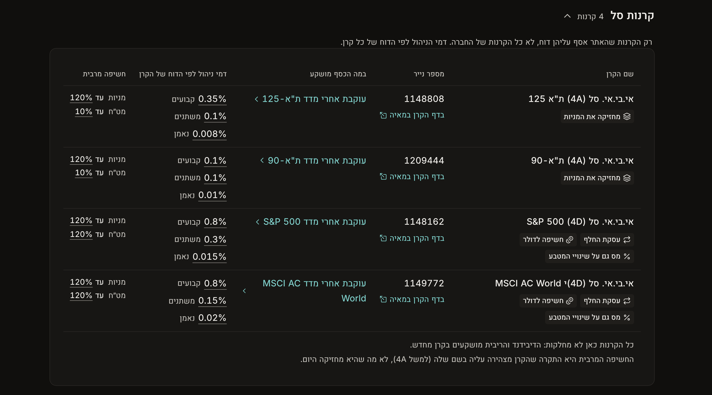
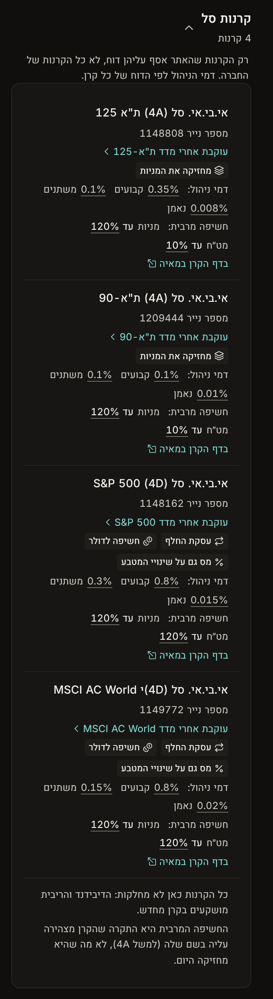
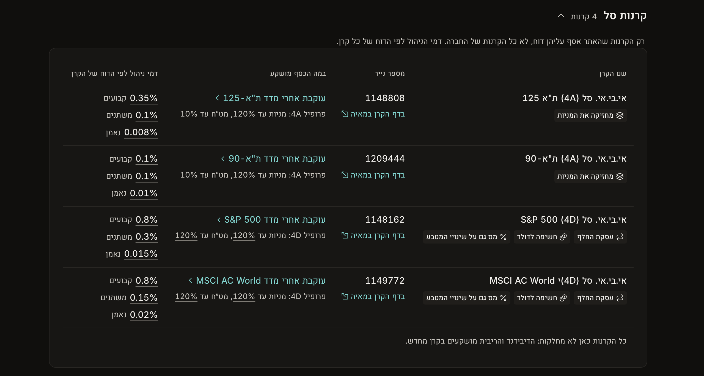
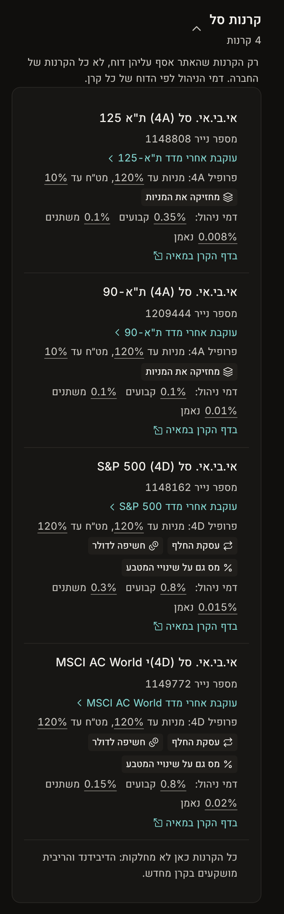
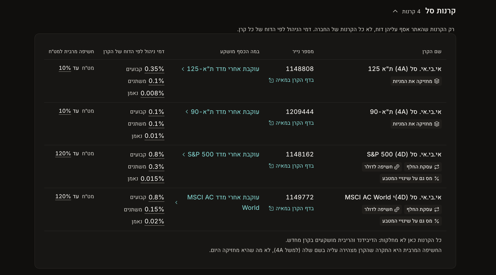
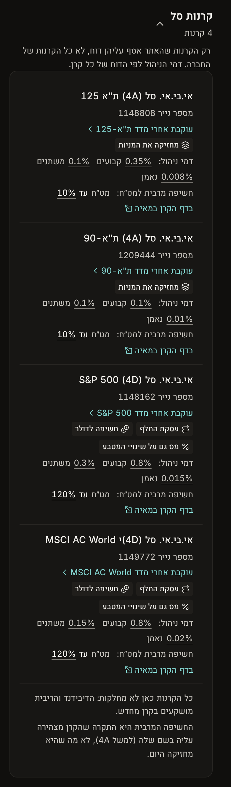

# Design: a company's funds as the track table, 2026-10-27

**Status:** proposal, waiting for the founder. Nothing here is built. `prototype.diff` is the throwaway sketch behind the screenshots, not the build.

The founder, 2026-10-27, on IBI's page (`/companies/ibi`): "what should we put here?", and then, "does the existing table from קופת גמל fit here? … ok redesign it then." A first draft filled the empty half of each fund card. It is superseded: the funds are shown in the same table the page uses for a managing company's tracks (`TrackList` in `site/app/components/decoder/tracks.tsx`), with phone rows like the track rows.

## 1. Today

Today the fund list (`site/app/components/decoder/brand-funds.tsx`, fed by `brandFunds()` in `site/app/lib/brands.server.ts`, D33) is a stack of cards. Each card holds the name, the manager, the TASE number, the Maya link, "עוקבת אחרי מדד …" and three fees. The fee list has `max-w-sm`, so on a desktop the left half of each card is empty. The other product groups on the same page are tables.

| Desktop | Phone |
|---|---|
|  |  |

## 2. The table

Each track column, and what a fund puts there:

| Track table | Fund table | Source |
|---|---|---|
| Track name, with its tags | **שם הקרן**, with the fund's labels: how it tracks the index (holds the shares / a swap), currency, tax on the currency move. The same labels and sheet as the index page (`fundLabels()`) | `replication`, the index's currency, `hedged`, `domicile`; rules ETF-51 to 53, ETF-12, TXS-09 |
| קופה | **מספר נייר**, with "בדף הקרן במאיה" under it | `identifiers.tase_number` |
| במה הכסף מושקע | **"עוקבת אחרי מדד …"**, linking to the index's guide page | `exposure_id` |
| The two fee averages from the regulator | **דמי ניהול לפי הדוח של הקרן**: three lines (קבועים, משתנים, נאמן), each the manager's own figure (D31) | `fees.*` |
| The exposure rings | **Depends on the option (section 3)** | `exposure_code`, decoded with ETF-12 |
| The arrow into the track's page | **None**: a fund has no page of its own (section 5, question 3) | |

**Under the table**, in the footnote slot:
- one line when every fund in the group has the same payout policy, for example "כל הקרנות כאן לא מחלקות: הדיבידנד והריבית מושקעים בקרן מחדש." (`distribution_policy`, MF-49). It replaces a column whose value would be the same on every row.
- in options A and C, one line saying the ceiling is what the fund declares in its name, not what it holds today.

**Why the rings do not carry over:** the track rings show what a track actually held at the end of the regulator's period (F-87, F-88, computed). A fund's code, for example "4A", is only the ceiling it declares (ETF-12: up to 120% in stocks, up to 10% in foreign currency). A ceiling drawn as a ring, on the same page as rings of actual holdings, would read as a holding. So the fund's exposure is written in words, never as rings.

## 3. Three options for the exposure

**A. An exposure column: stocks and currency.** The column "חשיפה מרבית" has two lines, "מניות עד 120%" and "מט״ח עד 10%". It sits where the rings sit for tracks. On the phone it is one line under the fees.

| Desktop | Phone |
|---|---|
|  |  |

**B. No column: the ceilings under the index.** No fifth column. The "במה הכסף מושקע" cell gets a muted second line, "פרופיל 4A: מניות עד 120%, מט״ח עד 10%". The table is narrower, and the profile sits next to what it describes.

| Desktop | Phone |
|---|---|
|  |  |

**C. A currency-only column.** The column "חשיפה מרבית למט״ח" has one line. Among the collected records every index fund is stock grade 4, so the stock line says the same thing on every row. The currency letter is the one that varies (0, A or D), and it separates a currency-hedged S&P 500 fund (4A, for example Harel's 5127527) from an unhedged one (4D).

| Desktop | Phone |
|---|---|
|  |  |

**Recommendation: C.** It is the one exposure fact that differs between funds, and the table stays the shape of the track table. B is the fallback if a fifth column feels heavy.

## 4. Left out

- **Any comparison with other companies' funds** (D35). The index link leads to where funds are compared.
- **IBI's own fund terms** (ETF-64, 65, 66, 69). They are already in the page's last section, "מה כתוב במסמכים של אי.בי.אי".
- **Fund size and return against the index.** Today both are only text in the records (`legal_form`, notes), not sourced fields. The 12-month tracking difference is empty because its publisher forbids copying it, a decision already pending.
- **Creation and redemption fee category, distribution fee type.** These matter only to someone dealing with the manager directly.

## 5. Build

**Data**
- Add `figures` to rule ETF-12: the seven stock grades and the seven currency grades, with the regulation as their source. They go into the `il-finance` rule first and are carried into `data/rules/etf-12.json`. The cells then read them with `ruleFigure()`, so the percentages go through `Num` as sourced. In the prototype they are plain text with a drawn underline.

**Code**
- **Shared table, not a copy.** Today `TrackList` takes `Track` rows from the CMA. Either generalise it (column heads and cells passed in; the fee cell takes 2 or 3 lines; the exposure cell is rings or words; the arrow column is optional), or extract its table and phone-row shell into the kit and build both lists from that. The prototype copied the markup only to get the screenshots; the build must not copy it.
- **Labels in the kit.** `LabelChip`, `LabelRow` and `LabelSheetHost` move from `site/app/components/invest/parts.tsx` into `site/app/components/kit/`, with a gallery entry, because two pages use them now. The company page loads the rules their sheet names: ETF-12, ETF-51, ETF-52, ETF-53, TXS-09 and MF-49.
- **`brandFunds()`** adds `labels`, `profile` (the two grades as SiteValues) and `policy` to each row.
- **Copy** (`copy.ts` `brands.funds`, `docs/copy.md` 8.7): the column heads "שם הקרן", "מספר נייר", "במה הכסף מושקע" (as the track table), "דמי ניהול לפי הדוח של הקרן", "חשיפה מרבית למט״ח" (or "חשיפה מרבית"); the fee words קבועים, משתנים, נאמן; the exposure words מניות, מט״ח, עד, מעל, בלי; and the two footnote lines.
- **Money-market funds** use the same table: code "00" reads "בלי", and they get no labels, because `fundLabels()` is for index funds.

**Checks:** `npm run check`; screenshots at 1280 and 390 px of `/companies/ibi` with the ETF group open, and of a brand that has a money-market fund; the structure review (`merge-review.mjs`) before merge.

## 6. Questions for the founder

1. **Exposure: A, B or C?** (Section 3. Recommended: C.)
2. **Payouts in the footnote.** Is one line under the table enough while every collected fund has the same policy? A fund that differs would bring the line back onto its own row.
3. **A page per fund?** A track row opens the track's page; a fund row opens nothing. A fund page would hold what is now spread across Maya and the sources. `docs/product.md` does not cover it, so it is a product decision. Until then, there is no arrow.
4. **Size and past return:** worth a data pass to store them as sourced fields?

## 7. Found on the way

`data/funds/1149772@2026-10-25.json`: the name the table shows is "אי.בי.אי. סל (4D)י MSCI AC World", with a stray "י" after the code; the second name on the record has no "י". Check it against Maya before changing which name comes first.
