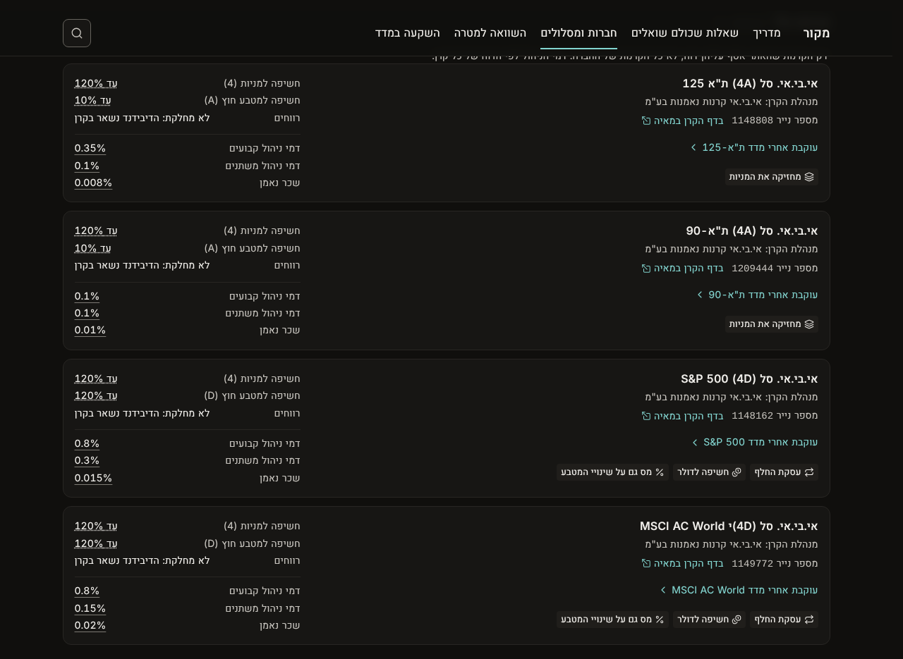
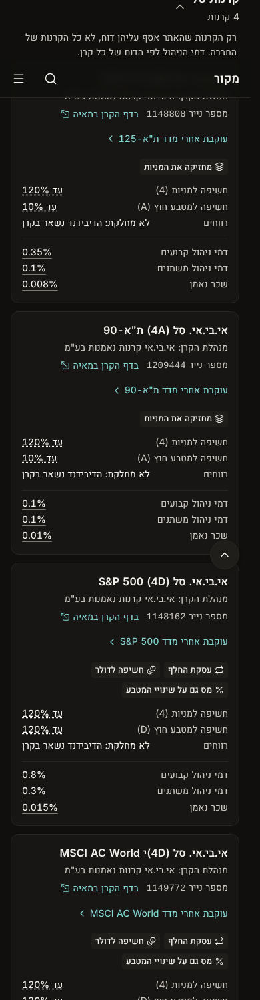

# Design: the fund card on a company page, 2026-10-27

**Status:** proposal, waiting for the founder. Nothing here is built; `prototype.diff` is a throwaway sketch used for the screenshots, not the build.

The founder, 2026-10-27, on IBI's page (`/companies/ibi`): "what should we put here?" Each fund card fills its right side and leaves the left half empty. This document says what goes there, where each item comes from, and how it is built.

## 1. What the card shows today

`site/app/components/decoder/brand-funds.tsx`, fed by `brandFunds()` in `site/app/lib/brands.server.ts` (D33). One card per collected fund record of the brand's fund managers:

- the name, the fund manager, the TASE number, the link to the fund's page on Maya;
- "עוקבת אחרי מדד …", linking to the index's guide page (`/exposure/<index>`);
- three fees: fixed management, variable management, trustee (D31: the manager's own figures, plain sourced).

The fee list has `max-w-sm`, so on a desktop the card's left half is empty.

| Desktop, today | Phone, today |
|---|---|
|  |  |

The whole page today: `shots/before-page.png`.

## 2. What it should show

The fund record already holds more than the card shows. Everything below comes from fields already on the record or rules already in the base. **No new collection is needed.** The one data change is adding figures to rule ETF-12 (section 5).

| # | Item | From | Number state (D7) | Rule chips |
|---|---|---|---|---|
| 1 | **How it tracks the index:** "מחזיקה את המניות" or "עסקת החלף" | `replication.method` | no number | ETF-52 (physical); ETF-51, ETF-52, ETF-53 (swap) |
| 2 | **Currency:** "חשיפה לדולר", only when the index is priced in a foreign currency and the fund is not hedged | the index's exposure record, `hedged` | no number | ETF-12 |
| 3 | **Tax:** "מס גם על שינויי המטבע", for an Israeli fund on a foreign index | `domicile`, the index's `constituents_israeli` | no number | TXS-09 |
| 4 | **Maximum share in stocks:** "חשיפה מרבית למניות (4)": "עד 120%" | first character of `exposure_code`, decoded with ETF-12's scale | sourced (regulation, through ETF-12) | ETF-12 |
| 5 | **Maximum share in foreign currency:** "חשיפה מרבית למטבע חוץ (A)": "עד 10%" | second character of `exposure_code`, same scale | sourced | ETF-12 |
| 6 | **Payouts:** "לא מחלקת: הדיבידנד והריבית מושקעים בקרן מחדש", or "מחלקת" | `distribution_policy` | no number | MF-49 |
| 7 | The three fees, as today | `fees.*` | sourced, the manager's own (D31) | as today |

Items 1 to 3 are the labels the index page already shows on each fund (`fundLabels()` in `site/app/lib/labels.ts`), with the same text, explanation sheet and rules. The two option labels ("קרן ישראלית", "קרן סל: נסחרת כל היום") are left out: the group heading already says the type, and every fund on the page is Israeli.

Items 4 and 5 decode the code that is already in the fund's name, for example "(4A)". ETF-12 quotes the full scale from the classification regulations (reg. 1). Stocks: 0 none, 1 up to 10%, 2 up to 30%, 3 up to 50%, 4 up to 120%, 5 up to 200%, 6 above 200%. Foreign currency: 0 none, then A to F on the same steps. The rows say **"מרבית"**: this is the ceiling the fund declares, not what it holds today. Num's sheet says so in one line.

What the four IBI ETFs would show:

| Fund | Labels | Stocks / currency | Payouts |
|---|---|---|---|
| אי.בי.אי. סל (4A) ת"א 125 (1148808) | מחזיקה את המניות | up to 120% / up to 10% | לא מחלקת |
| אי.בי.אי. סל (4A) ת"א-90 (1209444) | מחזיקה את המניות | up to 120% / up to 10% | לא מחלקת |
| אי.בי.אי. סל (4D) S&P 500 (1148162) | עסקת החלף · חשיפה לדולר · מס גם על שינויי המטבע | up to 120% / up to 120% | לא מחלקת |
| אי.בי.אי. סל (4D) MSCI AC World (1149772) | עסקת החלף · חשיפה לדולר · מס גם על שינויי המטבע | up to 120% / up to 120% | לא מחלקת |

## 3. Layout

- **Desktop (md and up):** two columns. Right (start): the name, manager, number, Maya, "עוקבת אחרי", then the label row. Left (end), about 20rem wide: the fund's makeup (items 4 to 6) as a `KeyValue` list, a thin rule, then the fees. The empty half becomes the card's facts column.
- **Phone:** one column, in the same order. The card gets longer, about 370 px for an ETF. If that is too long, the payouts row can drop on the phone (question 3 in section 7).

| Desktop, proposed | Phone, proposed |
|---|---|
|  |  |

In the prototype the two percentage rows use a hand-drawn dotted underline. The build uses `Num`, which gives the sourced solid grey underline (item 4 is sourced, not computed).

## 4. What it does not show, and why

- **Anything that places the fund against other companies' funds** (rank, "cheaper than most", a median). D35: a company page compares nothing with other companies. The "עוקבת אחרי מדד" link already leads to the index, where funds are compared.
- **IBI's own terms about its funds** (ETF-64, ETF-65, ETF-66, ETF-69: swaps, net index, tracking). They are already in the page's last section, "מה כתוב במסמכים של אי.בי.אי", under "קרנות סל וקרנות מחקות" (14 items). Repeating them on every card would duplicate them.
- **Fund size.** The market value (for example 3,362,803 thousand ₪ for 1148808 on 23.10.2026) is only prose inside `legal_form`, not a value object with a source. To show it, a data update must first store it as a sourced field on every fund record.
- **Return against the index.** The annual reports print it (1148808: 2025, 50.42% against 50.96%), but the record keeps it only in a note. The 12-month tracking difference is empty because the page that publishes it forbids copying its figures. That is the founder decision already pending in the record's notes.
- **Creation and redemption fee category and distribution fee type** (`creation_redemption_fee_category`, `distribution_fee_type`). These concern people who create or redeem units directly with the manager, not someone buying through a broker. They are left out.

## 5. Build

**Data**
- Add `figures` to ETF-12: the seven stock grades and the seven currency grades, each with the regulation as its source. The figures go into the `il-finance` rule first and are carried into `data/rules/etf-12.json` the way rules are generated, never typed into the site. The card then reads them with `ruleFigure()`, and Num shows them as sourced. If figures cannot hold a scale, the alternative is a small table in `data/parameters/` that cites ETF-12; that choice is the builder's to raise, not to settle silently.
- No fund record changes.

**Code**
- `brands.server.ts` `fundRow()`: add `labels` (from `fundLabels()`, with the index built from the exposure record the same way `invest.ts` `refOfExposure` does), `profile` (the two grades as SiteValues) and `policy`. Hebrew stays in `copy.ts`; the prototype's inline strings are not the build.
- **Kit:** `LabelChip`, `LabelRow` and `LabelSheetHost` live in `site/app/components/invest/parts.tsx`. Under the shared-components rule, a second page using them means they move to `site/app/components/kit/` with a gallery entry, and the index page imports them from there. The company page wraps its fund groups in `LabelSheetHost`.
- **Rules on the page:** the label sheet's rule chips (ETF-12, ETF-51, ETF-52, ETF-53, TXS-09, MF-49) must be among the rules the company page loads, or the chips open nothing.
- `brand-funds.tsx`: the two-column card from section 3. `Card` and `KeyValue` from the kit, no new card shape.
- **Copy** (`copy.ts`, `brands.funds`, and `docs/copy.md` 8.7):

  | Key | Text |
  |---|---|
  | `profileStocks` | חשיפה מרבית למניות |
  | `profileFx` | חשיפה מרבית למטבע חוץ |
  | `profileNote` (Num sheet) | זו התקרה שהקרן מצהירה עליה, לא מה שהיא מחזיקה היום. |
  | `payouts` | חלוקה |
  | `accumulating` | לא מחלקת: הדיבידנד והריבית מושקעים בקרן מחדש |
  | `distributing` | מחלקת תשלומים לבעלי היחידות |
  | grade words | בלי · עד · מעל |

**Checks:** `npm run check`; screenshots at 1280 and 390 px of `/companies/ibi` (the ETF group open) and of one company with a money-market fund. Structure review with `merge-review.mjs` before merge.

## 6. Applies to

Every brand with collected fund records, not only IBI. The money-market fund cards get items 4 to 6, which come from their own records. They get no labels, because `fundLabels()` is for index funds and its index argument does not exist for them.

## 7. Questions for the founder

1. **The stocks row repeats.** Every index fund among the collected records is grade 4 ("up to 120%"), so on an index fund this row says little. The currency row is the one that varies (0, A or D), and it is useful: it separates a currency-hedged S&P 500 fund (4A, for example 5127527) from an unhedged one (4D). Should both rows show, or only the currency row, with the stocks grade in its sheet?
2. **Two rows or one?** The alternative is one row, "פרופיל החשיפה (4A)": "מניות עד 120% · מט״ח עד 10%". It is shorter, but harder to read on a phone.
3. **Phone length.** Keep every row on the phone, or drop the payouts row there?
4. **Size and past record** (section 4): worth a data pass to store them as sourced fields, or not for now?

## 8. Found on the way

`data/funds/1149772@2026-10-25.json`: the first Hebrew name, the one the card shows, is "אי.בי.אי. סל (4D)י MSCI AC World", with a stray "י" after the code. The second name has no "י". Check it against Maya before changing which name comes first.
