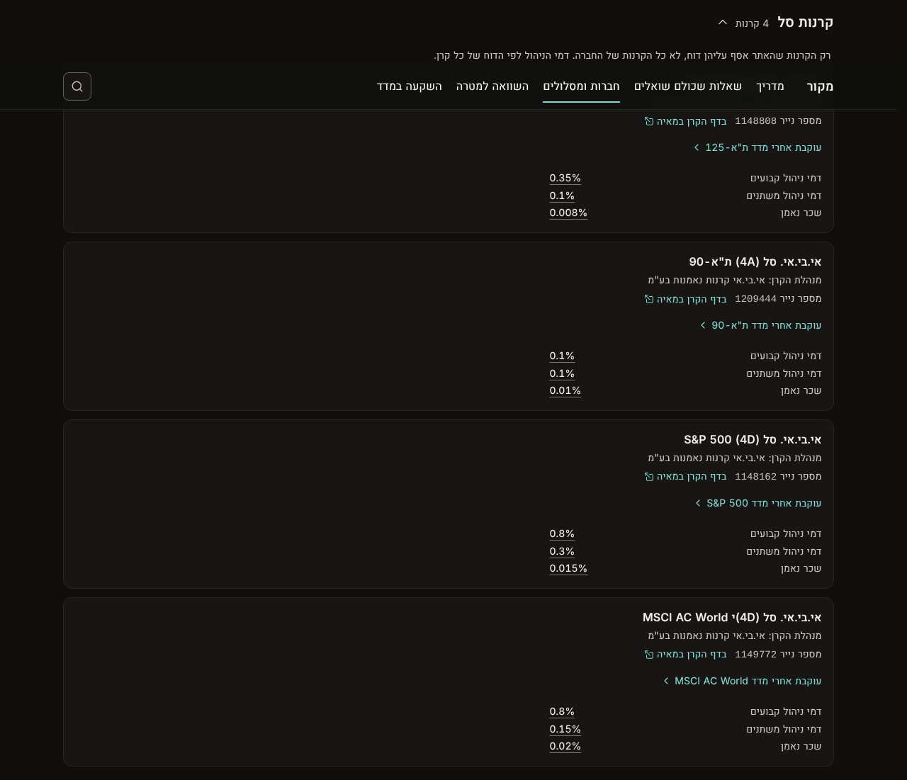
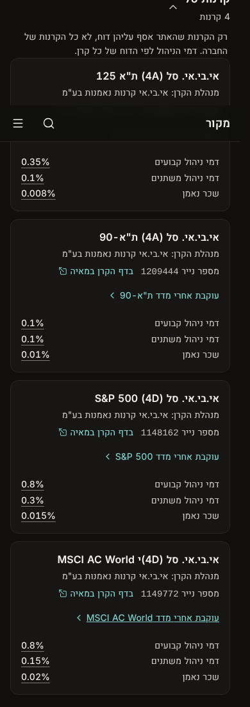
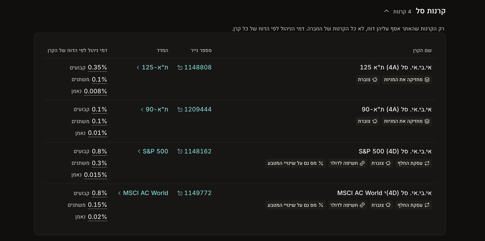
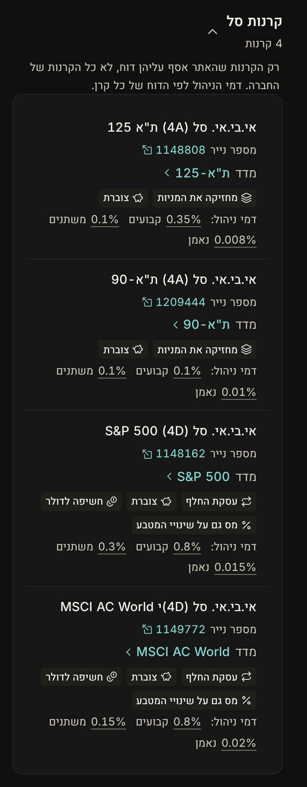

# Design: a company's funds as the track table, 2026-10-27

**Status:** settled by the founder on 2026-10-27; not built. `prototype.diff` is the throwaway sketch behind the screenshots, not the build.

How it got here, all on 2026-10-27 on IBI's page (`/companies/ibi`):
- The founder: "what should we put here?" A first draft filled the empty half of each fund card.
- The founder: "does the existing table from קופת גמל fit here? … ok redesign it then." The funds move into the table the page uses for a managing company's tracks (`TrackList` in `site/app/components/decoder/tracks.tsx`), with phone rows like the track rows. Three options were drawn for the exposure ceiling in the fund's name (for example 4A).
- The founder: "dont write the stocks percentage. dont mention [currency] risk because we already have חשיפה לדולר label." So there is no exposure column and no ceiling anywhere. The currency fact is the label alone.
- The founder: "Add an accumulating or dividend label. Lets change the whats the money invested in column somehow." The payout policy becomes a label on each fund, in place of the line under the table. The third column becomes "המדד", in two versions.
- The founder: "Remove the text under the index and resize the column." Version A (the index name only), with the column as wide as its content.
- The founder: "the בדף הקרן במאיה is placed weird can you move it somewhere." The TASE number itself becomes the link to the fund's Maya page, with the external-link icon; the separate "בדף הקרן במאיה" line is gone.

## 1. Today

Today the fund list (`site/app/components/decoder/brand-funds.tsx`, fed by `brandFunds()` in `site/app/lib/brands.server.ts`, D33) is a stack of cards. Each card holds the name, the manager, the TASE number, the Maya link, "עוקבת אחרי מדד …" and three fees. The fee list has `max-w-sm`, so on a desktop the left half of each card is empty. The other product groups on the same page are tables.

| Desktop | Phone |
|---|---|
|  |  |

## 2. The table

| Desktop | Phone |
|---|---|
|  |  |

Each track column, and what a fund puts there:

| Track table | Fund table | Source |
|---|---|---|
| Track name, with its tags | **שם הקרן**, with the fund's labels: how it tracks the index ("מחזיקה את המניות" or "עסקת החלף"), **the payout policy ("צוברת" or "מחלקת דיבידנד", new)**, "חשיפה לדולר" (or the hedged label), "מס גם על שינויי המטבע". The same labels and sheet as the index page (`fundLabels()`) | `replication`, `distribution_policy`, the index's currency, `hedged`, `domicile`; rules ETF-51 to 53, MF-49, ETF-12, TXS-09 |
| קופה | **מספר נייר**: the number is the link to the fund's page on Maya, with the external-link icon ("1148808 ↗"); its accessible name says "בדף הקרן במאיה". No separate Maya line | `identifiers.tase_number` |
| במה הכסף מושקע | **המדד**: the index's name alone as the link to its guide page, for example "ת"א-125 ›", without "עוקבת אחרי מדד" on every row and without a line under it. On the phone: "מדד ת"א-125 ›" | `exposure_id`; the exposure record's name |
| The two fee averages from the regulator | **דמי ניהול לפי הדוח של הקרן**: three lines (קבועים, משתנים, נאמן), each the manager's own figure (D31) | `fees.*` |
| The exposure rings | **None.** The rings show what a track actually holds. A fund's code is only a ceiling, and the currency label already says what matters. | |
| The arrow into the track's page | **None.** A fund has no page of its own (question 1). | |

**The payout label (new).** Two new labels in the label set, in a new family "חלוקה", both resting on MF-49:

| Label | Icon | Its sheet |
|---|---|---|
| צוברת | piggy bank | הקרן לא מחלקת תשלומים: הדיבידנד והריבית שהיא מקבלת מושקעים בה מחדש, והרווח נשאר בתוך מחיר היחידה. |
| מחלקת דיבידנד | hand with coins | הקרן מחלקת תשלומים לבעלי היחידות, פעם בשנה או יותר, לפי שיקול דעת המנהל. |

`fundLabels()` is shared, so the index page gets the payout label on its fund rows too. A distributing fund there already carries "מס על כל חלוקה" (TXF-08), which stays: one label says what the fund does, the other what it costs in tax. There is no footnote under the table any more.

**Column widths.** The number, index and fee columns are as wide as their content (`w-px`, the index cell does not wrap); the fund name takes the rest, so its labels sit on one line where they fit.

**Phone:** one row per fund, like a track row: the name; "מספר נייר" with the number as the Maya link; "מדד …" as a link; the labels; "דמי ניהול:" with the three fees on one line.

## 3. Left out

- **The exposure profile** (founder, above): no stock or currency ceiling, in a column or anywhere else. `exposure_code` stays on the record unused.
- **Any comparison with other companies' funds** (D35). The index link leads to where funds are compared.
- **IBI's own fund terms** (ETF-64, 65, 66, 69). They are already in the page's last section, "מה כתוב במסמכים של אי.בי.אי".
- **Fund size and return against the index.** Today both are only text in the records (`legal_form`, notes), not sourced fields. The 12-month tracking difference is empty because its publisher forbids copying it, a decision already pending.
- **Creation and redemption fee category, distribution fee type.** These matter only to someone dealing with the manager directly.

## 4. Build

- **Shared table, not a copy.** Today `TrackList` takes `Track` rows from the CMA. Either generalise it (column heads and cells passed in; the fee cell takes 2 or 3 lines; the exposure and arrow columns are optional), or extract its table and phone-row shell into the kit and build both lists from that. The prototype copied the markup only to get the screenshots; the build must not copy it.
- **Labels in the kit.** `LabelChip`, `LabelRow` and `LabelSheetHost` move from `site/app/components/invest/parts.tsx` into `site/app/components/kit/`, with a gallery entry, because two pages use them now. The company page loads the rules their sheet names: ETF-12, ETF-51, ETF-52, ETF-53, TXS-09 and MF-49.
- **The payout labels.** `pays-accumulating` and `pays-distributing` in `labelDefs` (MF-49), the family "payout" ("חלוקה") in `copy.ts` `labelFamilies`, and two icons (Lucide `PiggyBank`, `HandCoins`) in `site/app/components/invest/icons.tsx`. `fundLabels()` adds one of them from `distribution_policy`. The labels legend on the index page ("מה אומרות התוויות?") lists the new family.
- **`brandFunds()`** adds `labels` and `index` (its short name and link) to each row.
- **No data change.** The ETF-12 figures the earlier drafts needed are not needed.
- **Copy** (`copy.ts` `brands.funds`, `docs/copy.md` 8.7): the column heads "שם הקרן", "מספר נייר", "המדד" and "דמי ניהול לפי הדוח של הקרן"; the fee words קבועים, משתנים, נאמן; "דמי ניהול:" for the phone row; "מדד" before the index on the phone; the two payout labels and their sheets.
- **Money-market funds** use the same table. They get no labels, because `fundLabels()` is for index funds.
- **Checks:** `npm run check`; screenshots at 1280 and 390 px of `/companies/ibi` with the ETF group open, and of a brand that has a money-market fund; the structure review (`merge-review.mjs`) before merge.

## 5. Questions for the founder

1. **A page per fund?** A track row opens the track's page; a fund row opens nothing. A fund page would hold what is now spread across Maya and the sources. `docs/product.md` does not cover it, so it is a product decision. Until then, there is no arrow.
2. **Size and past return:** worth a data pass to store them as sourced fields?

## 6. Found on the way

`data/funds/1149772@2026-10-25.json`: the name the table shows is "אי.בי.אי. סל (4D)י MSCI AC World", with a stray "י" after the code; the second name on the record has no "י". Check it against Maya before changing which name comes first.
